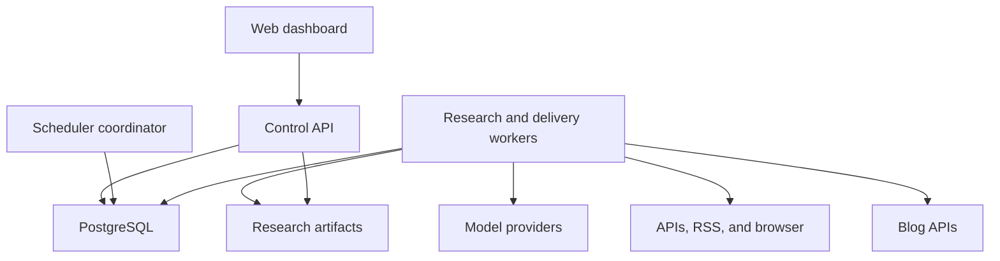
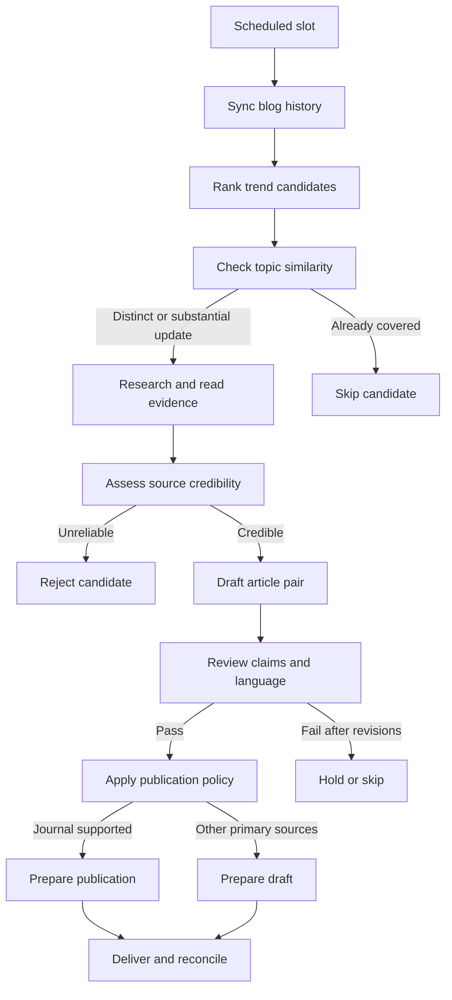

# Takumi Research Agent — Product, Architecture, and Implementation Plan

> Status: rencana implementasi; belum menyatakan fitur telah dibangun atau siap produksi.  
> Pemilik produk: Arya / aryanattapt  
> Tanggal: 6 November 2026  
> Repository: [takumi-research-agent-v0](https://github.com/aryanattapt/takumi-research-agent-v0)  
> Baseline yang ditinjau: commit `c8f588bd7a6b0bd0a0f5c4e386b9dd5665ecf656`.  
> Bahasa dokumen: Indonesia. Bahasa artikel yang dihasilkan: Indonesia dan English.

## 1. Latar belakang

Menulis artikel teknologi dan sains secara rutin membutuhkan beberapa pekerjaan yang berbeda: menemukan percakapan yang sedang naik, memilih sudut pembahasan, membaca penelitian, memeriksa kebenaran klaim, menghindari pengulangan artikel, dan menyesuaikan hasil ke platform blog. Jika dilakukan manual untuk beberapa blog, pekerjaan ini sulit dijalankan konsisten setiap hari.

Popularitas sebuah topik tidak otomatis membuktikan kebenarannya. Sebaliknya, penelitian yang baik belum tentu menjadi topik yang menarik bagi pembaca awam. Takumi perlu menggabungkan sinyal ketertarikan publik dengan bukti yang dapat ditelusuri, tanpa mengubah klaim spekulatif menjadi kepastian.

Platform blog juga memiliki kontrak API yang berbeda. Daftar artikel dapat berada di array langsung, di dalam beberapa lapisan object, atau di struktur multilingual. Payload pembuatan artikel, autentikasi, pagination, dan nilai status publikasi juga tidak selalu sama. Karena itu, integrasi perlu menggunakan adapter yang dipahami AI dan dieksekusi melalui kontrak yang tervalidasi.

Repository saat ini sudah memiliki fondasi pengambilan literatur dan penyimpanan. Pengembangan berikutnya mengubah fondasi tersebut menjadi aplikasi dengan dashboard konfigurasi, pipeline agent yang dapat dilanjutkan setelah gangguan, dan pengiriman artikel ke maksimal 10 blog.

## 2. Tujuan dan hasil yang diharapkan

### 2.1 Tujuan produk

1. Menemukan topik technology dan science yang sedang meningkat setiap hari.
2. Memilih topik yang relevan dan belum tercakup secara substansial dalam blog tujuan.
3. Mengumpulkan sumber ilmiah dan sumber primer yang kredibel untuk mendukung isi.
4. Menulis dua versi artikel yang mudah dipahami pembaca awam dan menarik tanpa clickbait menyesatkan.
5. Mengirim artikel ke API blog sebagai published atau draft sesuai kekuatan bukti.
6. Mengelola koneksi, jadwal, model, dan operasi melalui dashboard.
7. Menjalankan seluruh proses untuk beberapa blog tanpa mengunci kode ke satu struktur JSON.
8. Menargetkan artikel sudah terbit pada pukul yang dikonfigurasi, dengan default 06:00 WIB.

### 2.2 Prinsip keberhasilan

- Klaim penting mempunyai sumber dan bukti yang dapat diperiksa.
- Popularitas dan kredibilitas dihitung sebagai dua hal yang berbeda.
- Artikel Indonesia dan English menyampaikan fakta, angka, dan batasan yang setara.
- Keberhasilan HTTP request tidak langsung dianggap sebagai keberhasilan publikasi.
- Kegagalan satu blog tidak menghentikan blog lain.
- Tidak ada publikasi yang dipaksakan hanya untuk memenuhi kuota atau mengejar jam.
- Pencarian tidak mewajibkan langganan search API berbayar; biaya model dan infrastruktur tetap dihitung.

## 3. Kebutuhan yang sudah dikonfirmasi

| ID | Kebutuhan | Perilaku yang dituju |
| --- | --- | --- |
| BR-01 | Maksimal 10 blog | Mendukung beberapa profil dan jadwal independen; batas 10 profil nondeleted termasuk yang paused. |
| BR-02 | Dashboard konfigurasi | Koneksi blog, model AI, jadwal, cakupan topik, editorial, dan aktivitas dikelola melalui web. |
| BR-03 | Technology | AI agent, software engineering, cloud, dan perkembangan teknologi relevan lain. |
| BR-04 | Science | Physics, chemistry, dan biology. |
| BR-05 | Topik harian | Default satu topik terbaik per blog per hari, tren global, tanpa kuota tetap per kategori. |
| BR-06 | Waktu publikasi | Default daily 06:00 Asia/Jakarta; artikel ditargetkan sudah terbit saat itu. |
| BR-07 | API blog adaptif | Mendukung struktur request/response JSON berbeda antarblog melalui mapping dinamis tervalidasi. |
| BR-08 | Riwayat artikel | Mengambil daftar artikel dari API blog dan detail tambahan bila dibutuhkan untuk deduplikasi. |
| BR-09 | Model AI | Mendukung endpoint OpenAI-compatible dan Anthropic melalui dashboard. |
| BR-10 | Kualitas sumber | Mengutamakan jurnal peer-reviewed; sumber primer lain boleh digunakan jika kredibel dan jelas. |
| BR-11 | Hoaks dan keraguan | Informasi meragukan atau bukti tidak memadai tidak diteruskan menjadi konten yang layak kirim. |
| BR-12 | Dua bahasa | Dua post terpisah, Indonesia dan English, dari research bundle yang sama. |
| BR-13 | Gaya tulisan | Bahasa awam, menarik, penjelasan istilah, analogi yang tepat, dan batasan temuan. |
| BR-14 | Publikasi | Publish bila dukungan jurnal relevan memenuhi pemeriksaan; tanpa dukungan jurnal yang memadai dikirim sebagai draft. |
| BR-15 | Kontrak API menyusul | Pengembangan memakai fixture; integrasi nyata diselesaikan setelah kontrak API blog tersedia. |

Satu topik berarti satu pasangan artikel, bukan dua topik. Dengan seluruh 10 blog aktif pada konfigurasi default, kapasitas yang perlu diuji adalah hingga 10 topik dan 20 versi artikel per hari.

### 3.1 Default teknis awal yang dapat diubah

Default berikut merupakan keputusan rancangan awal untuk membuat implementasi konkret. Nilainya perlu diuji pada deployment sebenarnya.

| Pengaturan | Default awal |
| --- | --- |
| Timezone | Asia/Jakarta; disimpan sebagai IANA timezone, bukan offset tetap. |
| Frekuensi | Daily. Dashboard juga menyediakan hari tertentu dan jam publikasi lain. |
| Target publikasi | 06:00 waktu profil blog. |
| Persiapan | Mulai 120 menit sebelum target, lalu sesuaikan berdasarkan durasi dan antrean terukur. |
| Jendela tren | 24 jam; diperluas sampai 72 jam jika kandidat belum cukup. |
| Kuota | Satu topik per blog per hari. |
| Panjang artikel | 800–1.200 kata per bahasa; bukan alasan untuk menambah isi tanpa bukti. |
| Research concurrency | Dua pekerjaan aktif secara global. |
| Browser concurrency | Satu sesi pengambilan sumber aktif secara global. |
| Delivery concurrency | Dua pekerjaan pengiriman aktif, terpisah dari kapasitas riset. |
| Perbaikan output model | Maksimal dua percobaan perbaikan JSON atau editorial setelah respons awal. |
| Evaluasi kandidat | Maksimal tiga kandidat utama per slot sebelum dilaporkan tidak ada topik layak. |
| Duplikasi lintas blog | Diperiksa per blog; topik yang sama di blog lain tidak otomatis dilarang. |
| Deadline terlewat | Simpan hasil, tandai missed deadline, dan tahan pengiriman baru untuk slot tersebut. |
| Pencarian berbayar | Nonaktif secara default. |
| Embedding berbayar | Tidak wajib; deduplikasi dasar memakai indeks konsep dan pemeriksaan semantik model. |

Kuota, concurrency, lead time, dan batas biaya perlu memiliki batas server yang wajar. Dashboard harus memperlihatkan konsekuensi menaikkan beban terhadap peluang memenuhi deadline.

## 4. Ruang lingkup dan batas sistem

### 4.1 Ruang lingkup versi pertama

- Dashboard dengan satu administrator.
- Maksimal 10 profil blog dalam satu deployment.
- REST API berbasis JSON dengan endpoint dan autentikasi yang dikonfigurasi.
- OpenAPI JSON/YAML atau contoh request/response sebagai input pemahaman kontrak.
- Sinkronisasi daftar dan detail artikel, termasuk pagination.
- Pemilihan topik, penelitian, penulisan bilingual, editorial review, dan evidence review.
- Adapter OpenAI-compatible dan Anthropic.
- API/RSS/HTTP retrieval dengan headless browser lokal sebagai fallback.
- Penjadwalan berdasarkan target publikasi, run manual, pause, resume, dan retry yang aman.
- Penyimpanan durabel, audit trail, status per bahasa, dan rekonsiliasi pengiriman.
- Deployment self-hosted melalui Docker Compose.

### 4.2 Batas awal

- Dukungan JSON dinamis tidak berarti AI dapat mengetahui arti field atau endpoint yang tidak pernah diberikan.
- Integrasi membutuhkan endpoint yang diizinkan, schema atau sampel, dan autentikasi yang valid.
- Dukungan GraphQL, login interaktif kompleks, dan proprietary content editor menjadi adapter lanjutan jika dibutuhkan.
- Multiadmin, role perusahaan, dan SaaS multitenant berada di luar versi pertama.
- Tidak ada kebutuhan Kubernetes, Kafka, vector database, atau browser berbayar pada versi pertama.
- Pembuatan gambar dengan layanan berbayar bukan dependensi penerbitan; media opsional mengikuti kemampuan API dan hak penggunaan.
- Sistem tidak mengatasi paywall atau memaksakan pengambilan sumber yang tidak dapat diakses.
- Ketersediaan model, jaringan, sumber, dan API blog memengaruhi deadline; tidak ada janji publikasi tepat waktu tanpa syarat.

## 5. Kondisi repository dan perubahan fondasi

| Area existing | Kondisi yang ditemukan | Perubahan yang direncanakan |
| --- | --- | --- |
| `config.py` | Satu model dan satu blog melalui environment variables. | Pisahkan bootstrap environment dari konfigurasi durabel per provider dan per blog. |
| `models.py` | Research bundle berpusat pada satu paper DOI. | Mendukung beberapa sumber, jurnal maupun nonjurnal, evidence span, dan keputusan editorial. |
| `sources.py` | Crossref, Europe PMC, pembacaan sebagian full text, dan pemeriksaan DOAJ. | Tambahkan trend discovery, sumber technology, preprint berlabel, dan verifikasi dengan beberapa sinyal. |
| `sources.py` | Terdapat batas umur penelitian lima tahun. | Pisahkan umur sinyal tren dan umur bukti; paper lama yang relevan tetap boleh menjadi konteks. |
| `store.py` | SQLite, tabel single-blog, dan file lock global. | Migrasi ke persistence multi-blog dengan transaction, run lease, dan publication outbox. |
| `replace_blog_posts` | Mengganti seluruh kumpulan riwayat tanpa namespace blog. | Sinkronisasi bertahap dan scoped per blog; snapshot lama tetap valid jika sinkronisasi baru gagal. |
| Dependensi browser | Browser Use sudah dicantumkan tetapi loop belum dibangun. | Buktikan kompatibilitas pada spike; Playwright menjadi jalur browser fallback yang terkontrol. |
| Dashboard/pipeline/publisher | Belum tersedia. | Dibangun dalam urutan milestone di bagian 15 dan 16. |

Tidak menganggap DOI, tipe metadata journal-article, atau pencantuman sebuah jurnal di indeks sebagai bukti tunggal bahwa semua klaim artikel benar. Tidak ditemukannya sebuah jurnal di DOAJ juga bukan bukti bahwa jurnal tersebut tidak peer-reviewed.

## 6. Arsitektur sistem

### 6.1 Pendekatan

Gunakan modular monolith dalam satu repository. API dashboard dan worker berjalan sebagai proses terpisah, tetapi menggunakan domain model dan database yang sama.

Pemilihan ini menjaga transaksi, konfigurasi, dan operasi tetap sederhana untuk maksimal 10 blog. Modul mempunyai interface yang jelas agar worker dapat dipisah lebih jauh jika kapasitas nantinya membutuhkan.



Scheduler coordinator dan worker pool dapat berjalan dalam satu service worker pada deployment awal. Hanya satu coordinator aktif; job dan lease disimpan di database.

### 6.2 Breakdown tanggung jawab

| Komponen | Tanggung jawab | Kontrak keluar |
| --- | --- | --- |
| Dashboard | Form konfigurasi, onboarding blog, preview, evidence, aktivitas, dan tindakan operator. | API aplikasi; tidak mengakses secret provider secara langsung. |
| Control API | Autentikasi, validasi, batas 10 blog, konfigurasi, health check, dan permintaan run. | Database, antrean durabel, response tervalidasi. |
| Scheduler | Mengubah jadwal target menjadi slot persiapan, pengiriman, dan verifikasi. | Run/job unik berdasarkan blog dan slot. |
| Orchestrator | Menentukan urutan stage, checkpoint, batas waktu, retry, dan resource budget. | State transition dan task berikutnya. |
| Trend discovery | Mengumpulkan sinyal popularitas dan menghasilkan kandidat berperingkat. | Candidate beserta skor, waktu, dan asal sinyal. |
| Blog intelligence | Memahami kontrak, membentuk adapter, dan menormalisasi riwayat blog. | Adapter version dan CanonicalBlogPost. |
| Deduplication | Membandingkan kandidat dengan artikel lama dan pekerjaan aktif. | duplicate, new_update, distinct, atau uncertain beserta alasan. |
| Research | Menemukan, membaca, dan mengelompokkan sumber. | ResearchBundle dan evidence records. |
| Writer | Membuat outline dan dua versi tulisan dari fakta yang sudah dipilih. | ArticlePair. |
| Reviewer | Memeriksa bukti, keterbacaan, kesetaraan bahasa, dan kesesuaian judul. | ReviewReport dan hasil perbaikan. |
| Policy engine | Memutuskan publish, draft, skip, atau blocked secara deterministik. | PublicationDecision dengan reason codes. |
| Delivery | Membuat request, mengirim, dan merekonsiliasi status remote. | Status per bahasa dan bukti status remote. |
| Provider adapters | Menormalkan perbedaan protokol model. | Output JSON, tool intent tervalidasi, usage, dan error terstruktur. |
| Persistence | Konfigurasi, history, evidence, lease, outbox, event, dan migrasi. | Transaction serta query yang scoped per blog. |

### 6.3 Batas peran AI dan kode aplikasi

AI digunakan untuk memahami schema/sampel JSON, merumuskan pencarian, menilai hubungan semantik, merangkum bukti, dan menyusun tulisan.

Kode aplikasi bertanggung jawab atas autentikasi, validasi mapping, batas blog, transaksi, jadwal, penghitungan kuota, dan keputusan pengiriman yang mempunyai efek ke blog.

Output model selalu dianggap sebagai usulan terstruktur. AI tidak mendapat kemampuan menjalankan Python, JavaScript, SQL, shell, atau HTTP request bebas untuk menulis ke blog. Executor hanya menjalankan operasi dan transformasi yang diizinkan adapter.

## 7. Tech stack yang direncanakan

Versi patch dan lockfile ditetapkan setelah compatibility spike. Tidak menaikkan semua dependensi ke versi terbaru tanpa pengujian.

| Lapisan | Pilihan awal | Alasan dan batas |
| --- | --- | --- |
| Backend | Python 3.12 dengan minimum repository 3.11 dievaluasi saat spike | Melanjutkan fondasi Python yang sudah ada. |
| Web API | FastAPI + Uvicorn | API dashboard dan kontrak bertipe. |
| Validasi | Pydantic 2.x | Validasi konfigurasi, mapping, output model, dan state. |
| HTTP | httpx | Request asynchronous, timeout, transport fixture, dan pembatasan koneksi. |
| Model OpenAI-compatible | Official OpenAI Python SDK melalui adapter aplikasi | Baseline Chat Completions; fitur khusus provider diuji sebelum diaktifkan. |
| Model Anthropic | Official Anthropic Python SDK melalui adapter aplikasi | Menggunakan protokol native Messages; tidak dipaksa menjadi request OpenAI. |
| Database | PostgreSQL, image versi mayor supported dipin saat implementasi | Konfigurasi, job queue, row locking, dan outbox durabel. |
| Persistence | SQLAlchemy 2.x + Alembic | Session/transaction yang jelas dan migrasi schema berversi. |
| Scheduling | APScheduler 3.x yang dipin + zoneinfo | Trigger dalam satu coordinator; durable run queue tetap milik aplikasi. |
| Browser | Playwright Python + Chromium lokal | Fallback untuk halaman yang memerlukan browser; binary disesuaikan dengan versi Playwright. |
| Agent browsing opsional | Browser Use setelah lolos spike | Dipakai hanya jika navigasi agent diperlukan dan kemampuan model sesuai. |
| Ekstraksi | Parser HTML/XML serta pypdf untuk PDF teks | Simpan kualitas ekstraksi; OCR bukan syarat versi pertama. |
| Frontend | React + TypeScript + Vite | Dashboard form dan state operasi yang terpisah dari pipeline. |
| UI | Tailwind CSS dan komponen accessible | Form konfigurasi, tabel, editor JSON, serta tampilan status yang konsisten. |
| Progress UI | Server-Sent Events dengan polling fallback | Menampilkan perubahan tanpa memindahkan kontrol pipeline ke browser. |
| Testing backend | pytest + httpx transport fixtures | Contract, policy, scheduler, retry, dan simulasi integrasi. |
| Testing frontend | Vitest + React Testing Library | Perilaku form, status, masking, dan batas konfigurasi. |
| End-to-end | Playwright | Onboarding dan alur operator dengan fake provider/blog server. |
| Deployment | Docker Compose | Service aplikasi, worker, PostgreSQL, dan persistent volumes. |
| CI | GitHub Actions | Test, type/build checks, dan build image; tidak memakai secret produksi untuk fixture test. |

Redis tidak menjadi dependensi awal. Klaim job menggunakan transaction singkat dan row lock; network call tidak dilakukan sambil menahan transaction database. SQLite existing dipertahankan sebagai input migrasi, bukan backend produksi kedua yang harus didukung penuh.

## 8. Desain web dashboard

### 8.1 Menu dan interaksi

| Menu | Informasi dan tindakan |
| --- | --- |
| Overview | Blog aktif, slot berikutnya, target terbit, run berjalan, status sumber/provider, dan deadline yang terlewat. |
| Blog profiles | Tambah/edit/pause profil sampai 10, nama, base URL, autentikasi, cakupan topik, dan model override. |
| API adapter | Import OpenAPI atau sampel, konfigurasi endpoint, infer mapping, preview normalisasi, dan read-only connection test. |
| Models | Provider type, base URL, model ID, API key, timeout, token limit, capability test, serta default provider. |
| Schedule & topics | Daily/hari tertentu, timezone, jam target publikasi, lead time, kuota, kategori, jendela tren, dan prioritas. |
| Sources | RSS/API/domain sumber, status konektor, batas request, browser fallback, dan konfigurasi kredensial opsional. |
| Editorial | Panjang tulisan, gaya bahasa, profil pembaca, kategori/tag, SEO, format body, dan kebijakan sumber. |
| Runs | Stage, durasi, alasan gagal/skip, penggunaan token, checkpoint, pause, resume, dan retry. |
| Articles & evidence | Preview Indonesia/English, claim-to-source mapping, daftar referensi, verdict, dan perbedaan setelah revisi. |
| Deliveries | Status per bahasa, post ID remote, target vs waktu terbit, partial result, dan rekonsiliasi unknown. |
| System | Pengaturan administrator, concurrency, budget, retensi, health, dan backup. |

### 8.2 Onboarding sebuah blog

1. Buat profil dan masukkan base URL serta autentikasi.
2. Tambahkan kontrak OpenAPI atau definisi endpoint dengan sampel request/response.
3. Jalankan pemeriksaan GET yang tidak membuat konten.
4. AI menyusun mapping dari struktur sumber ke model canonical.
5. Dashboard menampilkan hasil normalisasi beberapa artikel, pagination, dan capability yang ditemukan.
6. Validasi mapping serta field wajib untuk create, draft, publish, dan localization.
7. Jika kontrak kurang jelas, operator melengkapi field di dashboard; tidak perlu mengubah source code.
8. Aktifkan profil setelah konfigurasi valid. Preview payload tidak mengirim post.
9. Test pengiriman nyata menggunakan blog sandbox saat tersedia; bukan efek samping tombol test koneksi.

### 8.3 Penyimpanan konfigurasi

- Provider dapat dipakai bersama dan dioverride per blog.
- Base URL, header, field mapping, serta nilai status tidak ditanam di prompt global.
- Secret disimpan terenkripsi di server dengan master key dari environment deployment.
- API hanya mengembalikan penanda secret terpasang dan versi masked, bukan secret asli.
- Perubahan pengaturan menghasilkan config version.
- Run menggunakan snapshot versi konfigurasi untuk menjaga audit dan reproducibility.
- Pause menghentikan tindakan baru pada checkpoint aman; tidak membatalkan artikel remote secara diam-diam.
- Environment digunakan untuk bootstrap aplikasi, koneksi database, master key, dan administrator awal.

## 9. Integrasi blog dan JSON dinamis

### 9.1 Input kontrak yang didukung

| Input | Cara digunakan |
| --- | --- |
| OpenAPI JSON/YAML | Membaca operasi, parameter, schema, status, dan deklarasi autentikasi yang tersedia. |
| Sampel daftar artikel | Menemukan lokasi array, ID, judul, bahasa, waktu, dan struktur pagination. |
| Sampel detail artikel | Menemukan isi penuh, status, referensi, serta relasi terjemahan. |
| Definisi request create/update | Menentukan required fields, nesting, format body, dan nilai enum. |
| Nilai dari operator | Mengisi author ID, category ID, default tambahan, dan arti field yang tidak dapat disimpulkan. |

OpenAPI bukan syarat mutlak. Tanpa OpenAPI, endpoint dan arti operasi harus diberikan melalui konfigurasi serta sampel yang cukup. AI tidak memindai endpoint secara acak atau mencoba POST untuk menebak kontrak.

### 9.2 Model canonical

Pipeline memakai model internal tetap, sedangkan adapter menerjemahkan struktur eksternal yang berubah.

```json
{
  "blog_id": "blog-profile-id",
  "remote_id": "external-id",
  "language": "id",
  "translation_group": "optional-external-group",
  "title": "Judul artikel",
  "body": "Isi yang sudah dinormalisasi",
  "status": "published",
  "url": "https://blog.example/article",
  "published_at": "2026-11-06T06:00:00+07:00",
  "updated_at": "2026-11-06T06:00:00+07:00",
  "source_identifiers": [],
  "raw_record_ref": "artifact-reference"
}
```

Ini adalah contoh data internal, bukan payload yang harus diterima semua blog.

### 9.3 Format yang perlu dibuktikan lewat fixture

- Array artikel langsung, misalnya `[...]`.
- Wrapper satu atau beberapa lapis, misalnya `data.items` dan `response.payload.posts`.
- Field judul/isi yang memakai nama berbeda.
- Object bahasa seperti `title.id` dan `content.en`.
- Array translation dengan satu entry per bahasa.
- ID berupa angka, string, atau UUID.
- Pagination page, offset/limit, cursor, atau next link.
- Metadata next page di header jika kontrak memang mendefinisikannya.
- JSON error dengan HTTP 200; status bisnis tetap harus diperiksa.
- List berisi ringkasan saja, sehingga isi perlu dibaca dari detail.
- Status draft/publish/scheduled menggunakan enum atau operasi terpisah.
- Pasangan artikel ditautkan melalui translation group, metadata, atau link canonical jika API mendukung.

Default pengiriman tetap dua post terpisah. Bila API menyimpan seluruh bahasa dalam satu resource, dashboard menjelaskan keterbatasannya dan menawarkan mode resource multilingual yang harus dipilih secara eksplisit pada profil blog. Dalam mode itu, adapter boleh mengemas ArticlePair dalam satu request; hasil editorial tetap dua versi dan status per versi dicatat. Jika kontrak tidak bisa memenuhi mode yang dipilih, integrasi ditandai blocked, bukan diam-diam mengubah bentuk keluaran.

### 9.4 Inferensi dan eksekusi mapping

1. Hilangkan secret dan batasi sampel sebelum diberikan ke model.
2. Minta output AdapterPlan yang mengikuti JSON Schema.
3. AdapterPlan menjelaskan operation, method/path, extraction path, field types, pagination, template payload, enum, dan cara membaca hasil.
4. Gunakan DSL transformasi terbatas: extraction path, rename, konversi tipe, format tanggal, pemilihan locale, serta nilai literal yang dikonfigurasi.
5. Jalankan mapping pada fixture dan read-only sample.
6. Validasi tipe, field wajib, ID, status, dan akhir pagination.
7. Simpan mapping yang tervalidasi sebagai adapter version.
8. Gunakan adapter tersebut berulang kali; tidak perlu meminta LLM menebak ulang setiap request.

Model tidak menghasilkan program yang kemudian dieksekusi dengan eval. Missing value harus tetap dibedakan dari null, string kosong, angka nol, dan false.

### 9.5 Perubahan schema

- Simpan fingerprint struktur response dan versi mapping.
- Toleransi field opsional tambahan tanpa membatalkan integrasi yang masih valid.
- Jika field inti berubah, tahan sinkronisasi atau pengiriman yang terdampak.
- Lakukan inferensi ulang pada sampel read-only dan tampilkan hasil baru.
- Mapping baru harus lolos validasi sebelum dipakai untuk mutation.
- Response kosong atau error tidak boleh dianggap sebagai blog tanpa artikel.
- Batas pagination, ukuran response, dan deteksi cursor berulang mencegah loop tanpa akhir.
- Riwayat parsial diberi status incomplete; pemeriksaan duplikasi tidak mengklaim sudah memeriksa seluruh blog.

### 9.6 Capability matrix

Setiap profil mencatat kemampuan `list`, `detail`, `create_draft`, `publish`, `update`, `schedule`, `lookup_delivery`, `idempotency_key`, dan `translation_link`.

Kemampuan yang tidak terbukti dianggap unavailable. Jika API tidak menyediakan operasi draft yang aman, hasil tanpa dukungan jurnal disimpan sebagai draft lokal dan tidak dikirim melalui endpoint yang otomatis mempublish.

## 10. Alur AI agent

### 10.1 Alur utama



Setelah kandidat ditolak, orchestrator boleh memilih kandidat berikutnya sampai batas evaluasi tercapai. Tidak ada loop pencarian atau revisi tanpa batas.

### 10.2 Stage dan output

| Stage | Pekerjaan | Output/checkpoint |
| --- | --- | --- |
| Preflight | Cek profil aktif, model, adapter, budget, jadwal, dan sumber yang tersedia. | RunContext dengan config snapshot. |
| History sync | Ambil semua halaman yang diperlukan dan detail konten yang belum diindeks. | Snapshot per blog dengan coverage dan freshness. |
| Discover | Ambil sinyal baru dari konektor trend. | Candidate pool dengan asal dan waktu pengamatan. |
| Rank | Nilai hype, recency, relevansi, dan keragaman sumber. | Kandidat berurutan dan penjelasan skor. |
| Deduplicate | Bandingkan kandidat dengan history dan reservasi topik run lain. | Verdict serta artikel pembanding. |
| Research plan | Pecah pertanyaan riset dan tentukan bukti yang dibutuhkan. | Query plan dan batas pengambilan sumber. |
| Retrieve/read | Ambil metadata, full text terbuka, atau halaman primer. | SourceRecord dan evidence spans. |
| Evidence review | Periksa identitas sumber, status riset, dukungan klaim, dan konflik. | Evidence assessment dan daftar fakta yang boleh dipakai. |
| Outline | Susun pertanyaan pembaca, alur cerita, dan analogi. | Outline bersama kedua bahasa. |
| Write | Tulis Indonesia dan English dari fact sheet yang sama. | ArticlePair dan metadata. |
| Editorial review | Periksa klaim, judul, angka, keterbacaan, serta language parity. | ReviewReport dan revisi terbatas. |
| Policy | Tentukan publish/draft/skip/blocked. | Keputusan beserta alasan yang dapat ditelusuri. |
| Prepare delivery | Bentuk payload, cek ulang duplikasi, dan buat outbox per bahasa. | DeliveryIntent yang immutable. |
| Deliver | Kirim sesuai kemampuan API dan target waktu. | Remote ID, response, dan status sementara. |
| Reconcile | Baca status remote sampai diketahui atau batas waktu tercapai. | Hasil akhir per bahasa dan per pasangan. |

### 10.3 Trend discovery dan hype score

Sumber awal yang direncanakan:

| Kelompok | Contoh konektor | Fungsi |
| --- | --- | --- |
| Percakapan technology | Hacker News API/RSS dan feed komunitas yang diizinkan | Sinyal perhatian serta perubahan engagement. |
| Engineering dan cloud | Blog engineering resmi, release notes, dan announcement vendor | Perkembangan primer dan konteks penggunaan. |
| Science | Feed jurnal, institusi riset, dan universitas | Temuan serta pengumuman penelitian untuk dicocokkan dengan paper. |
| Literatur | Crossref, Europe PMC, arXiv, dan konektor sumber terbuka relevan | Penemuan bukti; bukan ukuran hype tunggal. |
| Konfigurasi pengguna | RSS dan domain tambahan yang disetujui | Penyesuaian cakupan per blog. |

Formula awal, untuk dikalibrasi menggunakan hasil nyata:

```text
hype_score =
  0.30 * normalized_attention
+ 0.25 * observed_growth
+ 0.20 * independent_source_breadth
+ 0.15 * recency
+ 0.10 * blog_relevance
```

- Nilai setiap komponen dinormalisasi ke rentang yang sama.
- Growth hanya dihitung jika ada minimal dua pengamatan yang dapat dibandingkan.
- Pada cold start, komponen growth berstatus unavailable dan bobot komponen yang tersedia dinormalisasi ulang.
- Salinan berita dari sumber yang sama tidak dihitung sebagai dukungan independen.
- Normalisasi memperhatikan sumber dan bidang agar biology/physics tidak selalu kalah terhadap komunitas software yang lebih ramai.
- Kategori tidak memiliki kuota wajib secara default; pengaturan per blog boleh mengubahnya.
- Jumlah sitasi paper bukan proksi kenaikan minat harian.
- Skor hype tidak melewati evidence gate dan tidak membuktikan klaim.
- Skor dan raw signals disimpan agar keputusan dapat dijelaskan.

### 10.4 Strategi pencarian dan browser

Urutan pengambilan data:

1. API publik dan RSS jika tersedia.
2. HTTP retrieval HTML/XML/PDF untuk sumber yang bisa dibaca langsung.
3. Headless Chromium lokal untuk halaman yang memang membutuhkan browser.
4. Navigasi berbasis agent hanya bila jalur sebelumnya belum cukup dan budget tersedia.

Crossref berguna untuk metadata bibliografis; ketersediaan metadata tidak menjamin full text tersedia. Europe PMC memberi jalur untuk sebagian literatur dan full text open access. Preprint seperti yang ditemukan di arXiv harus diberi status review yang sesuai, bukan dianggap peer-reviewed hanya karena terindeks.

Simpan URL, waktu akses, identifier, tipe sumber, content hash, kualitas ekstraksi, dan lokasi bukti. Sumber yang hanya terbaca sebagai abstrak diberi label jelas. Jika bukti inti tidak dapat dibaca memadai, automatic publish ditahan.

Browser mempunyai batas domain, ukuran unduhan, durasi, dan jumlah langkah. Teks web dianggap sebagai data sumber; instruksi yang ditemukan dalam halaman tidak boleh mengubah aturan agent atau memperoleh secret.

### 10.5 Pemeriksaan kemiripan lintas bahasa

1. Normalisasi judul, isi, bahasa, topik, entity, identifier sumber, dan waktu.
2. Simpan ringkasan konsep dalam bahasa kerja yang konsisten untuk indeks lintas bahasa.
3. Filter kandidat pembanding melalui entity, keyword lintas bahasa, judul, dan content fingerprint.
4. Bandingkan pertanyaan utama, temuan, sudut pembahasan, dan waktu perkembangan secara semantik.
5. Keluarkan verdict terstruktur dengan alasan dan ID artikel pembanding.
6. Lakukan pengecekan lagi sebelum pengiriman untuk menangkap perubahan blog selama riset.
7. Gunakan unique reservation agar dua run blog yang sama tidak memilih topik sama secara bersamaan.

| Verdict | Tindakan default |
| --- | --- |
| duplicate | Lewati kandidat; tidak menulis ulang isi yang sudah tercakup. |
| new_update | Boleh lanjut jika perubahan penting dapat dibuktikan dan dijelaskan kepada pembaca. |
| distinct | Boleh lanjut. |
| uncertain | Tahan kandidat sampai bukti pembanding cukup; tidak otomatis dianggap unik. |

Artikel Indonesia dan English dari satu pasangan diperlakukan sebagai satu topik. Kemiripan DOI merupakan sinyal, bukan satu-satunya penentu: satu paper bisa mendukung beberapa pertanyaan berbeda. Ambang similarity diuji terhadap fixture; tidak mengandalkan angka generik tanpa kalibrasi.

Jika riwayat tidak dapat disinkronkan secara memadai, run diblokir untuk pengiriman eksternal. Snapshot lama boleh membantu pemulihan, tetapi harus jelas batas cakupan dan freshness-nya.

### 10.6 Kurasi sumber dan kebijakan publikasi

Kredibilitas dinilai dari identitas penerbit/penulis, kecocokan metadata dan isi, status review, tanggal, status koreksi/retraksi yang tersedia, metode penelitian, konflik antarsumber, dan dukungan terhadap klaim spesifik.

Peer review diperiksa dengan beberapa sinyal yang dapat ditelusuri. DOAJ dapat menjadi salah satu sinyal, tetapi bukan satu-satunya gate. Angka confidence dari LLM tidak dianggap sebagai bukti.

| Kondisi | Keputusan otomatis | Penjelasan |
| --- | --- | --- |
| Jurnal relevan, kredibilitas dan status publikasinya terverifikasi, bukti inti mendukung isi, review lolos | publish | Jurnal benar-benar mendukung pembahasan, bukan sekadar dicantumkan. |
| Sumber primer kredibel, tetapi dukungan jurnal belum memadai | draft | Termasuk pengumuman engineering dan dokumentasi resmi. |
| Hanya preprint/prosiding tanpa dukungan jurnal yang memenuhi syarat | draft | Tidak diperlakukan sebagai jurnal secara otomatis, meskipun sumber dapat bermanfaat. |
| Metadata jurnal ada tetapi isi/bukti inti atau status review belum cukup terverifikasi | draft atau hold | Default konservatif; tampilkan apa yang belum diketahui. |
| Jurnal tidak relevan terhadap klaim utama | draft atau reject | Keberadaan link jurnal tidak menaikkan status dengan sendirinya. |
| Bukti bertentangan dan konflik utama belum terselesaikan | hold atau skip | Jangan menulis kesimpulan pasti. |
| Sumber/temuan terbukti menyesatkan, hoaks, atau bukti inti ditarik | skip | Simpan alasan penolakan. |
| Klaim penting tanpa dukungan setelah revisi | hold atau skip | Tidak dikirim sebagai tulisan layak hanya karena ada sumber lain. |
| Konten layak draft tetapi API tidak mendukung draft dengan aman | local draft | Dashboard menjelaskan bahwa draft belum berada di blog. |

Pengutamaan peer review mengikuti kebutuhan pengguna. Default automatic publish mensyaratkan verifikasi jurnal yang cukup; bila peer review/status venue masih tidak jelas, artikel tetap bisa disiapkan sebagai draft dengan label keterbatasan.

Jika sumber jurnal mendukung sebagian isi tetapi klaim utama hanya spekulasi dari pengumuman lain, artikel tidak otomatis mendapat verdict publish.

### 10.7 Penulisan Indonesia dan English

Kedua versi berasal dari satu fact sheet dan outline. English bukan terjemahan kata per kata; urutan fakta dan tingkat kepastian harus tetap sama.

Struktur editorial awal:

1. Judul yang menjelaskan manfaat atau pertanyaan pembaca.
2. Pembuka yang menunjukkan mengapa topik relevan.
3. Penjelasan inti dengan istilah sederhana dan analogi yang dibatasi.
4. Cara kerja atau cara penelitian dilakukan, sesuai sumber.
5. Implikasi praktis dan siapa yang mungkin terdampak.
6. Hal yang belum diketahui, batas eksperimen, dan potensi salah paham.
7. Referensi primer yang dapat dibuka pembaca.

Pemeriksaan mencakup angka, satuan, tanggal, besaran efek, atribusi, sumber, ketepatan analogi, dan kesetaraan klaim. Hasil pada sel/hewan, eksperimen laboratorium, dan penerapan di dunia nyata tidak boleh ditulis seolah setara. Klaim produk dari vendor tetap diberi atribusi.

Metadata SEO, excerpt, slug, tag, serta kategori disusun dari isi. Jika kategori/author memerlukan ID remote, adapter memakai konfigurasi atau lookup yang valid; model tidak mengarang ID.

## 11. Penjadwalan berdasarkan waktu sudah terbit

### 11.1 Semantik target

Jam 06:00 adalah target artikel sudah published di blog, bukan waktu mulai melakukan riset atau baru mengirim request.

Interpretasi teknis awal adalah published paling lambat pada target. Bila API mendukung scheduled publication, gunakan jadwal remote yang terverifikasi. Bila tidak, kirim sebelum target dengan delivery margin; artikel mungkin terlihat beberapa menit lebih awal.

Publikasi tepat pada satu detik tertentu tidak dapat dijamin dari API eksternal tanpa dukungan platform. Dashboard memperlihatkan mode yang digunakan, target, waktu kirim, waktu terbit yang dilaporkan blog, dan waktu hasil tersebut dikonfirmasi.

### 11.2 Contoh slot default Asia/Jakarta

| Waktu relatif | Contoh awal | Pekerjaan |
| --- | --- | --- |
| T - 120 menit | 04:00 | Persiapan dimulai, sesuai antrean dan kapasitas. |
| Sebelum delivery window | Sebelum sekitar 05:55 | Riset, penulisan, review, dan payload selesai. |
| Delivery window | Sekitar 05:55–06:00 | Pengiriman dan rekonsiliasi, atau pemeriksaan jadwal remote. |
| Target T | 06:00 | Kedua bahasa diharapkan sudah terbit untuk verdict publish. |
| Setelah T | Setelah 06:00 | Rekonsiliasi hasil tidak pasti dan pelaporan; tidak mengirim ulang konten secara buta. |

Waktu 04:00 dan 05:55 adalah default rancangan, bukan jaminan durasi. Lead time disesuaikan dengan p95 durasi pipeline, antrean blog lain, batas concurrency, dan margin provider/API.

Untuk verdict draft, target waktu diukur sebagai kedua draft remote berhasil tersimpan. Draft tidak dihitung sebagai published. Jika draft hanya tersimpan lokal, hasilnya ditampilkan terpisah.

### 11.3 Aturan operasional

- Semua timestamp operasional disimpan dalam UTC dan ditampilkan sesuai timezone blog.
- Slot mempunyai identitas blog, waktu target UTC, ordinal kuota, dan versi jadwal.
- Database mencegah scheduler restart menghasilkan slot ganda.
- Scheduler tidak ditanam di setiap process Uvicorn.
- Antrean delivery mendapat kapasitas terpisah agar tidak tertahan oleh riset panjang.
- Jurnal/evidence, status profil, dan duplikasi diperiksa kembali sebelum mutation.
- Retry menghormati budget waktu, Retry-After, dan deadline.
- Jika server mati saat jadwal lewat, slot ditandai missed; catch-up tidak otomatis menerbitkan banyak artikel lama.
- Riset yang terlambat boleh selesai sebagai draft lokal dengan label missed deadline; pengiriman slot baru ditahan.
- Setelah deadline, rekonsiliasi GET tetap boleh berjalan untuk mengetahui hasil POST yang sudah terlanjur dikirim.
- Tidak menurunkan standar bukti agar memenuhi waktu.
- Tidak menandai scheduled, accepted, atau HTTP 200 sebagai published tanpa hasil remote yang sesuai.

### 11.4 Kapasitas 10 blog

Gunakan discovery cache bersama dan reuse sumber yang sama jika relevan, tetapi history, keputusan duplikasi, konfigurasi, kuota, dan delivery tetap terisolasi per blog.

Uji semua blog dengan target waktu sama. Hitung antrean dan sarankan lead time lebih awal jika kapasitas tidak cukup. Jangan menganggap batas 10 profil berarti 10 sesi browser atau 10 panggilan model harus berjalan serentak.

## 12. Data model, state, dan reliabilitas

### 12.1 Entitas utama

| Entitas | Isi penting |
| --- | --- |
| admin_users / sessions | Administrator, password hash, session expiry. |
| provider_profiles / credentials | Provider type, model, endpoint, capability, dan secret terenkripsi. |
| blog_profiles | Identitas blog, status, provider reference, topic/editorial settings. |
| adapter_versions | Schema fingerprint, mapping, capability, validation result. |
| schedules | Timezone, target time, recurrence, quota, lead time, dan version. |
| runs / jobs | Slot, stage, status, attempts, next_run_at, lease owner, dan lease expiry. |
| config_snapshots | Konfigurasi immutable yang dipakai sebuah run. |
| trend_observations / candidates | Sinyal tren, raw metric, waktu, skor, dan lineage. |
| blog_history / sync_snapshots | Artikel canonical, raw record, coverage, dan freshness per blog. |
| topic_reservations | Reservasi topik aktif untuk mencegah pemilihan ganda dalam blog yang sama. |
| sources / evidence_spans | Identifier opsional, URL, status review, potongan bukti, dan artifact hash. |
| research_bundles / claims | Pertanyaan riset, temuan, claim-to-evidence, dan keterbatasan. |
| article_pairs / article_versions | Pasangan bahasa, revisi, metadata, dan review. |
| publication_decisions | Publish/draft/skip/blocked dengan reason codes dan evidence references. |
| delivery_intents / delivery_attempts | Payload final, idempotency key, respons, remote ID, dan status per bahasa. |
| run_events / audit_events | Perubahan state dan tindakan administrator tanpa membocorkan secret. |

Semua entity yang spesifik blog harus memiliki blog_id. Data sumber dapat dibagi melalui cache global, tetapi akses dan keputusan penggunaan tetap ditelusuri dari run.

### 12.2 State run

```text
queued -> preflight -> syncing -> discovering -> deduplicating
       -> researching -> drafting -> reviewing -> ready
       -> delivering -> reconciling
```

Hasil akhir dibedakan menjadi published, drafted_remote, drafted_local, skipped, blocked, missed_deadline, partial_publication, publication_unknown, failed, atau cancelled.

- published berarti kedua versi terkonfirmasi sesuai target action.
- partial_publication berarti hasil antarbahasa berbeda; bukan sukses penuh.
- publication_unknown berarti hasil mutation belum dapat diketahui.
- Konfirmasi remote yang terlambat dibedakan dari waktu publikasi remote, jika platform menyediakan timestamp yang dapat dipercaya.

### 12.3 Job lease dan crash recovery

- Klaim job secara atomik dengan row lock dan lease berjangka.
- Heartbeat memperpanjang lease selama worker masih aktif.
- Worker yang restart melanjutkan checkpoint; tidak selalu memulai riset dari awal.
- File lock global existing diganti lease database.
- Run tidak memegang transaction selama panggilan LLM, browser, atau API eksternal.
- Jika lease mutation kedaluwarsa, worker berikutnya masuk rekonsiliasi sebelum membuat request lain.
- Config edit atau pause diperiksa pada batas stage sebelum efek eksternal.

### 12.4 Idempotency dan outbox

```text
run_key = hash(blog_id, scheduled_target_utc, quota_ordinal)
delivery_key = hash(blog_id, article_pair_id, language, action)
```

- Unique constraint mencegah dua outbox intent untuk operasi logis yang sama.
- Payload final disimpan sebelum network call dan tetap sama saat retry intent itu.
- Header idempotency hanya digunakan jika API memang mendukungnya.
- Attempt, response, dan remote ID dicatat terpisah dari intent.
- Jika timeout terjadi setelah POST, lakukan lookup melalui remote ID, idempotency metadata, external key, slug, atau mekanisme yang sudah divalidasi.
- Jika tidak ada lookup andal dan tidak ada idempotency remote, tahan pada unknown dan minta rekonsiliasi operator melalui dashboard.
- Local outbox mengurangi duplikasi, tetapi tidak menjamin exactly-once di API eksternal yang tidak menyediakan dukungan.
- Delivery yang sudah sukses tidak dikirim ulang ketika hanya bahasa lain yang gagal.
- Jangan menghapus versi yang sudah terbit sebagai kompensasi otomatis.

### 12.5 Migrasi existing SQLite

1. Backup database existing dan pertahankan file aslinya.
2. Buat schema PostgreSQL melalui migrasi berversi.
3. Import sumber, evidence, drafts, jobs, events, dan publication records yang relevan.
4. Data single-blog lama tidak mempunyai blog_id; minta pemetaan ke profil legacy yang dipilih administrator saat migrasi.
5. Jangan menyalin data historis lama ke seluruh blog.
6. Rekonsiliasi publication records sebelum mengaktifkan jadwal.
7. Verifikasi jumlah record dan hubungan data; simpan laporan migrasi.
8. Tool import dapat dijalankan ulang dengan migration marker tanpa menggandakan data.

## 13. Provider AI, biaya, dan batas sumber daya

### 13.1 Konfigurasi provider

| Field | Fungsi |
| --- | --- |
| provider_type | openai_compatible atau anthropic. |
| base_url | Endpoint resmi atau gateway milik pengguna. |
| api_key | Kredensial terenkripsi. |
| model | ID model yang diisi pengguna; tidak terikat daftar model di source code. |
| timeout / token limits | Mengendalikan batas request dan output. |
| capability_result | Dukungan JSON, tool calling, dan parameter yang benar-benar lolos test. |
| optional pricing | Harga input/output yang dimasukkan untuk estimasi; bukan tagihan terverifikasi. |
| request budget | Batas panggilan/token per run dan per hari. |

OpenAI-compatible tidak selalu berarti seluruh fitur identik. Gunakan capability test dan normalisasi parameter yang didukung. Fitur built-in web search provider tidak aktif secara default.

Structured output memakai JSON Schema/tool calling ketika tersedia, atau JSON yang diparse dan divalidasi dengan revisi terbatas. Provider yang gagal memenuhi kebutuhan minimal ditandai tidak cocok untuk pipeline aktif.

### 13.2 Pengendalian biaya

- Gunakan API/RSS publik sebelum browser dan model browsing.
- Cache discovery, metadata, content extraction, dan hasil normalisasi history.
- Jangan mengirim seluruh arsip blog ke setiap prompt.
- Simpan shortlist dan evidence chunks yang relevan dengan source ID.
- Tampilkan token usage dari provider; bedakan usage aktual dari estimasi.
- Biaya unknown tidak ditampilkan sebagai nol.
- Batas token/request selalu berlaku walaupun pricing belum dikonfigurasi.
- Jika budget habis, tahan pekerjaan dan jelaskan stage yang berhenti.
- Fallback provider hanya digunakan jika sudah dikonfigurasi, termasuk budgetnya.
- Request pricing dan rate limit mengikuti provider yang dipilih pada saat deployment; dokumen ini tidak mengunci harga.

### 13.3 Resource awal

Mulai dengan satu host Docker dan inference melalui API yang dikonfigurasi. Kebutuhan CPU/RAM belum menjadi angka terjamin; ukur saat spike dengan browser dan dua run aktif. Menggunakan model lokal menambah kebutuhan hardware di luar baseline aplikasi.

Simpan artifact di persistent volume dengan retensi yang dapat diatur. Pemangkasan artifact tidak menghapus provenance minimum atau bukti keputusan yang masih diperlukan.

## 14. Keamanan aplikasi dan operasi

Keamanan berikut merupakan bagian dari dashboard yang menyimpan credential dan melakukan mutation ke blog.

- Login administrator dengan password hash yang sesuai, session HttpOnly, dan proteksi CSRF untuk mutation berbasis cookie.
- HTTPS pada deployment yang diakses melalui jaringan.
- Secret, Authorization header, dan body sensitif disensor dari log, error, serta sampel untuk model.
- Semua field dan operasi blog di-scope ke profil yang benar.
- URL input diperiksa untuk mencegah SSRF dan akses metadata host.
- Blog/model di jaringan privat boleh didaftarkan administrator melalui host allowlist eksplisit; ini terpisah dari domain retrieval publik.
- Redirect dan referensi schema eksternal diperiksa kembali; credential tidak diteruskan ke origin berbeda.
- Browser retrieval tidak memiliki credential dashboard/provider dan tidak diizinkan menulis ke API blog.
- Konten HTML/Markdown disanitasi saat preview untuk mencegah stored XSS.
- Source text tidak dapat mengganti system instructions, publication policy, atau batas tools.
- Endpoint test model memberi tahu bahwa test melakukan request model dan dapat memakai token.
- Backup mencakup database dan artifact penting; master key dikelola terpisah agar backup terenkripsi tetap bisa dipulihkan.
- Pembaruan dependensi mengikuti build dan regression checks.

## 15. Development plan

### 15.1 Strategi pengembangan

Bangun vertical slice dengan fixture sebelum integrasi blog nyata. Dahulukan kontrak domain, policy, dan reliabilitas; dashboard kemudian menggunakan kontrak yang sama. Jangan memulai dengan demo UI yang menyatakan job berhasil tanpa pipeline nyata.

Semua milestone mengacu pada kebutuhan BR di bagian 3. Status rencana tidak dianggap selesai hanya karena file/modul telah dibuat.

### 15.2 Milestone

| Milestone | Fokus | Hasil dan kriteria keluar |
| --- | --- | --- |
| M0 — Baseline dan spike | Dependency/model/browser fit, fixture API, dan keputusan kontrak. | OpenAI-compatible dan Anthropic dapat menghasilkan output tervalidasi; browser membaca satu sumber terbuka; batas integrasi tercatat. |
| M1 — Fondasi aplikasi | PostgreSQL, migrasi, admin auth, konfigurasi, dan audit. | Profil ke-11 ditolak server; secret tidak muncul di response; import SQLite diuji. |
| M2 — Dashboard dan adapter | Form konfigurasi serta pemahaman beberapa struktur blog. | Onboarding fixture blog dengan bentuk berbeda tanpa edit kode adapter per fixture. |
| M3 — History dan trend | Pagination, indeks lintas bahasa, source connectors, dan ranking. | Deduplikasi diuji; sumber tren memiliki asal, waktu, serta skor yang dapat dijelaskan. |
| M4 — Research dan editorial | Evidence retrieval, fact sheet, dua bahasa, serta reviewer. | Kandidat menghasilkan dua artikel dengan bukti yang terlacak; sumber lemah tidak lolos publish. |
| M5 — Delivery dan policy | Publish/draft rule, outbox, status per bahasa, dan reconciliation. | Simulasi timeout/partial failure tidak membuat post ganda atau sukses palsu. |
| M6 — Deadline scheduler | Slot target terbit, recovery, fairness, dan batas concurrency. | Uji 10 blog pada slot sama; missed deadline terlihat dan tidak memaksa konten terbit. |
| M7 — Deployment dan UAT | Compose, backup/restore, contract blog nyata, serta operasi. | End-to-end pada sandbox API nyata lolos sebelum fitur dijadwalkan pada blog produksi. |

### 15.3 Dependency dan blocker

- M0 sampai M6 bisa dibangun menggunakan fake provider dan fake blog server.
- Konfigurasi credential nyata diperlukan untuk capability test provider sebenarnya.
- Kontrak blog yang akan disediakan pengguna diperlukan untuk mengakhiri M7.
- Dukungan draft, jadwal remote, relasi terjemahan, lookup, dan idempotency harus dibuktikan dari API tujuan.
- Waktu preparation dan resource final ditetapkan berdasarkan benchmark, bukan asumsi bahwa semua riset selesai dalam dua jam.

## 16. Implementation plan

### 16.1 Struktur target repository

Tabel ini adalah struktur yang diusulkan; belum menyatakan direktori tersebut sudah tersedia.

| Path | Isi |
| --- | --- |
| `docs/planning/plan.md` | Dokumen rencana ini. |
| `src/takumi_research_agent/api/` | Router dashboard, auth, konfigurasi, dan query aktivitas. |
| `src/takumi_research_agent/domain/` | Model canonical, state, policy, dan reason codes. |
| `src/takumi_research_agent/providers/` | Adapter model serta capability probes. |
| `src/takumi_research_agent/blogs/` | Contract loader, mapping DSL, validator, dan runtime adapter. |
| `src/takumi_research_agent/discovery/` | Connector tren, observasi, dan scoring. |
| `src/takumi_research_agent/research/` | Literature sources, retrieval, extraction, evidence, dan verification. |
| `src/takumi_research_agent/editorial/` | Outline, writer, reviewer, bilingual parity, dan prompt versions. |
| `src/takumi_research_agent/orchestration/` | Scheduler, worker, checkpoint, lease, dan resource budget. |
| `src/takumi_research_agent/delivery/` | Outbox, payload rendering, publisher, dan reconciliation. |
| `src/takumi_research_agent/persistence/` | ORM, repository, transaction boundaries, dan migration import. |
| `web/` | Dashboard React/TypeScript. |
| `tests/fixtures/` | Blog API, provider, source, dan clock fixtures. |
| `tests/contract/` | Perbedaan schema, pagination, dan capability. |
| `tests/integration/` | Pipeline, database, scheduler, dan outbox. |
| `deploy/` | Dockerfile, Compose, environment example, dan panduan operasi. |

### 16.2 Urutan implementasi dan commit/PR

| Urutan | Paket pekerjaan | Deliverable | Dependensi |
| --- | --- | --- | --- |
| IP-01 | Dokumentasi requirement dan desain | plan.md dalam folder planning | Permintaan pengguna saat ini. |
| IP-02 | Compatibility spike | Hasil probe, dependency lock, interface provider, dan fixture contracts | IP-01. |
| IP-03 | Domain/persistence | Model multi-blog, migration schema, SQLite import, job/outbox constraints | IP-02. |
| IP-04 | Control API dan auth | CRUD konfigurasi, max-10 enforcement, secret management, run query | IP-03. |
| IP-05 | Dashboard dasar | Overview, model settings, profil blog, jadwal, connection test | IP-04. |
| IP-06 | Dynamic blog adapter | OpenAPI/samples, mapping inference, validator, capabilities, payload preview | IP-02, IP-04. |
| IP-07 | History/dedup | Sync per blog, pagination, canonical indexing, semantic verdict, topic reservation | IP-03, IP-06. |
| IP-08 | Trend discovery | RSS/API connectors, observations, scoring, candidate pool | IP-02, IP-03. |
| IP-09 | Research engine | Sumber jurnal/nonjurnal, extraction, evidence spans, credibility assessment | IP-07, IP-08. |
| IP-10 | Bilingual editorial | Fact sheet, outline, dua versi, review, revision limits, policy decision | IP-09. |
| IP-11 | Publisher dan reconciliation | Outbox per bahasa, draft/publish rendering, timeout/partial handling | IP-06, IP-10. |
| IP-12 | Scheduler/worker runtime | Target-based preparation, priority delivery, lease recovery, resource budget | IP-03, IP-11. |
| IP-13 | Dashboard operasional | Evidence view, stage/progress, delivery state, unknown/missed handling | IP-10 sampai IP-12. |
| IP-14 | CI dan deployment | Backend/frontend checks, image build, Compose, backup/restore guide | Paket yang sudah terintegrasi. |
| IP-15 | Contract integration/UAT | Adapter untuk API nyata melalui konfigurasi, benchmark 10 blog, release checklist | IP-14 dan kontrak API pengguna. |

Pekerjaan scheduler dapat dispike lebih awal menggunakan fake pipeline, tetapi baru dianggap lengkap setelah terintegrasi dengan delivery nyata. Tidak ada perubahan aplikasi yang masuk dalam commit dokumentasi IP-01.

### 16.3 Acceptance per komponen penting

**Provider**

- Provider dapat diganti melalui dashboard tanpa perubahan kode pipeline.
- Timeout, rate limit, invalid JSON, parameter unsupported, dan usage yang hilang ditangani eksplisit.
- Native Anthropic dan OpenAI-compatible diuji dengan contract fixture terpisah.

**Blog adapter**

- Bentuk nested dan multilingual dinormalisasi tanpa hardcode struktur satu blog.
- Page/cursor/offset selesai atau berhenti dengan status incomplete yang jelas.
- Ambiguitas status atau required field memblokir mutation.
- Mapping yang berubah tidak digunakan diam-diam untuk POST.

**Research/editorial**

- Klaim inti mengarah ke evidence yang benar-benar dibaca.
- Jurnal tidak relevan tidak membuat tulisan lolos publish.
- Preprint dan sumber primer nonjurnal tetap dapat menghasilkan draft yang layak.
- Artikel kedua bahasa tidak menambah klaim atau mengubah angka.

**Delivery/schedule**

- Timeout sesudah remote create tidak menghasilkan retry buta.
- Sukses satu bahasa tidak memicu pengiriman ulang bahasa yang sudah sukses.
- Jadwal restart tidak menduplikasi slot.
- Target pukul 06:00 berarti waktu terbit, bukan waktu riset dimulai.
- Keputusan draft tidak pernah dikirim sebagai published hanya karena API kekurangan status draft.

## 17. Verification dan UAT

### 17.1 Strategi test

Fokus pada perilaku yang memengaruhi kebenaran konten, integrasi, biaya, dan mutation eksternal. Hindari test yang hanya menyalin implementasi.

| Jenis | Cakupan |
| --- | --- |
| Unit | Policy, normalisasi nilai, timezone, scoring missing signals, mapping validation, dan run keys. |
| Contract | Beberapa blog fixture dan kedua keluarga protokol model. |
| Integration | PostgreSQL transaction, lease, outbox, crash recovery, dan checkpoint. |
| Editorial evaluation | Bukti tidak relevan, salah satuan, klaim berlebihan, translasi berubah arti, dan sumber meragukan. |
| Frontend behavior | Form, max-10 state, error mapping, secret masking, dan tindakan retry. |
| End-to-end | Konfigurasi sampai hasil bilingual pada fake blog yang benar-benar menyimpan post. |
| Capacity | 10 blog, 20 versi, concurrency limits, antrean delivery, dan deadline pressure. |
| Live UAT | Sandbox API pengguna dan provider yang dipilih, dengan kredensial deployment. |

CI rutin memakai fixture deterministik. Pengujian live model dipisahkan karena output dan biaya bervariasi; hasilnya dicatat, bukan dianggap deterministik hanya karena satu kali lolos.

### 17.2 Skenario wajib

| ID | Skenario | Hasil yang diharapkan |
| --- | --- | --- |
| UAT-01 | Dua request menambah profil saat sudah ada sembilan | Tidak lebih dari 10 profil tersimpan. |
| UAT-02 | List blog memakai wrapper nested dan cursor | Seluruh halaman dinormalisasi dan cursor berulang terdeteksi. |
| UAT-03 | Artikel English sudah membahas kandidat Indonesia | Kandidat dikenali sebagai topik yang sudah tercakup. |
| UAT-04 | Topik sama mempunyai temuan baru yang penting | Lanjut hanya jika novelty didukung evidence. |
| UAT-05 | Jurnal relevan dan review lolos | Dua versi dikirim dengan target publish. |
| UAT-06 | Hanya dokumentasi resmi atau preprint kredibel | Dua versi menjadi draft, bukan published. |
| UAT-07 | Ada jurnal tetapi tidak mendukung klaim utama | Tidak lolos automatic publish. |
| UAT-08 | Sumber hoaks atau bukti inti ditarik | Kandidat ditolak dengan alasan. |
| UAT-09 | API tidak bisa membuat draft | Draft tersimpan lokal; endpoint auto-publish tidak dipakai. |
| UAT-10 | POST sukses remote tetapi respons timeout | Lookup dilakukan; tidak ada duplicate create. |
| UAT-11 | Indonesia sukses, English gagal | Status partial; retry hanya operasi yang aman dan belum sukses. |
| UAT-12 | Schema status berubah | Mutation ditahan sampai adapter tervalidasi kembali. |
| UAT-13 | Worker restart sebelum/selama delivery | Resume atau reconciliation; bukan menjalankan seluruh efek ulang. |
| UAT-14 | Sepuluh blog mempunyai target 06:00 | Beban terukur, batas resource ditaati, dan hasil per blog tidak tertukar. |
| UAT-15 | Riset belum lolos kualitas saat deadline | Missed deadline/local draft; tidak memaksa publish. |
| UAT-16 | Source berisi prompt injection atau URL privat | Instruksi tidak dijalankan dan akses tidak sah ditolak. |
| UAT-17 | Provider kehabisan budget/rate limit | Retry mengikuti batas waktu atau run ditahan dengan alasan. |
| UAT-18 | Terjemahan mengubah angka/tingkat kepastian | Review menolak sampai diperbaiki. |
| UAT-19 | API menerima job asynchronous dengan HTTP 200/202 | Status menunggu verifikasi; tidak langsung published. |
| UAT-20 | Backup dipulihkan pada deployment baru | Konfigurasi/evidence kembali dan slot/delivery tidak digandakan. |

## 18. Deployment dan operasi

### 18.1 Bentuk deployment awal

| Service | Peran | Persistence |
| --- | --- | --- |
| app | FastAPI dan dashboard production build; satu origin untuk UI/API. | Konfigurasi melalui PostgreSQL. |
| worker | Coordinator tunggal, research pool, delivery pool, dan Chromium. | Job/evidence/outbox di PostgreSQL dan artifact volume. |
| postgres | Database aplikasi. | Database volume yang dibackup. |

Frontend dibuild pada image build sehingga server Node terpisah tidak diperlukan pada runtime awal. Reverse proxy/TLS dapat mengikuti infrastruktur deployment pengguna.

### 18.2 Runbook minimum

- Bootstrap administrator dan master key.
- Migrasikan/import data existing jika tersedia.
- Konfigurasikan provider dan jalankan capability test.
- Tambahkan blog dan verifikasi mapping dengan operasi read-only.
- Jalankan satu pipeline sandbox sampai draft/publish terverifikasi.
- Ukur durasi, resource, dan token usage.
- Atur lead time serta batas concurrency sesuai hasil.
- Aktifkan jadwal blog secara bertahap sampai maksimal 10.
- Pantau missed deadline, source failures, partial publication, dan unknown delivery.
- Backup database/artifact; uji restore sebelum operasi dianggap stabil.

Dashboard adalah kanal observasi minimum. Integrasi notifikasi eksternal bersifat lanjutan dan tidak menjadi syarat versi pertama.

### 18.3 Metrik utama

- Candidate count dan alasan reject per sumber/kategori.
- History sync coverage dan freshness.
- Duplikasi yang terdeteksi serta verdict uncertain.
- Research/editorial duration per stage.
- Token usage dan estimasi biaya per run/blog.
- Evidence coverage untuk klaim utama.
- Deadline success, missed deadline, dan lead time terukur.
- Delivery attempts, unknown, partial, dan remote verification latency.
- Browser concurrency, timeout, serta source extraction failures.

## 19. Risiko dan mitigasi

| Risiko | Dampak | Mitigasi |
| --- | --- | --- |
| Sinyal hype tidak tersedia merata | Ranking berat sebelah | Normalisasi per sumber/bidang, simpan missing signals, dan kalibrasi. |
| Model mengarang mapping | Salah payload atau status | DSL terbatas, fixture validation, dan capability checks sebelum mutation. |
| API berubah | Sync/publish gagal atau salah arti | Fingerprint, validation, versioned adapter, dan blocked state. |
| Bukti sulit diakses | Artikel kurang dapat dipertanggungjawabkan | Sumber terbuka alternatif; draft/hold jika bukti inti belum cukup. |
| Jurnal palsu/tidak relevan | Salah automatic publish | Pemeriksaan identitas, status, relevansi, dan claim-level evidence. |
| Model lambat/rate limited | Deadline terlewat | Lead time adaptif, budget, concurrency limits, dan delivery priority. |
| Timeout setelah POST | Duplikasi post | Outbox, remote idempotency bila ada, dan reconciliation sebelum retry. |
| Hanya satu bahasa berhasil | Pengalaman bilingual tidak lengkap | Status per bahasa dan repair tanpa mengulang hasil sukses. |
| Sinkronisasi parsial | Duplikasi tidak terdeteksi | Coverage/freshness tracking; blokir pengiriman jika pemeriksaan belum memadai. |
| Sepuluh blog membebani satu host | Kualitas/waktu tidak stabil | Benchmark, fairness, cache bersama, dan mulai persiapan lebih awal. |
| Secret atau prompt injection bocor | Akses tidak sah | Pemisahan secret/tools, sanitasi, allowlist, dan audit. |
| API tidak mendukung draft/schedule/lookup | Sebagian requirement tidak dapat dipenuhi remote | Tampilkan capability limit dan gunakan local draft atau blocked state yang jujur. |

## 20. Definition of Done

Implementasi dianggap memenuhi versi pertama jika:

- [ ] Dashboard dapat mengelola maksimum 10 profil blog dengan konfigurasi independen.
- [ ] OpenAI-compatible dan Anthropic dapat dikonfigurasi serta diuji melalui dashboard.
- [ ] Beberapa bentuk JSON dan pagination terintegrasi tanpa mengganti source code untuk setiap blog.
- [ ] Riwayat lintas bahasa dipakai untuk memeriksa kemiripan sebelum menulis dan sebelum mengirim.
- [ ] Topik dipilih berdasarkan sinyal yang dapat dijelaskan, dengan default global dan satu topik per blog per hari.
- [ ] Sumber jurnal dan primer memiliki provenance dan evidence yang dapat diperiksa.
- [ ] Dua versi tulisan mudah dipahami, konsisten, dan tidak mengubah kekuatan bukti.
- [ ] Dukungan jurnal relevan dapat menghasilkan publish; sumber primer tanpa jurnal menghasilkan draft.
- [ ] Informasi meragukan tidak dipublish atau dikirim sebagai draft layak tanpa pemeriksaan.
- [ ] Default 06:00 WIB diterapkan sebagai target terbit, dengan persiapan sebelumnya.
- [ ] Partial, unknown, blocked, local draft, remote draft, dan missed deadline ditampilkan berbeda.
- [ ] Restart/retry tidak menggandakan operasi logis yang sudah selesai.
- [ ] Pengujian fixture, kapasitas, dan skenario kegagalan wajib lolos.
- [ ] Deployment Compose, migrasi, backup, dan restore dapat dijalankan sesuai runbook.
- [ ] UAT dengan API blog nyata selesai setelah kontraknya tersedia.
- [ ] README menggambarkan kemampuan yang benar-benar sudah ada, beserta batas integrasi.

## 21. Referensi teknis

Referensi diperiksa pada 6 November 2026. Referensi menjelaskan capability teknologi; pilihan arsitektur, default, dan policy dalam dokumen ini merupakan rancangan proyek, bukan jaminan dari penyedia.

| Referensi | Kegunaan |
| --- | --- |
| [FastAPI documentation](https://fastapi.tiangolo.com/) | Fondasi API bertipe dan dokumentasi endpoint. |
| [OpenAI Chat API reference](https://developers.openai.com/api/reference/resources/chat) | Baseline protokol untuk adapter OpenAI-compatible. |
| [Anthropic Messages API](https://platform.claude.com/docs/en/api/messages) | Adapter native Anthropic. |
| [Playwright Python browsers](https://playwright.dev/python/docs/browsers) | Browser binary dan dependency yang harus cocok dengan versi library. |
| [APScheduler 3.x user guide](https://apscheduler.readthedocs.io/en/3.x/userguide.html) | Trigger, coordinator, dan batas penggunaan job store. |
| [SQLAlchemy PostgreSQL dialect](https://docs.sqlalchemy.org/en/20/dialects/postgresql.html) | Integrasi persistence PostgreSQL. |
| [SQLite WAL](https://www.sqlite.org/wal.html) | Konteks penyimpanan existing sebelum migrasi. |
| [Crossref REST API](https://www.crossref.org/documentation/retrieve-metadata/rest-api/) | Pencarian metadata dan identifier penelitian. |
| [Europe PMC developer resources](https://europepmc.org/developers) | Metadata dan akses sumber terbuka sesuai capability. |
| [arXiv API access](https://info.arxiv.org/help/api/index.html) | Discovery sumber dan aturan akses API. |
| [arXiv moderation](https://info.arxiv.org/help/moderation/index.html) | Memisahkan moderasi preprint dari peer review. |
