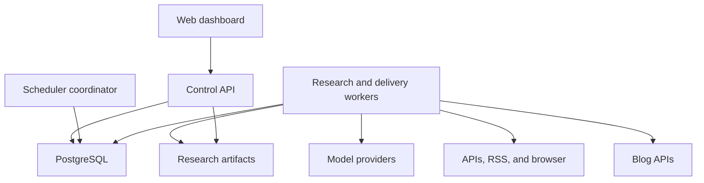
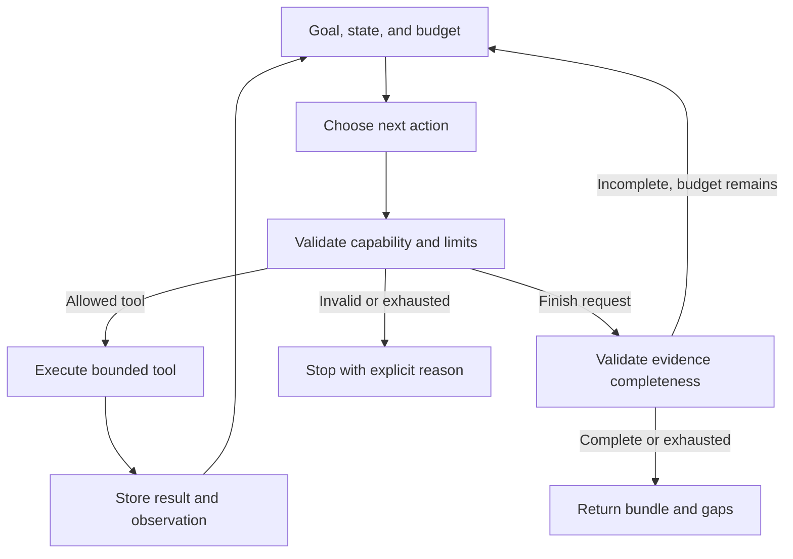

Warning: truncated output (original token count: 29234)
Total output lines: 1356

# Takumi Research Agent — Product, Architecture, and Implementation Plan

| Metadata | Nilai |
| --- | --- |
| Status | implementasi bertahap; lihat status milestone pada bagian 15.4. Belum menyatakan siap produksi. |
| Pemilik produk | Arya / aryanattapt |
| Penyusun dan reviewer | Codex |
| Versi rencana | 1.2 — review alur lintas komponen dan traceability requirement |
| Catatan review | [review.md](review.md), termasuk review lanjutan. |
| Cakupan requirement | [traceability.md](traceability.md) |
| Tanggal | 6 November 2026 |
| Repository | [takumi-research-agent-v0](https://github.com/aryanattapt/takumi-research-agent-v0) |
| Baseline yang ditinjau | commit `c8f588bd7a6b0bd0a0f5c4e386b9dd5665ecf656`. |
| Bahasa dokumen | Indonesia. Bahasa artikel yang dihasilkan: Indonesia dan English. |

## 1. Latar belakang

Menulis artikel teknologi dan sains secara rutin membutuhkan beberapa pekerjaan yang berbeda: menemukan percakapan yang sedang naik, memilih sudut pembahasan, membaca penelitian, memeriksa kebenaran klaim, menghindari pengulangan artikel, dan menyesuaikan hasil ke platform blog. Jika dilakukan manual untuk beberapa blog, pekerjaan ini sulit dijalankan konsisten setiap hari.

Popularitas sebuah topik tidak otomatis membuktikan kebenarannya. Sebaliknya, penelitian yang baik belum tentu menjadi topik yang menarik bagi pembaca awam. Takumi perlu menggabungkan sinyal ketertarikan publik dengan bukti yang dapat ditelusuri, tanpa mengubah klaim spekulatif menjadi kepastian.

Platform blog juga memiliki kontrak API yang berbeda. Daftar artikel dapat berada di array langsung, di dalam beberapa lapisan object, atau di struktur multilingual. Payload pembuatan artikel, autentikasi, pagination, dan nilai status publikasi juga tidak selalu sama. Karena itu, integrasi perlu menggunakan adapter yang dipahami AI dan dieksekusi melalui kontrak yang tervalidasi.

Repository saat ini sudah memiliki fondasi pengambilan literatur dan penyimpanan. Pengembangan berikutnya mengubah fondasi tersebut menjadi aplikasi dengan dashboard konfigurasi, pipeline agent yang dapat dilanjutkan setelah gangguan, dan pengiriman artikel ke maksimal 10 blog.

## 2. Tujuan dan hasil yang diharapkan

### 2.1 Tujuan produk

1. Menemukan topik technology dan science yang sedang meningkat setiap hari.
2. Memilih topik yang relevan dan belum tercakup secara substansial dalam blog tujuan.
3. Mengumpulkan sumber ilmiah dan sumber primer yang kredibel untuk mendukung isi.
4. Menulis dua versi artikel yang mudah dipahami pembaca awam dan menarik tanpa clickbait menyesatkan.
5. Mengirim artikel ke API blog sebagai published atau draft sesuai kekuatan bukti.
6. Mengelola koneksi, jadwal, model, dan operasi melalui dashboard.
7. Menjalankan seluruh proses untuk beberapa blog tanpa mengunci kode ke satu struktur JSON.
8. Menargetkan artikel sudah terbit pada pukul yang dikonfigurasi, dengan default 06:00 WIB.

### 2.2 Prinsip keberhasilan

- Klaim penting mempunyai sumber dan bukti yang dapat diperiksa.
- Popularitas dan kredibilitas dihitung sebagai dua hal yang berbeda.
- Artikel Indonesia dan English menyampaikan fakta, angka, dan batasan yang setara.
- Keberhasilan HTTP request tidak langsung dianggap sebagai keberhasilan publikasi.
- Kegagalan satu blog tidak menghentikan blog lain.
- Tidak ada publikasi yang dipaksakan hanya untuk memenuhi kuota atau mengejar jam.
- Pencarian tidak mewajibkan langganan search API berbayar; biaya model dan infrastruktur tetap dihitung.

## 3. Kebutuhan yang sudah dikonfirmasi

| ID | Kebutuhan | Perilaku yang dituju |
| --- | --- | --- |
| BR-01 | Maksimal 10 blog | Mendukung beberapa profil dan jadwal independen; batas 10 profil nondeleted termasuk yang paused. |
| BR-02 | Dashboard konfigurasi | Koneksi blog, model AI, jadwal, cakupan topik, editorial, dan aktivitas dikelola melalui web. |
| BR-03 | Technology | AI agent, software engineering, cloud, dan perkembangan teknologi relevan lain. |
| BR-04 | Science | Physics, chemistry, dan biology. |
| BR-05 | Topik harian | Default satu topik terbaik per blog per hari, tren global, tanpa kuota tetap per kategori. |
| BR-06 | Waktu publikasi | Default daily 06:00 Asia/Jakarta; artikel ditargetkan sudah terbit saat itu. |
| BR-07 | API blog adaptif | Mendukung struktur request/response JSON berbeda antarblog melalui mapping dinamis tervalidasi. |
| BR-08 | Riwayat artikel | Mengambil daftar artikel dari API blog dan detail tambahan bila dibutuhkan untuk deduplikasi. |
| BR-09 | Model AI | Mendukung endpoint OpenAI-compatible dan Anthropic melalui dashboard. |
| BR-10 | Kualitas sumber | Mengutamakan jurnal peer-reviewed; sumber primer lain boleh digunakan jika kredibel dan jelas. |
| BR-11 | Hoaks dan keraguan | Informasi meragukan atau bukti tidak memadai tidak diteruskan menjadi konten yang layak kirim. |
| BR-12 | Dua bahasa | Dua post terpisah, Indonesia dan English, dari research bundle yang sama. |
| BR-13 | Gaya tulisan | Bahasa awam, menarik, penjelasan istilah, analogi yang tepat, dan batasan temuan. |
| BR-14 | Publikasi | Publish bila dukungan jurnal relevan memenuhi pemeriksaan; tanpa dukungan jurnal yang memadai dikirim sebagai draft. |
| BR-15 | Kontrak API menyusul | Pengembangan memakai fixture; integrasi nyata diselesaikan setelah kontrak API blog tersedia. |

Satu topik berarti satu pasangan artikel, bukan dua topik. Dengan seluruh 10 blog aktif pada konfigurasi default, kapasitas yang perlu diuji adalah hingga 10 topik dan 20 versi artikel per hari.

### 3.1 Default teknis awal yang dapat diubah

Default berikut merupakan keputusan rancangan awal untuk membuat implementasi konkret. Nilainya perlu diuji pada deployment sebenarnya.

| Pengaturan | Default awal |
| --- | --- |
| Timezone | Asia/Jakarta; disimpan sebagai IANA timezone, bukan offset tetap. |
| Frekuensi | Daily. Dashboard juga menyediakan hari tertentu dan jam publikasi lain. |
| Target publikasi | 06:00 waktu profil blog. |
| Persiapan | Mulai 120 menit sebelum target, lalu sesuaikan berdasarkan durasi dan antrean terukur. |
| Jendela tren | 24 jam; diperluas sampai 72 jam jika kandidat belum cukup. |
| Kuota | Satu topik per blog per hari. |
| Panjang artikel | 800–1.200 kata per bahasa; bukan alasan untuk menambah isi tanpa bukti. |
| Research concurrency | Dua pekerjaan aktif secara global. |
| Browser concurrency | Satu sesi pengambilan sumber aktif secara global. |
| Delivery concurrency | Dua pekerjaan pengiriman aktif, terpisah dari kapasitas riset. |
| Perbaikan output model | Maksimal dua percobaan perbaikan JSON atau editorial setelah respons awal. |
| Evaluasi kandidat | Maksimal tiga kandidat utama per slot sebelum dilaporkan tidak ada topik layak. |
| Agent loop | Maksimal 20 request model fisik termasuk retry/repair/fallback dan 40 tool actions per run; dibagi antarstage sesuai 13.4. |
| Observasi tren | Polling ringan setiap 60 menit dengan cache; tidak memanggil model untuk setiap polling. |
| Duplikasi lintas blog | Diperiksa per blog; topik yang sama di blog lain tidak otomatis dilarang. |
| Deadline terlewat | Simpan hasil, tandai missed deadline, dan tahan pengiriman baru untuk slot tersebut. |
| Aktivasi profil | Jadwal nonaktif saat profil baru dibuat; aktivasi memakai konfigurasi valid dan mode rollout yang terlihat. |
| Pencarian berbayar | Nonaktif secara default. |
| Embedding berbayar | Tidak wajib; deduplikasi dasar memakai indeks konsep dan pemeriksaan semantik model. |

Kuota, concurrency, lead time, dan batas biaya perlu memiliki batas server yang wajar. Dashboard harus memperlihatkan konsekuensi menaikkan beban terhadap peluang memenuhi deadline.

## 4. Ruang lingkup dan batas sistem

### 4.1 Ruang lingkup versi pertama

- Dashboard dengan satu administrator.
- Maksimal 10 profil blog dalam satu deployment.
- REST API berbasis JSON dengan endpoint dan autentikasi yang dikonfigurasi.
- OpenAPI JSON/YAML atau contoh request/response sebagai input pemahaman kontrak.
- Sinkronisasi daftar dan detail artikel, termasuk pagination.
- Pemilihan topik, penelitian, penulisan bilingual, editorial review, dan evidence review.
- Adapter OpenAI-compatible dan Anthropic.
- API/RSS/HTTP retrieval dengan headless browser lokal sebagai fallback.
- Penjadwalan berdasarkan target publikasi, run manual, pause, resume, dan retry yang aman.
- Penyimpanan durabel, audit trail, status per bahasa, dan rekonsiliasi pengiriman.
- Deployment self-hosted melalui Docker Compose.

### 4.2 Batas awal

- Dukungan JSON dinamis tidak berarti AI dapat mengetahui arti field atau endpoint yang tidak pernah diberikan.
- Integrasi membutuhkan endpoint yang diizinkan, schema atau sampel, dan autentikasi yang valid.
- Dukungan GraphQL, login interaktif kompleks, dan proprietary content editor menjadi adapter lanjutan jika dibutuhkan.
- Multiadmin, role perusahaan, dan SaaS multitenant berada di luar versi pertama.
- Tidak ada kebutuhan Kubernetes, Kafka, vector database, atau browser berbayar pada versi pertama.
- Pembuatan gambar dengan layanan berbayar bukan dependensi penerbitan; media opsional mengikuti kemampuan API dan hak penggunaan.
- Sistem tidak mengatasi paywall atau memaksakan pengambilan sumber yang tidak dapat diakses.
- Ketersediaan model, jaringan, sumber, dan API blog memengaruhi deadline; tidak ada janji publikasi tepat waktu tanpa syarat.

## 5. Kondisi repository dan perubahan fondasi

| Area existing | Kondisi yang ditemukan | Perubahan yang direncanakan |
| --- | --- | --- |
| `config.py` | Satu model dan satu blog melalui environment variables. | Pisahkan bootstrap environment dari konfigurasi durabel per provider dan per blog. |
| `models.py` | Research bundle berpusat pada satu paper DOI. | Mendukung beberapa sumber, jurnal maupun nonjurnal, evidence span, dan keputusan editorial. |
| `sources.py` | Crossref, Europe PMC, pembacaan sebagian full text, dan pemeriksaan DOAJ. | Tambahkan trend discovery, sumber technology, preprint berlabel, dan verifikasi dengan beberapa sinyal. |
| `sources.py` | Terdapat batas umur penelitian lima tahun. | Pisahkan umur sinyal tren dan umur bukti; paper lama yang relevan tetap boleh menjadi konteks. |
| `store.py` | SQLite, tabel single-blog, dan file lock global. | Migrasi ke persistence multi-blog dengan transaction, run lease, dan publication outbox. |
| `replace_blog_posts` | Mengganti seluruh kumpulan riwayat tanpa namespace blog. | Sinkronisasi bertahap dan scoped per blog; snapshot lama tetap valid jika sinkronisasi baru gagal. |
| Dependensi browser | Browser Use sudah dicantumkan tetapi loop belum dibangun. | Buktikan kompatibilitas pada spike; Playwright menjadi jalur browser fallback yang terkontrol. |
| Dashboard/pipeline/publisher | Belum tersedia. | Dibangun dalam urutan milestone di bagian 15 dan 16. |

Tidak menganggap DOI, tipe metadata journal-article, atau pencantuman sebuah jurnal di indeks sebagai bukti tunggal bahwa semua klaim artikel benar. Tidak ditemukannya sebuah jurnal di DOAJ juga bukan bukti bahwa jurnal tersebut tidak peer-reviewed.

## 6. Arsitektur sistem

### 6.1 Pendekatan

Gunakan modular monolith dalam satu repository. API dashboard dan worker berjalan sebagai proses terpisah, tetapi menggunakan domain model dan database yang sama.

Pemilihan ini menjaga transaksi, konfigurasi, dan operasi tetap sederhana untuk maksimal 10 blog. Modul mempunyai interface yang jelas agar worker dapat dipisah lebih jauh jika kapasitas nantinya membutuhkan.

Scheduler coordinator dan worker pool dapat berjalan dalam satu service worker pada deployment awal. Hanya satu coordinator aktif; job dan lease disimpan di database.

### 6.2 Breakdown tanggung jawab

| Komponen | Tanggung jawab | Kontrak keluar |
| --- | --- | --- |
| Dashboard | Form konfigurasi, onboarding blog, preview, evidence, aktivitas, dan tindakan operator. | API aplikasi; tidak mengakses secret provider secara langsung. |
| Control API | Autentikasi, validasi, batas 10 blog, konfigurasi, health check, dan permintaan run. | Database, antrean durabel, response tervalidasi. |
| Scheduler | Mengubah jadwal target menjadi slot persiapan, pengiriman, dan verifikasi. | Run/job unik berdasarkan blog dan slot. |
| Orchestrator | Menentukan urutan stage, checkpoint, batas waktu, retry, dan resource budget. | State transition dan task berikutnya. |
| Trend discovery | Mengumpulkan sinyal popularitas dan menghasilkan kandidat berperingkat. | Candidate beserta skor, waktu, dan asal sinyal. |
| Blog intelligence | Memahami kontrak, membentuk adapter, dan menormalisasi riwayat blog. | Adapter version dan CanonicalBlogPost. |
| Deduplication | Membandingkan kandidat dengan artikel lama dan pekerjaan aktif. | duplicate, new_update, distinct, atau uncertain beserta alasan. |
| Research | Menemukan, membaca, dan mengelompokkan sumber. | ResearchBundle dan evidence records. |
| Writer | Membuat outline dan dua versi tulisan dari fakta yang sudah dipilih. | ArticlePair. |
| Reviewer | Memeriksa bukti, keterbacaan, kesetaraan bahasa, dan kesesuaian judul. | ReviewReport dan hasil perbaikan. |
| Policy engine | Memutuskan publish, draft, skip, atau blocked secara deterministik. | PublicationDecision dengan reason codes. |
| Delivery | Membuat request, mengirim, dan merekonsiliasi status remote. | Status per bahasa dan bukti status remote. |
| Provider adapters | Menormalkan perbedaan protokol model. | Output JSON, tool intent tervalidasi, usage, dan error terstruktur. |
| Persistence | Konfigurasi, history, evidence, lease, outbox, event, dan migrasi. | Transaction serta query yang scoped per blog. |

### 6.3 Batas peran AI dan kode aplikasi

AI digunakan untuk memahami schema/sampel JSON, merumuskan pencarian, menilai hubungan semantik, merangkum bukti, dan menyusun tulisan.

Kode aplikasi bertanggung jawab atas autentikasi, validasi mapping, batas blog, transaksi, jadwal, penghitungan kuota, dan keputusan pengiriman yang mempunyai efek ke blog.

Output model selalu dianggap sebagai usulan terstruktur. AI tidak mendapat kemampuan menjalankan Python, JavaScript, SQL, shell, atau HTTP request bebas untuk menulis ke blog. Executor hanya menjalankan operasi dan transformasi yang diizinkan adapter.

### 6.4 Runtime agent yang dituju

Arsitektur yang dipilih adalah **agentic workflow**: satu research agent memilih langkah pencarian secara adaptif di dalam workflow aplikasi yang persisten. Tahap penulisan dan review memakai model dengan tugas berbeda; keduanya tidak otomatis menjadi agent otonom tambahan. Perbedaan antara jalur tetap dan pemilihan tools oleh model mengikuti [pembedaan workflow/agent Anthropic](https://www.anthropic.com/research/building-effective-agents).

Agent mendapat goal, context, tools, dan budget. Setelah membaca observation, agent dapat mengubah query, memilih sumber lain, memeriksa paper yang bertentangan, atau menyimpulkan bukti tidak cukup. Menjalankan daftar prompt yang sama tanpa memperhatikan hasil tools belum memenuhi kriteria agent pada proyek ini.

Harness memvalidasi setiap action menggunakan discriminated union: `tool_call` atau `finish`. Model tidak dapat menambahkan tool baru, memperluas scope blog, mengubah policy, atau menaikkan budget. Native tool calls dan fallback JSON diterjemahkan ke bentuk action internal yang sama.

| Tool namespace | Input inti | Observation yang dikembalikan |
| --- | --- | --- |
| `literature.search` | Query, bidang, filter sumber/tanggal, page limit | Metadata kandidat, identifiers, dan status metadata tersedia/unknown. |
| `sources.search_primary` | Query dan connector sumber primer terdaftar | Hasil indeks RSS atau search endpoint publik sumber resmi, beserta URL, tanggal, dan provenance. |
| `sources.read` | Source ID atau URL yang lolos allowlist, section/cursor | Potongan teks, locator, hash versi sumber, scope yang dibaca, dan batas ekstraksi. |
| `sources.check_status` | Identifier dan source version | Bukti status publikasi/review/koreksi/retraksi yang tersedia. |
| `history.find_related` | Blog scope dari runtime, konsep, entity, dan query | Artikel pembanding beserta coverage/freshness dan retrieval metadata. |
| `browser.read` | URL yang diizinkan dan tujuan pengambilan | Observation halaman, judul/URL final, timestamp, dan extraction quality. |
| `evidence.record` | Claim, source version, locator, dan evidence span | Evidence ID jika span dapat diverifikasi pada artifact sumber. |
| `research.finish` | Research summary, claims, evidence IDs, dan unresolved gaps | Bundle tervalidasi atau daftar kekurangan yang masih perlu ditangani. |

`evidence.record` hanya menulis bukti lokal tervalidasi, dengan key idempotent. Tidak ada tool research untuk create/publish/update/delete post, menjalankan shell, membaca secret, atau mengakses database bebas.

Setiap tool mempunyai JSON Schema input/output, contoh penggunaan, scope, timeout, output limit, cost estimate bila tersedia, dan error code. Error seperti `AUTH_FAILED`, `RATE_LIMITED`, `NOT_FOUND`, `EXTRACTION_INCOMPLETE`, atau `BLOCKED_URL` tidak dikembalikan sebagai teks yang menyerupai hasil riset sukses. Field `truncated`, `next_cursor`, dan `retry_after` harus eksplisit.

Stop conditions: bukti cukup; tidak ada kandidat layak; budget langkah/token/waktu habis; sumber penting unavailable; atau tidak ada progres setelah dua observation identik. Finish adalah permintaan model yang dinilai controller, bukan pernyataan keberhasilan yang langsung dipercaya.

**Contoh penerimaan agent:** ketika full text pertama tidak tersedia, agent mencari jalur open-access lain; ketika hasil kedua membantah klaim awal, agent memperbarui fact sheet atau menolak klaim. Test harus menunjukkan observation mengubah pilihan action, bukan hanya melihat sebuah tool pernah dipanggil.

### 6.5 Context, memory, dan replay

| Jenis state | Penyimpanan dan batas |
| --- | --- |
| Working memory | Goal, pertanyaan terbuka, evidence IDs, ringkasan observation, dan budget dalam run checkpoint. |
| Source memory | Artifact immutable dengan content hash; excerpt diambil sesuai kebutuhan, bukan seluruh paper dimasukkan ke setiap prompt. |
| Blog memory | Indeks konsep, history, serta keputusan terdahulu yang scoped per blog. |
| Configuration memory | Snapshot berversi; secret tetap berupa reference dan tidak disisipkan ke context. |
| Evaluation memory | Dataset dan trace regression berversi, terpisah dari memory operasional yang dapat berubah. |

Bangun context pada setiap turn: instruksi stabil, tool registry yang diizinkan, snapshot fakta terpilih, evidence relevan, pertanyaan terbuka, serta sisa budget. Sisakan ruang untuk hasil tool dan output. Compaction menyimpan ID sumber, locator, fakta, dan kekurangan; ringkasan model tidak menggantikan bukti asli.

Checkpoint mencatat tool intent sebelum eksekusi dan hasil setelah eksekusi. Read boleh diulang sesuai cache/freshness; effect lokal harus idempotent. Replay test memakai observation/model response yang direkam dan disensor untuk memeriksa transisi state, bukan menjanjikan respons model live identik.

Trace berisi action, argumen tersensor, observation reference, keputusan ringkas, versi prompt/model/tool, durasi, dan usage. Tidak meminta atau menyimpan hidden chain-of-thought model. Restart tidak boleh menghapus daftar bukti yang belum terjawab atau mengulang mutation remote.

### 6.6 Pilihan framework dan kompleksitas

Mulai dengan AgentRuntime bertipe melalui provider SDK, explicit state machine, dan checkpoint aplikasi. Durable queue, policy, serta delivery tetap berada di aplikasi. Framework agent bukan syarat agar sistem memenuhi definisi agent.

Compatibility spike harus membuktikan tool calling, fallback JSON, pause/resume, replay, serta budget enforcement. Jika kebutuhan graph/interrupt/replay sulit dipenuhi dengan runtime kecil, buat ADR untuk mengadopsi framework; jangan membangun framework umum baru di dalam proyek ini.

Browser Use merupakan evaluasi opsional setelah jalur Playwright berfungsi. Tidak menjalankan dua control loop browser sekaligus. Multi-agent swarm dan MCP server tidak menjadi dependensi default; penambahannya membutuhkan masalah terukur yang belum diselesaikan desain ini.

## 7. Tech stack yang direncanakan

Versi patch dan lockfile ditetapkan setelah compatibility spike. Tidak menaikkan semua dependensi ke versi terbaru tanpa pengujian.

| Lapisan | Pilihan awal | Alasan dan batas |
| --- | --- | --- |
| Backend | Python 3.12 dengan minimum repository 3.11 dievaluasi saat spike | Melanjutkan fondasi Python yang sudah ada. |
| Web API | FastAPI + Uvicorn | API dashboard dan kontrak bertipe. |
| Validasi | Pydantic 2.x | Validasi konfigurasi, mapping, output model, dan state. |
| Agent harness | AgentRuntime bertipe, explicit state machine, checkpoint PostgreSQL | Loop observation/action yang dibatasi dan dapat diuji; framework tambahan melalui ADR jika spike membutuhkannya. |
| HTTP | httpx | Request asynchronous, timeout, transport fixture, dan pembatasan koneksi. |
| Model OpenAI-compatible | Official OpenAI Python SDK melalui adapter aplikasi | Baseline Chat Completions; fitur khusus provider diuji sebelum diaktifkan. |
| Model Anthropic | Official Anthropic Python SDK melalui adapter aplikasi | Menggunakan protokol native Messages; tidak dipaksa menjadi request OpenAI. |
| Database | PostgreSQL, image versi mayor supported dipin saat implementasi | Konfigurasi, job queue, row locking, dan outbox durabel. |
| Persistence | SQLAlchemy 2.x + Alembic | Session/transaction yang jelas dan migrasi schema berversi. |
| Scheduling | APScheduler 3.x yang dipin + zoneinfo | Trigger dalam satu coordinator; durable run queue tetap milik aplikasi. |
| Browser | Playwright Python + Chromium lokal | Fallback untuk halaman yang memerlukan browser; binary disesuaikan dengan versi Playwright. |
| Agent browsing opsional | Browser Use setelah lolos spike | Dipakai hanya jika navigasi agent diperlukan dan kemampuan model sesuai. |
| Ekstraksi | Parser HTML/XML serta pypdf untuk PDF teks | Simpan kualitas ekstraksi; OCR bukan syarat versi pertama. |
| Frontend | React + TypeScript + Vite | Dashboard form dan state operasi yang terpisah dari pipeline. |
| UI | Tailwind CSS dan komponen accessible | Form konfigurasi, tabel, editor JSON, serta tampilan status yang konsisten. |
| Progress UI | Server-Sent Events dengan polling fallback | Menampilkan perubahan tanpa memindahkan kontrol pipeline ke browser. |
| Testing backend | pytest + httpx transport fixtures | Contract, policy, scheduler, retry, dan simulasi integrasi. |
| Testing frontend | Vitest + React Testing Library | Perilaku form, status, masking, dan batas konfigurasi. |
| End-to-end | Playwright | Onboarding dan alur operator dengan fake provider/blog server. |
| Deployment | Docker Compose | Service aplikasi, worker, PostgreSQL, dan persistent volumes. |
| CI | GitHub Actions | Test, type/build checks, dan build image; tidak memakai secret produksi untuk fixture test. |

Redis tidak menjadi dependensi awal. Klaim job menggunakan transaction singkat dan row lock; network call tidak dilakukan sambil menahan transaction database.…17234 tokens truncated…ish.
- Preprint dan sumber primer nonjurnal tetap dapat menghasilkan draft yang layak.
- Artikel kedua bahasa tidak menambah klaim atau mengubah angka.

**Delivery/schedule**

- Timeout sesudah remote create tidak menghasilkan retry buta.
- Sukses satu bahasa tidak memicu pengiriman ulang bahasa yang sudah sukses.
- Jadwal restart tidak menduplikasi slot.
- Target pukul 06:00 berarti waktu terbit, bukan waktu riset dimulai.
- Keputusan draft tidak pernah dikirim sebagai published hanya karena API kekurangan status draft.

## 17. Verification dan UAT

### 17.1 Strategi test

Fokus pada perilaku yang memengaruhi kebenaran konten, integrasi, biaya, dan mutation eksternal. Hindari test yang hanya menyalin implementasi.

| Jenis | Cakupan |
| --- | --- |
| Unit | Policy, normalisasi nilai, timezone, scoring missing signals, mapping validation, dan run keys. |
| Contract | Beberapa blog fixture dan kedua keluarga protokol model. |
| Integration | PostgreSQL transaction, lease, outbox, crash recovery, dan checkpoint. |
| Editorial evaluation | Bukti tidak relevan, salah satuan, klaim berlebihan, translasi berubah arti, dan sumber meragukan. |
| Frontend behavior | Form, max-10 state, error mapping, secret masking, dan tindakan retry. |
| End-to-end | Konfigurasi sampai hasil bilingual pada fake blog yang benar-benar menyimpan post. |
| Capacity | 10 blog, 20 versi, concurrency limits, antrean delivery, dan deadline pressure. |
| Live UAT | Sandbox API pengguna dan provider yang dipilih, dengan kredensial deployment. |

CI rutin memakai fixture deterministik. Pengujian live model dipisahkan karena output dan biaya bervariasi; hasilnya dicatat, bukan dianggap deterministik hanya karena satu kali lolos.

### 17.2 Skenario wajib

| ID | Skenario | Hasil yang diharapkan |
| --- | --- | --- |
| UAT-01 | Dua request menambah profil saat sudah ada sembilan | Tidak lebih dari 10 profil tersimpan. |
| UAT-02 | List blog memakai wrapper nested dan cursor | Seluruh halaman dinormalisasi dan cursor berulang terdeteksi. |
| UAT-03 | Artikel English sudah membahas kandidat Indonesia | Kandidat dikenali sebagai topik yang sudah tercakup. |
| UAT-04 | Topik sama mempunyai temuan baru yang penting | Lanjut hanya jika novelty didukung evidence. |
| UAT-05 | Jurnal relevan dan review lolos | Dua versi dikirim dengan target publish. |
| UAT-06 | Hanya dokumentasi resmi atau preprint kredibel | Dua versi menjadi draft, bukan published. |
| UAT-07 | Ada jurnal tetapi tidak mendukung klaim utama | Tidak lolos automatic publish. |
| UAT-08 | Sumber hoaks atau bukti inti ditarik | Kandidat ditolak dengan alasan. |
| UAT-09 | API tidak bisa membuat draft | Draft tersimpan lokal; endpoint auto-publish tidak dipakai. |
| UAT-10 | POST sukses remote tetapi respons timeout | Lookup dilakukan; tidak ada duplicate create. |
| UAT-11 | Indonesia sukses, English gagal | Status partial; retry hanya operasi yang aman dan belum sukses. |
| UAT-12 | Schema status berubah | Mutation ditahan sampai adapter tervalidasi kembali. |
| UAT-13 | Worker restart sebelum/selama delivery | Resume atau reconciliation; bukan menjalankan seluruh efek ulang. |
| UAT-14 | Sepuluh blog mempunyai target 06:00 | Beban terukur, batas resource ditaati, dan hasil per blog tidak tertukar. |
| UAT-15 | Riset belum lolos kualitas saat deadline | Missed deadline/local draft; tidak memaksa publish. |
| UAT-16 | Source berisi prompt injection atau URL privat | Instruksi tidak dijalankan dan akses tidak sah ditolak. |
| UAT-17 | Provider kehabisan budget/rate limit | Retry mengikuti batas waktu atau run ditahan dengan alasan. |
| UAT-18 | Terjemahan mengubah angka/tingkat kepastian | Review menolak sampai diperbaiki. |
| UAT-19 | API menerima job asynchronous dengan HTTP 200/202 | Status menunggu verifikasi; tidak langsung published. |
| UAT-20 | Backup dipulihkan pada deployment baru | Konfigurasi/evidence kembali dan slot/delivery tidak digandakan. |
| UAT-21 | Observation kurang lalu sumber baru membantah klaim | Agent mengubah strategi dan memperbarui keputusan berbasis observation. |
| UAT-22 | Agent mengulang hasil atau meminta tool tanpa izin | No-progress menghentikan loop; action terlarang tidak berefek. |
| UAT-23 | Lease habis saat worker lama masih berjalan | Fencing menolak stale update; in-flight effect direkonsiliasi. |
| UAT-24 | Jadwal berubah dari 06:00 ke 07:00 pada hari sama | Satu ledger slot; tidak memperoleh jatah topik kedua. |
| UAT-25 | Body/mapping/policy berubah setelah review | Approval fingerprint invalid dan mutation ditahan. |
| UAT-26 | Core source dikoreksi sebelum publish | Approval batal; fact sheet/review diperbarui. |
| UAT-27 | Compaction/restart pada context panjang | Evidence references serta unresolved gaps tetap ada. |
| UAT-28 | Beberapa blog memanggil provider dekat batas budget | Reservasi atomik mencegah penggunaan paralel tanpa pencatatan. |
| UAT-29 | History private masuk cache global | Scope test mencegah kebocoran history/prompt antarblog. |
| UAT-30 | Artikel baru muncul saat backfill gagal di tengah | Watermark tidak maju; snapshot valid tidak diganti yang incomplete. |
| UAT-31 | Tool-call ID salah atau output terpotong | Result mismatch ditolak; tidak dianggap finish valid. |
| UAT-32 | JSON/OpenAPI valid meminta perubahan publish policy | Instruksi tetap data; executor menolak perubahan otoritas. |
| UAT-33 | Profil dipause setelah schedule remote dibuat | Cancel intent tervalidasi berjalan; hasilnya dibaca, bukan diasumsikan. |
| UAT-34 | Schedule/cancel timeout atau platform tidak mendukung cancel | Status unknown/unsupported terlihat; tidak membuat jadwal/post pengganti. |
| UAT-35 | Mode single_resource memuat id dan en | Hanya satu create request; completeness tetap diuji untuk dua locale. |
| UAT-36 | Terbit 05:59 tetapi baru terkonfirmasi 06:02, atau terbit 06:03 | Published, verified_at, dan hasil on_time/late/unconfirmed tidak saling menimpa. |
| UAT-37 | Bahasa pertama sudah terbit saat unit kedua di-retry | Own-pair ID dikecualikan dengan bukti; pair lain tetap diperiksa. |
| UAT-38 | GET list tidak menampilkan remote/local draft terdahulu | Content ledger mencegah draft topik sama dibuat ulang. |
| UAT-39 | Draft lama kini mempunyai dukungan jurnal memadai | Rereview dan promote resource/pair yang sama; tidak membuat salinan. |
| UAT-40 | Backup sebelum POST dipulihkan setelah post sudah terbit | Recovery mode menahan mutation dan merekonsiliasi remote sebelum aktivasi. |
| UAT-41 | Evidence artifact hilang atau hash berubah | Approval invalid dan publisher blocked; bukan mengandalkan metadata saja. |
| UAT-42 | SDK dan orchestrator sama-sama berpotensi retry | SDK retry dinonaktifkan; jumlah request fisik sesuai budget dan tercatat. |
| UAT-43 | Riset mendekati batas request model | Cadangan dua bahasa/review tidak terpakai riset; gap dilaporkan jika tak cukup. |
| UAT-44 | Base URL profil diubah ke blog lain saat ada pending intent | Destination epoch berubah; intent lama tidak dikirim ke tujuan baru. |
| UAT-45 | Operator mengedit draft remote sebelum publish_existing | Version conflict menahan update/publish; isi operator tidak ditimpa. |
| UAT-46 | Empat bidang dan primary-source search diuji | Metadata serta full text terverifikasi dapat dibaca lewat registry tanpa search API berbayar wajib. |
| UAT-47 | Dry-run menerima finish publish atau permintaan cancel | Tidak ada mutation blog; sandbox/live hanya pada destination dan mode yang sah. |
| UAT-48 | Provider menolak atau stream terputus | Refused/incomplete dibedakan dari JSON error; tidak dipaksa jadi hasil lengkap. |
| UAT-49 | Tulisan akurat tetapi jargon/clickbait berlebihan | Rubric awam menolak atau meminta revisi; fakta tidak dikorbankan demi hook. |
| UAT-50 | Dua tab menyimpan konfigurasi dengan revision berbeda | Stale save conflict; mapping atau secret baru tidak tertimpa. |
| UAT-51 | Body berisi active HTML/URL berbahaya atau renderer mengubah teks setelah review | Preview dan payload memakai konten aman yang sama; perubahan material membatalkan approval. |

### 17.3 Evaluation dataset dan release gates

Dataset berversi, mencakup contoh sulit, dan memisahkan development cases dari holdout. Label truth/support diperiksa dari sumber, bukan dibuat oleh model yang sedang diuji. Kasus sintetis error protokol tidak menggantikan penilaian kualitas riset pada contoh nyata.

Baseline qualification awal yang diusulkan:

| Suite | Minimum awal | Cakupan |
| --- | --- | --- |
| Research/evidence | 40 kasus, minimal 10 per bidang | Jurnal/preprint, sumber tidak relevan, keterbatasan, konflik, koreksi/retraksi, dan unavailable source. |
| Dedup | 40 pasangan berlabel, minimal separuh lintas bahasa, dengan sedikitnya 200 distractor atau corpus target yang lebih besar | Duplicate, substantial update, beda pertanyaan, dan false negatives retrieval. |
| Blog adapters | 12 kontrak fixture | Nesting, multilingual, pagination, business error, ambiguity, dan schema drift. |
| Adversarial/permission | 20 kasus | Injection pada web/history/OpenAPI, secret request, cross-blog access, dan unknown tools. |
| Recovery/capacity | Tiga siklus 10 blog | Restart, expired lease, unknown delivery, schedule edit, outage, dan deadline pressure. |

Target berikut merupakan **gate awal proyek**, bukan hasil yang sudah tercapai atau standar universal.

| Metrik | Gate sebelum automatic publish |
| --- | --- |
| Critical unsupported/contradicted claims | Nol pelanggaran yang teramati pada qualification suite. |
| Fabricated source/quote dan journal-policy bypass | Nol kasus lolos; span validity belum cukup tanpa semantic support. |
| Citation support precision | Minimal 95% pada klaim berlabel; semua klaim inti tetap wajib lolos. |
| Numeric/date/unit parity | 100% pada fakta material pasangan bahasa di suite. |
| Duplicate retrieval recall@20 | Minimal 95% pada corpus dan ukuran arsip yang disebutkan dalam laporan. |
| Duplicate verdict precision/recall | Keduanya minimal 95%; substantial updates tidak selalu ditolak demi angka recall. |
| Permission isolation dan duplicate external effect | Nol pelanggaran yang teramati pada fault/adversarial suite. |
| Deadline | Minimal 95% slot eligible pada latency envelope benchmark tercatat; sample kosong tidak dihitung lulus. |
| Readability | Minimal 80% artikel sampel mendapat skor 4/5 atau lebih pada rubric pembaca awam. |
| Biaya/latensi | Dilaporkan per successful article pair dan memenuhi batas deployment. |

Jalankan beberapa trial untuk kasus nondeterministik berisiko; default tiga trial per case yang masuk regression model/prompt. Laporkan jumlah trial, hasil terburuk, dan variasi, bukan hanya contoh terbaik. Jika budget evaluasi belum cukup, qualification tetap incomplete dan mode shadow/draft lokal masih dapat dipakai.

Gabungkan assertion kode, grader semantik dengan rubric, dan kalibrasi operator pada kasus berlabel. LLM tidak menjadi satu-satunya hakim untuk kebenaran sumber, publikasi remote, atau izin. Penilaian keterbacaan dipisahkan dari fakta.

Bandingkan loop adaptif dengan baseline retrieval/prompt tetap pada subset yang sama: task completion, evidence support, tools, token, dan latency. Tambahan otonomi harus memberi manfaat terukur; kegagalan gate tidak disembunyikan dengan menghapus kasus sulit.

Qualification mengikat versi dataset, prompt, tool schema, policy, provider/model, adapter, dan kode. Lulus suite tidak membuktikan zero hallucination di dunia nyata. Rollout memakai shadow run, sandbox, satu-blog pilot, lalu skala; aktivasi terjadwal tidak memerlukan persetujuan manual per artikel.

### 17.4 Rubric pembaca awam

Nilai setiap dimensi 1–5: daya tarik pembuka tanpa klaim berlebihan, kejelasan istilah, urutan penjelasan/analogi, manfaat atau relevansi konkret, dan kejelasan batas temuan. Skor artikel adalah rata-rata; target 4/5 tidak menggantikan gate fakta. Artikel yang akan dikirim harus lolos pemeriksaan tersebut; target qualification 80% mengukur keberhasilan model pada suite, bukan izin mengirim sisa artikel yang gagal. Kasus yang gagal direvisi atau ditahan.

Sampel qualification menyertakan dua pertanyaan pemahaman berjawaban dari artikel: gagasan utama dan satu keterbatasan penting. Kalibrasi grader menggunakan jawaban pembaca/operator serta artikel berlabel. Tulisan yang menarik tetapi menyesatkan tetap gagal.

### 17.5 Traceability requirement

[traceability.md](traceability.md) memetakan semua BR-01 sampai BR-15 ke desain, milestone, dan UAT. Setiap perubahan requirement memperbarui matriks dan skenario terkait. Tercakup di dokumen tidak sama dengan telah diimplementasikan atau lulus test.

## 18. Deployment dan operasi

### 18.1 Bentuk deployment awal

| Service | Peran | Persistence |
| --- | --- | --- |
| app | FastAPI dan dashboard production build; satu origin untuk UI/API. | Konfigurasi melalui PostgreSQL. |
| worker | Coordinator tunggal, research pool, delivery pool, dan Chromium. | Job/evidence/outbox di PostgreSQL dan artifact volume. |
| postgres | Database aplikasi. | Database volume yang dibackup. |

Frontend dibuild pada image build sehingga server Node terpisah tidak diperlukan pada runtime awal. Reverse proxy/TLS dapat mengikuti infrastruktur deployment pengguna.

### 18.2 Runbook minimum

- Bootstrap administrator dan master key.
- Migrasikan/import data existing jika tersedia.
- Konfigurasikan provider dan jalankan capability test.
- Tambahkan blog dan verifikasi mapping dengan operasi read-only.
- Jalankan satu pipeline sandbox sampai draft/publish terverifikasi.
- Ukur durasi, resource, dan token usage.
- Atur lead time serta batas concurrency sesuai hasil.
- Aktifkan jadwal blog secara bertahap sampai maksimal 10.
- Pantau missed deadline, source failures, partial publication, dan unknown delivery.
- Backup database/artifact; uji restore sebelum operasi dianggap stabil.

Dashboard adalah kanal observasi minimum. Integrasi notifikasi eksternal bersifat lanjutan dan tidak menjadi syarat versi pertama.

### 18.3 Artifact integrity, backup, dan restore

Artifact immutable memakai content hash. Tulis file sementara pada filesystem sama, finalisasikan secara atomik, lalu commit reference database. Crash dapat meninggalkan orphan file, tetapi tidak boleh menghasilkan evidence siap pakai yang filenya belum ada. Read memeriksa hash/manifest; artifact hilang atau rusak membatalkan approval.

Garbage collection tidak menghapus artifact yang masih direferensikan run aktif, approval, pending/unknown intent, atau backup manifest yang dipertahankan. Retensi bukti terbit/draft ditampilkan; penghapusan bukti tidak menyisakan label verified palsu.

Backup memuat snapshot database, manifest artifact terkait, schema version, dan key reference. Tahan penghapusan artifact dalam manifest sampai salinan dan hashnya terverifikasi. Master key dipulihkan terpisah.

Setelah restore, deployment masuk `recovery_mode`:

1. Scheduler delivery/mutation konten nonaktif; lease lama tidak berlaku.
2. Validasi schema, credential decryption, destination identity, dan artifact manifest.
3. Sync ulang history serta jadwal remote profil terkait.
4. Rekonsiliasi intent, IDs/external keys, dan kemungkinan pengiriman setelah waktu backup.
5. Jika data lama tidak membuktikan apakah remote create sudah terjadi, tandai unknown/blocked; jangan mengulang otomatis.
6. Setelah recovery report selesai, aktifkan profil valid. Missed slots tidak di-backfill menjadi post tanpa batas.

Idempotency remote yang kedaluwarsa bukan bukti operasi belum terjadi. API tanpa lookup cukup tetap ditahan untuk rekonsiliasi. Backup sukses dan restore sukses adalah pemeriksaan berbeda.

### 18.4 Metrik utama

- Candidate count dan alasan reject per sumber/kategori.
- History sync coverage dan freshness.
- Duplikasi yang terdeteksi serta verdict uncertain.
- Research/editorial duration per stage.
- Token usage dan estimasi biaya per run/blog.
- Evidence coverage untuk klaim utama.
- Deadline success, missed deadline, dan lead time terukur.
- Delivery attempts, unknown, partial, dan remote verification latency.
- Browser concurrency, timeout, serta source extraction failures.
- Agent turns, tool errors, no-progress exits, evidence gaps, dan compaction.
- Published/draft/skip/blocked/missed terhadap seluruh slot, serta deadline rate untuk slot eligible; kedua denominator dilaporkan.
- Trace correlation: blog_id, run_id, step_id, tool_call_id, config/prompt/tool version, model, dan artifact hash.

## 19. Risiko dan mitigasi

| Risiko | Dampak | Mitigasi |
| --- | --- | --- |
| Sinyal hype tidak tersedia merata | Ranking berat sebelah | Normalisasi per sumber/bidang, simpan missing signals, dan kalibrasi. |
| Model mengarang mapping | Salah payload atau status | DSL terbatas, fixture validation, dan capability checks sebelum mutation. |
| API berubah | Sync/publish gagal atau salah arti | Fingerprint, validation, versioned adapter, dan blocked state. |
| Bukti sulit diakses | Artikel kurang dapat dipertanggungjawabkan | Sumber terbuka alternatif; draft/hold jika bukti inti belum cukup. |
| Jurnal palsu/tidak relevan | Salah automatic publish | Pemeriksaan identitas, status, relevansi, dan claim-level evidence. |
| Model lambat/rate limited | Deadline terlewat | Lead time adaptif, budget, concurrency limits, dan delivery priority. |
| Timeout setelah POST | Duplikasi post | Outbox, remote idempotency bila ada, dan reconciliation sebelum retry. |
| Hanya satu bahasa berhasil | Pengalaman bilingual tidak lengkap | Status per bahasa dan repair tanpa mengulang hasil sukses. |
| Sinkronisasi parsial | Duplikasi tidak terdeteksi | Coverage/freshness tracking; blokir pengiriman jika pemeriksaan belum memadai. |
| Sepuluh blog membebani satu host | Kualitas/waktu tidak stabil | Benchmark, fairness, cache bersama, dan mulai persiapan lebih awal. |
| Secret atau prompt injection bocor | Akses tidak sah | Pemisahan secret/tools, sanitasi, allowlist, dan audit. |
| API tidak mendukung draft/schedule/lookup | Sebagian requirement tidak dapat dipenuhi remote | Tampilkan capability limit dan gunakan local draft atau blocked state yang jujur. |

## 20. Definition of Done

Implementasi dianggap memenuhi versi pertama jika:

- [ ] Dashboard dapat mengelola maksimum 10 profil blog dengan konfigurasi independen.
- [ ] OpenAI-compatible dan Anthropic dapat dikonfigurasi serta diuji melalui dashboard.
- [ ] Beberapa bentuk JSON dan pagination terintegrasi tanpa mengganti source code untuk setiap blog.
- [ ] Riwayat lintas bahasa dipakai untuk memeriksa kemiripan sebelum menulis dan sebelum mengirim.
- [ ] Topik dipilih berdasarkan sinyal yang dapat dijelaskan, dengan default global dan satu topik per blog per hari.
- [ ] Sumber jurnal dan primer memiliki provenance dan evidence yang dapat diperiksa.
- [ ] Dua versi tulisan mudah dipahami, konsisten, dan tidak mengubah kekuatan bukti.
- [ ] Dukungan jurnal relevan dapat menghasilkan publish; sumber primer tanpa jurnal menghasilkan draft.
- [ ] Informasi meragukan tidak dipublish atau dikirim sebagai draft layak tanpa pemeriksaan.
- [ ] Default 06:00 WIB diterapkan sebagai target terbit, dengan persiapan sebelumnya.
- [ ] Partial, unknown, blocked, local draft, remote draft, dan missed deadline ditampilkan berbeda.
- [ ] Restart/retry tidak menggandakan operasi logis yang sudah selesai.
- [ ] Pengujian fixture, kapasitas, dan skenario kegagalan wajib lolos.
- [ ] Deployment Compose, migrasi, backup, dan restore dapat dijalankan sesuai runbook.
- [ ] UAT dengan API blog nyata selesai setelah kontraknya tersedia.
- [ ] Agent mengadaptasi tools/query berdasarkan observation dan berhenti sesuai batas.
- [ ] Context/replay mempertahankan evidence/gaps dan izin tool dibatasi setiap action.
- [ ] Evidence per klaim, kritik terpisah, dan fingerprint approval terikat versi konten.
- [ ] Fencing/quota/schedule-edit tests mencegah stale update serta jatah ganda.
- [ ] Eval berversi dan beberapa trial dilaporkan; tidak mengklaim lulus tanpa data.
- [ ] Shadow/sandbox/pilot mendahului skala automatic publish sampai 10 blog.
- [ ] Remote scheduled post dapat dibaca/dibatalkan secara terbukti sebelum mode tersebut diaktifkan.
- [ ] Physical mutation units, internal draft ledger, own-pair retry, dan promosi draft lolos UAT.
- [ ] Outcome publikasi, kelengkapan bahasa, serta deadline tidak saling menimpa.
- [ ] Restore menahan mutation sampai reconciliation dan artifact integrity selesai.
- [ ] Seluruh BR memiliki desain serta acceptance scenario pada traceability.md, dengan status runtime yang jujur.
- [ ] README menggambarkan kemampuan yang benar-benar sudah ada, beserta batas integrasi.

## 21. Referensi teknis

Referensi diperiksa pada 6 November 2026. Referensi menjelaskan capability teknologi; pilihan arsitektur, default, dan policy dalam dokumen ini merupakan rancangan proyek, bukan jaminan dari penyedia.

| Referensi | Kegunaan |
| --- | --- |
| [FastAPI documentation](https://fastapi.tiangolo.com/) | Fondasi API bertipe dan dokumentasi endpoint. |
| [OpenAI Chat API reference](https://developers.openai.com/api/reference/resources/chat) | Baseline protokol untuk adapter OpenAI-compatible. |
| [Anthropic Messages API](https://platform.claude.com/docs/en/api/messages) | Adapter native Anthropic. |
| [Playwright Python browsers](https://playwright.dev/python/docs/browsers) | Browser binary dan dependency yang harus cocok dengan versi library. |
| [APScheduler 3.x user guide](https://apscheduler.readthedocs.io/en/3.x/userguide.html) | Trigger, coordinator, dan batas penggunaan job store. |
| [SQLAlchemy PostgreSQL dialect](https://docs.sqlalchemy.org/en/20/dialects/postgresql.html) | Integrasi persistence PostgreSQL. |
| [SQLite WAL](https://www.sqlite.org/wal.html) | Konteks penyimpanan existing sebelum migrasi. |
| [Crossref REST API](https://www.crossref.org/documentation/retrieve-metadata/rest-api/) | Pencarian metadata dan identifier penelitian. |
| [Europe PMC developer resources](https://europepmc.org/developers) | Metadata dan akses sumber terbuka sesuai capability. |
| [arXiv API access](https://info.arxiv.org/help/api/index.html) | Discovery sumber dan aturan akses API. |
| [arXiv moderation](https://info.arxiv.org/help/moderation/index.html) | Memisahkan moderasi preprint dari peer review. |
| [Anthropic: Building effective agents](https://www.anthropic.com/research/building-effective-agents) | Workflow/agent dan kompleksitas; detail tooling tetap mengikuti SDK terkini. |
| [Anthropic: Writing tools for agents](https://www.anthropic.com/research/writing-tools-for-agents) | Tool contract dan observation yang berguna. |
| [Anthropic: Context engineering](https://www.anthropic.com/research/effective-context-engineering-for-ai-agents) | Context terbatas dan memory sesuai tugas. |
| [Anthropic: Demystifying evals](https://www.anthropic.com/research/demystifying-evals-for-ai-agents) | Trial, grader, trace, dan hasil lingkungan. |
| [Official OpenAI documentation: Agent safety](https://developers.openai.com/api/docs/guides/agent-builder-safety) | Isolasi input tidak tepercaya dan structured outputs; bukan dependensi pada Agent Builder. |
| [Official OpenAI documentation: Agent evaluations](https://developers.openai.com/api/docs/guides/agent-evals) | Trace/dataset; harness proyek tetap provider-neutral. |
| [Official OpenAI Python SDK](https://github.com/openai/openai-python#retries) | Konfigurasi retry client yang perlu diselaraskan dengan orchestrator. |
| [Anthropic Python SDK configuration](https://platform.claude.com/docs/en/cli-sdks-libraries/sdks/python#retries) | Retry/timeout SDK dan pencatatan physical attempts. |
| [OWASP XSS Prevention](https://cheatsheetseries.owasp.org/cheatsheets/Cross_Site_Scripting_Prevention_Cheat_Sheet.html) | Output handling dan sanitasi konten yang dipreview/dipublish. |

Referensi best practice bukan sertifikasi produksi. Runtime, evaluasi, dan integrasi API nyata belum dibangun atau dijalankan pada commit dokumentasi ini.
