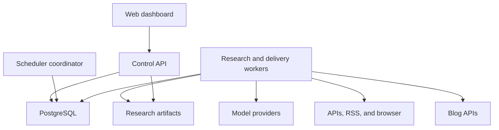
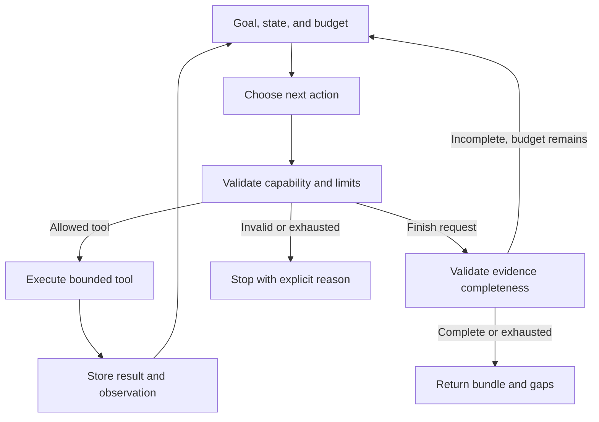
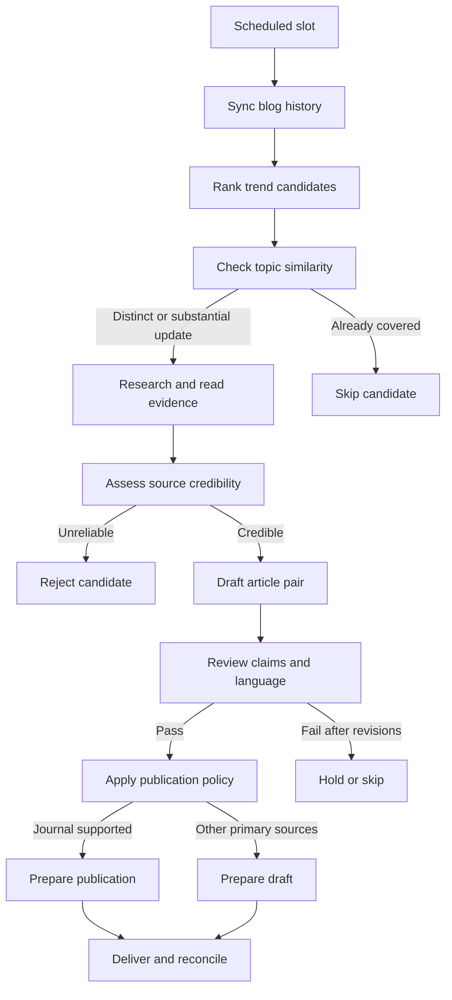

# Takumi Research Agent — Product, Architecture, and Implementation Plan

| Metadata | Nilai |
| --- | --- |
| Status | implementasi bertahap; lihat status milestone pada bagian 15.4. Belum menyatakan siap produksi. |
| Pemilik produk | Arya / aryanattapt |
| Penyusun dan reviewer | Codex |
| Versi rencana | 1.2 — review alur lintas komponen dan traceability requirement |
| Catatan review | [review.md](review.md), termasuk review lanjutan. |
| Cakupan requirement | [traceability.md](traceability.md) |
| Tanggal | 6 November 2026 |
| Repository | [takumi-research-agent-v0](https://github.com/aryanattapt/takumi-research-agent-v0) |
| Baseline yang ditinjau | commit `c8f588bd7a6b0bd0a0f5c4e386b9dd5665ecf656`. |
| Bahasa dokumen | Indonesia. Bahasa artikel yang dihasilkan: Indonesia dan English. |

## 1. Latar belakang

Menulis artikel teknologi dan sains secara rutin membutuhkan beberapa pekerjaan yang berbeda: menemukan percakapan yang sedang naik, memilih sudut pembahasan, membaca penelitian, memeriksa kebenaran klaim, menghindari pengulangan artikel, dan menyesuaikan hasil ke platform blog. Jika dilakukan manual untuk beberapa blog, pekerjaan ini sulit dijalankan konsisten setiap hari.

Popularitas sebuah topik tidak otomatis membuktikan kebenarannya. Sebaliknya, penelitian yang baik belum tentu menjadi topik yang menarik bagi pembaca awam. Takumi perlu menggabungkan sinyal ketertarikan publik dengan bukti yang dapat ditelusuri, tanpa mengubah klaim spekulatif menjadi kepastian.

Platform blog juga memiliki kontrak API yang berbeda. Daftar artikel dapat berada di array langsung, di dalam beberapa lapisan object, atau di struktur multilingual. Payload pembuatan artikel, autentikasi, pagination, dan nilai status publikasi juga tidak selalu sama. Karena itu, integrasi perlu menggunakan adapter yang dipahami AI dan dieksekusi melalui kontrak yang tervalidasi.

Repository saat ini sudah memiliki fondasi pengambilan literatur dan penyimpanan. Pengembangan berikutnya mengubah fondasi tersebut menjadi aplikasi dengan dashboard konfigurasi, pipeline agent yang dapat dilanjutkan setelah gangguan, dan pengiriman artikel ke maksimal 10 blog.

## 2. Tujuan dan hasil yang diharapkan

### 2.1 Tujuan produk

1. Menemukan topik technology dan science yang sedang meningkat setiap hari.
2. Memilih topik yang relevan dan belum tercakup secara substansial dalam blog tujuan.
3. Mengumpulkan sumber ilmiah dan sumber primer yang kredibel untuk mendukung isi.
4. Menulis dua versi artikel yang mudah dipahami pembaca awam dan menarik tanpa clickbait menyesatkan.
5. Mengirim artikel ke API blog sebagai published atau draft sesuai kekuatan bukti.
6. Mengelola koneksi, jadwal, model, dan operasi melalui dashboard.
7. Menjalankan seluruh proses untuk beberapa blog tanpa mengunci kode ke satu struktur JSON.
8. Menargetkan artikel sudah terbit pada pukul yang dikonfigurasi, dengan default 06:00 WIB.

### 2.2 Prinsip keberhasilan

- Klaim penting mempunyai sumber dan bukti yang dapat diperiksa.
- Popularitas dan kredibilitas dihitung sebagai dua hal yang berbeda.
- Artikel Indonesia dan English menyampaikan fakta, angka, dan batasan yang setara.
- Keberhasilan HTTP request tidak langsung dianggap sebagai keberhasilan publikasi.
- Kegagalan satu blog tidak menghentikan blog lain.
- Tidak ada publikasi yang dipaksakan hanya untuk memenuhi kuota atau mengejar jam.
- Pencarian tidak mewajibkan langganan search API berbayar; biaya model dan infrastruktur tetap dihitung.

## 3. Kebutuhan yang sudah dikonfirmasi

| ID | Kebutuhan | Perilaku yang dituju |
| --- | --- | --- |
| BR-01 | Maksimal 10 blog | Mendukung beberapa profil dan jadwal independen; batas 10 profil nondeleted termasuk yang paused. |
| BR-02 | Dashboard konfigurasi | Koneksi blog, model AI, jadwal, cakupan topik, editorial, dan aktivitas dikelola melalui web. |
| BR-03 | Technology | AI agent, software engineering, cloud, dan perkembangan teknologi relevan lain. |
| BR-04 | Science | Physics, chemistry, dan biology. |
| BR-05 | Topik harian | Default satu topik terbaik per blog per hari, tren global, tanpa kuota tetap per kategori. |
| BR-06 | Waktu publikasi | Default daily 06:00 Asia/Jakarta; artikel ditargetkan sudah terbit saat itu. |
| BR-07 | API blog adaptif | Mendukung struktur request/response JSON berbeda antarblog melalui mapping dinamis tervalidasi. |
| BR-08 | Riwayat artikel | Mengambil daftar artikel dari API blog dan detail tambahan bila dibutuhkan untuk deduplikasi. |
| BR-09 | Model AI | Mendukung endpoint OpenAI-compatible dan Anthropic melalui dashboard. |
| BR-10 | Kualitas sumber | Mengutamakan jurnal peer-reviewed; sumber primer lain boleh digunakan jika kredibel dan jelas. |
| BR-11 | Hoaks dan keraguan | Informasi meragukan atau bukti tidak memadai tidak diteruskan menjadi konten yang layak kirim. |
| BR-12 | Dua bahasa | Dua post terpisah, Indonesia dan English, dari research bundle yang sama. |
| BR-13 | Gaya tulisan | Bahasa awam, menarik, penjelasan istilah, analogi yang tepat, dan batasan temuan. |
| BR-14 | Publikasi | Publish bila dukungan jurnal relevan memenuhi pemeriksaan; tanpa dukungan jurnal yang memadai dikirim sebagai draft. |
| BR-15 | Kontrak API menyusul | Pengembangan memakai fixture; integrasi nyata diselesaikan setelah kontrak API blog tersedia. |

Satu topik berarti satu pasangan artikel, bukan dua topik. Dengan seluruh 10 blog aktif pada konfigurasi default, kapasitas yang perlu diuji adalah hingga 10 topik dan 20 versi artikel per hari.

### 3.1 Default teknis awal yang dapat diubah

Default berikut merupakan keputusan rancangan awal untuk membuat implementasi konkret. Nilainya perlu diuji pada deployment sebenarnya.

| Pengaturan | Default awal |
| --- | --- |
| Timezone | Asia/Jakarta; disimpan sebagai IANA timezone, bukan offset tetap. |
| Frekuensi | Daily. Dashboard juga menyediakan hari tertentu dan jam publikasi lain. |
| Target publikasi | 06:00 waktu profil blog. |
| Persiapan | Mulai 120 menit sebelum target, lalu sesuaikan berdasarkan durasi dan antrean terukur. |
| Jendela tren | 24 jam; diperluas sampai 72 jam jika kandidat belum cukup. |
| Kuota | Satu topik per blog per hari. |
| Panjang artikel | 800–1.200 kata per bahasa; bukan alasan untuk menambah isi tanpa bukti. |
| Research concurrency | Dua pekerjaan aktif secara global. |
| Browser concurrency | Satu sesi pengambilan sumber aktif secara global. |
| Delivery concurrency | Dua pekerjaan pengiriman aktif, terpisah dari kapasitas riset. |
| Perbaikan output model | Maksimal dua percobaan perbaikan JSON atau editorial setelah respons awal. |
| Evaluasi kandidat | Maksimal tiga kandidat utama per slot sebelum dilaporkan tidak ada topik layak. |
| Agent loop | Maksimal 20 request model fisik termasuk retry/repair/fallback dan 40 tool actions per run; dibagi antarstage sesuai 13.4. |
| Observasi tren | Polling ringan setiap 60 menit dengan cache; tidak memanggil model untuk setiap polling. |
| Duplikasi lintas blog | Diperiksa per blog; topik yang sama di blog lain tidak otomatis dilarang. |
| Deadline terlewat | Simpan hasil, tandai missed deadline, dan tahan pengiriman baru untuk slot tersebut. |
| Aktivasi profil | Jadwal nonaktif saat profil baru dibuat; aktivasi memakai konfigurasi valid dan mode rollout yang terlihat. |
| Pencarian berbayar | Nonaktif secara default. |
| Embedding berbayar | Tidak wajib; deduplikasi dasar memakai indeks konsep dan pemeriksaan semantik model. |

Kuota, concurrency, lead time, dan batas biaya perlu memiliki batas server yang wajar. Dashboard harus memperlihatkan konsekuensi menaikkan beban terhadap peluang memenuhi deadline.

## 4. Ruang lingkup dan batas sistem

### 4.1 Ruang lingkup versi pertama

- Dashboard dengan satu administrator.
- Maksimal 10 profil blog dalam satu deployment.
- REST API berbasis JSON dengan endpoint dan autentikasi yang dikonfigurasi.
- OpenAPI JSON/YAML atau contoh request/response sebagai input pemahaman kontrak.
- Sinkronisasi daftar dan detail artikel, termasuk pagination.
- Pemilihan topik, penelitian, penulisan bilingual, editorial review, dan evidence review.
- Adapter OpenAI-compatible dan Anthropic.
- API/RSS/HTTP retrieval dengan headless browser lokal sebagai fallback.
- Penjadwalan berdasarkan target publikasi, run manual, pause, resume, dan retry yang aman.
- Penyimpanan durabel, audit trail, status per bahasa, dan rekonsiliasi pengiriman.
- Deployment self-hosted melalui Docker Compose.

### 4.2 Batas awal

- Dukungan JSON dinamis tidak berarti AI dapat mengetahui arti field atau endpoint yang tidak pernah diberikan.
- Integrasi membutuhkan endpoint yang diizinkan, schema atau sampel, dan autentikasi yang valid.
- Dukungan GraphQL, login interaktif kompleks, dan proprietary content editor menjadi adapter lanjutan jika dibutuhkan.
- Multiadmin, role perusahaan, dan SaaS multitenant berada di luar versi pertama.
- Tidak ada kebutuhan Kubernetes, Kafka, vector database, atau browser berbayar pada versi pertama.
- Pembuatan gambar dengan layanan berbayar bukan dependensi penerbitan; media opsional mengikuti kemampuan API dan hak penggunaan.
- Sistem tidak mengatasi paywall atau memaksakan pengambilan sumber yang tidak dapat diakses.
- Ketersediaan model, jaringan, sumber, dan API blog memengaruhi deadline; tidak ada janji publikasi tepat waktu tanpa syarat.

## 5. Kondisi repository dan perubahan fondasi

| Area existing | Kondisi yang ditemukan | Perubahan yang direncanakan |
| --- | --- | --- |
| `config.py` | Satu model dan satu blog melalui environment variables. | Pisahkan bootstrap environment dari konfigurasi durabel per provider dan per blog. |
| `models.py` | Research bundle berpusat pada satu paper DOI. | Mendukung beberapa sumber, jurnal maupun nonjurnal, evidence span, dan keputusan editorial. |
| `sources.py` | Crossref, Europe PMC, pembacaan sebagian full text, dan pemeriksaan DOAJ. | Tambahkan trend discovery, sumber technology, preprint berlabel, dan verifikasi dengan beberapa sinyal. |
| `sources.py` | Terdapat batas umur penelitian lima tahun. | Pisahkan umur sinyal tren dan umur bukti; paper lama yang relevan tetap boleh menjadi konteks. |
| `store.py` | SQLite, tabel single-blog, dan file lock global. | Migrasi ke persistence multi-blog dengan transaction, run lease, dan publication outbox. |
| `replace_blog_posts` | Mengganti seluruh kumpulan riwayat tanpa namespace blog. | Sinkronisasi bertahap dan scoped per blog; snapshot lama tetap valid jika sinkronisasi baru gagal. |
| Dependensi browser | Browser Use sudah dicantumkan tetapi loop belum dibangun. | Buktikan kompatibilitas pada spike; Playwright menjadi jalur browser fallback yang terkontrol. |
| Dashboard/pipeline/publisher | Belum tersedia. | Dibangun dalam urutan milestone di bagian 15 dan 16. |

Tidak menganggap DOI, tipe metadata journal-article, atau pencantuman sebuah jurnal di indeks sebagai bukti tunggal bahwa semua klaim artikel benar. Tidak ditemukannya sebuah jurnal di DOAJ juga bukan bukti bahwa jurnal tersebut tidak peer-reviewed.

## 6. Arsitektur sistem

### 6.1 Pendekatan

Gunakan modular monolith dalam satu repository. API dashboard dan worker berjalan sebagai proses terpisah, tetapi menggunakan domain model dan database yang sama.

Pemilihan ini menjaga transaksi, konfigurasi, dan operasi tetap sederhana untuk maksimal 10 blog. Modul mempunyai interface yang jelas agar worker dapat dipisah lebih jauh jika kapasitas nantinya membutuhkan.



Scheduler coordinator dan worker pool dapat berjalan dalam satu service worker pada deployment awal. Hanya satu coordinator aktif; job dan lease disimpan di database.

### 6.2 Breakdown tanggung jawab

| Komponen | Tanggung jawab | Kontrak keluar |
| --- | --- | --- |
| Dashboard | Form konfigurasi, onboarding blog, preview, evidence, aktivitas, dan tindakan operator. | API aplikasi; tidak mengakses secret provider secara langsung. |
| Control API | Autentikasi, validasi, batas 10 blog, konfigurasi, health check, dan permintaan run. | Database, antrean durabel, response tervalidasi. |
| Scheduler | Mengubah jadwal target menjadi slot persiapan, pengiriman, dan verifikasi. | Run/job unik berdasarkan blog dan slot. |
| Orchestrator | Menentukan urutan stage, checkpoint, batas waktu, retry, dan resource budget. | State transition dan task berikutnya. |
| Trend discovery | Mengumpulkan sinyal popularitas dan menghasilkan kandidat berperingkat. | Candidate beserta skor, waktu, dan asal sinyal. |
| Blog intelligence | Memahami kontrak, membentuk adapter, dan menormalisasi riwayat blog. | Adapter version dan CanonicalBlogPost. |
| Deduplication | Membandingkan kandidat dengan artikel lama dan pekerjaan aktif. | duplicate, new_update, distinct, atau uncertain beserta alasan. |
| Research | Menemukan, membaca, dan mengelompokkan sumber. | ResearchBundle dan evidence records. |
| Writer | Membuat outline dan dua versi tulisan dari fakta yang sudah dipilih. | ArticlePair. |
| Reviewer | Memeriksa bukti, keterbacaan, kesetaraan bahasa, dan kesesuaian judul. | ReviewReport dan hasil perbaikan. |
| Policy engine | Memutuskan publish, draft, skip, atau blocked secara deterministik. | PublicationDecision dengan reason codes. |
| Delivery | Membuat request, mengirim, dan merekonsiliasi status remote. | Status per bahasa dan bukti status remote. |
| Provider adapters | Menormalkan perbedaan protokol model. | Output JSON, tool intent tervalidasi, usage, dan error terstruktur. |
| Persistence | Konfigurasi, history, evidence, lease, outbox, event, dan migrasi. | Transaction serta query yang scoped per blog. |

### 6.3 Batas peran AI dan kode aplikasi

AI digunakan untuk memahami schema/sampel JSON, merumuskan pencarian, menilai hubungan semantik, merangkum bukti, dan menyusun tulisan.

Kode aplikasi bertanggung jawab atas autentikasi, validasi mapping, batas blog, transaksi, jadwal, penghitungan kuota, dan keputusan pengiriman yang mempunyai efek ke blog.

Output model selalu dianggap sebagai usulan terstruktur. AI tidak mendapat kemampuan menjalankan Python, JavaScript, SQL, shell, atau HTTP request bebas untuk menulis ke blog. Executor hanya menjalankan operasi dan transformasi yang diizinkan adapter.

### 6.4 Runtime agent yang dituju

Arsitektur yang dipilih adalah **agentic workflow**: satu research agent memilih langkah pencarian secara adaptif di dalam workflow aplikasi yang persisten. Tahap penulisan dan review memakai model dengan tugas berbeda; keduanya tidak otomatis menjadi agent otonom tambahan. Perbedaan antara jalur tetap dan pemilihan tools oleh model mengikuti [pembedaan workflow/agent Anthropic](https://www.anthropic.com/research/building-effective-agents).

Agent mendapat goal, context, tools, dan budget. Setelah membaca observation, agent dapat mengubah query, memilih sumber lain, memeriksa paper yang bertentangan, atau menyimpulkan bukti tidak cukup. Menjalankan daftar prompt yang sama tanpa memperhatikan hasil tools belum memenuhi kriteria agent pada proyek ini.



Harness memvalidasi setiap action menggunakan discriminated union: `tool_call` atau `finish`. Model tidak dapat menambahkan tool baru, memperluas scope blog, mengubah policy, atau menaikkan budget. Native tool calls dan fallback JSON diterjemahkan ke bentuk action internal yang sama.

| Tool namespace | Input inti | Observation yang dikembalikan |
| --- | --- | --- |
| `literature.search` | Query, bidang, filter sumber/tanggal, page limit | Metadata kandidat, identifiers, dan status metadata tersedia/unknown. |
| `sources.search_primary` | Query dan connector sumber primer terdaftar | Hasil indeks RSS atau search endpoint publik sumber resmi, beserta URL, tanggal, dan provenance. |
| `sources.read` | Source ID atau URL yang lolos allowlist, section/cursor | Potongan teks, locator, hash versi sumber, scope yang dibaca, dan batas ekstraksi. |
| `sources.check_status` | Identifier dan source version | Bukti status publikasi/review/koreksi/retraksi yang tersedia. |
| `history.find_related` | Blog scope dari runtime, konsep, entity, dan query | Artikel pembanding beserta coverage/freshness dan retrieval metadata. |
| `browser.read` | URL yang diizinkan dan tujuan pengambilan | Observation halaman, judul/URL final, timestamp, dan extraction quality. |
| `evidence.record` | Claim, source version, locator, dan evidence span | Evidence ID jika span dapat diverifikasi pada artifact sumber. |
| `research.finish` | Research summary, claims, evidence IDs, dan unresolved gaps | Bundle tervalidasi atau daftar kekurangan yang masih perlu ditangani. |

`evidence.record` hanya menulis bukti lokal tervalidasi, dengan key idempotent. Tidak ada tool research untuk create/publish/update/delete post, menjalankan shell, membaca secret, atau mengakses database bebas.

Setiap tool mempunyai JSON Schema input/output, contoh penggunaan, scope, timeout, output limit, cost estimate bila tersedia, dan error code. Error seperti `AUTH_FAILED`, `RATE_LIMITED`, `NOT_FOUND`, `EXTRACTION_INCOMPLETE`, atau `BLOCKED_URL` tidak dikembalikan sebagai teks yang menyerupai hasil riset sukses. Field `truncated`, `next_cursor`, dan `retry_after` harus eksplisit.

Stop conditions: bukti cukup; tidak ada kandidat layak; budget langkah/token/waktu habis; sumber penting unavailable; atau tidak ada progres setelah dua observation identik. Finish adalah permintaan model yang dinilai controller, bukan pernyataan keberhasilan yang langsung dipercaya.

**Contoh penerimaan agent:** ketika full text pertama tidak tersedia, agent mencari jalur open-access lain; ketika hasil kedua membantah klaim awal, agent memperbarui fact sheet atau menolak klaim. Test harus menunjukkan observation mengubah pilihan action, bukan hanya melihat sebuah tool pernah dipanggil.

### 6.5 Context, memory, dan replay

| Jenis state | Penyimpanan dan batas |
| --- | --- |
| Working memory | Goal, pertanyaan terbuka, evidence IDs, ringkasan observation, dan budget dalam run checkpoint. |
| Source memory | Artifact immutable dengan content hash; excerpt diambil sesuai kebutuhan, bukan seluruh paper dimasukkan ke setiap prompt. |
| Blog memory | Indeks konsep, history, serta keputusan terdahulu yang scoped per blog. |
| Configuration memory | Snapshot berversi; secret tetap berupa reference dan tidak disisipkan ke context. |
| Evaluation memory | Dataset dan trace regression berversi, terpisah dari memory operasional yang dapat berubah. |

Bangun context pada setiap turn: instruksi stabil, tool registry yang diizinkan, snapshot fakta terpilih, evidence relevan, pertanyaan terbuka, serta sisa budget. Sisakan ruang untuk hasil tool dan output. Compaction menyimpan ID sumber, locator, fakta, dan kekurangan; ringkasan model tidak menggantikan bukti asli.

Checkpoint mencatat tool intent sebelum eksekusi dan hasil setelah eksekusi. Read boleh diulang sesuai cache/freshness; effect lokal harus idempotent. Replay test memakai observation/model response yang direkam dan disensor untuk memeriksa transisi state, bukan menjanjikan respons model live identik.

Trace berisi action, argumen tersensor, observation reference, keputusan ringkas, versi prompt/model/tool, durasi, dan usage. Tidak meminta atau menyimpan hidden chain-of-thought model. Restart tidak boleh menghapus daftar bukti yang belum terjawab atau mengulang mutation remote.

### 6.6 Pilihan framework dan kompleksitas

Mulai dengan AgentRuntime bertipe melalui provider SDK, explicit state machine, dan checkpoint aplikasi. Durable queue, policy, serta delivery tetap berada di aplikasi. Framework agent bukan syarat agar sistem memenuhi definisi agent.

Compatibility spike harus membuktikan tool calling, fallback JSON, pause/resume, replay, serta budget enforcement. Jika kebutuhan graph/interrupt/replay sulit dipenuhi dengan runtime kecil, buat ADR untuk mengadopsi framework; jangan membangun framework umum baru di dalam proyek ini.

Browser Use merupakan evaluasi opsional setelah jalur Playwright berfungsi. Tidak menjalankan dua control loop browser sekaligus. Multi-agent swarm dan MCP server tidak menjadi dependensi default; penambahannya membutuhkan masalah terukur yang belum diselesaikan desain ini.

## 7. Tech stack yang direncanakan

Versi patch dan lockfile ditetapkan setelah compatibility spike. Tidak menaikkan semua dependensi ke versi terbaru tanpa pengujian.

| Lapisan | Pilihan awal | Alasan dan batas |
| --- | --- | --- |
| Backend | Python 3.12 dengan minimum repository 3.11 dievaluasi saat spike | Melanjutkan fondasi Python yang sudah ada. |
| Web API | FastAPI + Uvicorn | API dashboard dan kontrak bertipe. |
| Validasi | Pydantic 2.x | Validasi konfigurasi, mapping, output model, dan state. |
| Agent harness | AgentRuntime bertipe, explicit state machine, checkpoint PostgreSQL | Loop observation/action yang dibatasi dan dapat diuji; framework tambahan melalui ADR jika spike membutuhkannya. |
| HTTP | httpx | Request asynchronous, timeout, transport fixture, dan pembatasan koneksi. |
| Model OpenAI-compatible | Official OpenAI Python SDK melalui adapter aplikasi | Baseline Chat Completions; fitur khusus provider diuji sebelum diaktifkan. |
| Model Anthropic | Official Anthropic Python SDK melalui adapter aplikasi | Menggunakan protokol native Messages; tidak dipaksa menjadi request OpenAI. |
| Database | PostgreSQL, image versi mayor supported dipin saat implementasi | Konfigurasi, job queue, row locking, dan outbox durabel. |
| Persistence | SQLAlchemy 2.x + Alembic | Session/transaction yang jelas dan migrasi schema berversi. |
| Scheduling | APScheduler 3.x yang dipin + zoneinfo | Trigger dalam satu coordinator; durable run queue tetap milik aplikasi. |
| Browser | Playwright Python + Chromium lokal | Fallback untuk halaman yang memerlukan browser; binary disesuaikan dengan versi Playwright. |
| Agent browsing opsional | Browser Use setelah lolos spike | Dipakai hanya jika navigasi agent diperlukan dan kemampuan model sesuai. |
| Ekstraksi | Parser HTML/XML serta pypdf untuk PDF teks | Simpan kualitas ekstraksi; OCR bukan syarat versi pertama. |
| Frontend | React + TypeScript + Vite | Dashboard form dan state operasi yang terpisah dari pipeline. |
| UI | Tailwind CSS dan komponen accessible | Form konfigurasi, tabel, editor JSON, serta tampilan status yang konsisten. |
| Progress UI | Server-Sent Events dengan polling fallback | Menampilkan perubahan tanpa memindahkan kontrol pipeline ke browser. |
| Testing backend | pytest + httpx transport fixtures | Contract, policy, scheduler, retry, dan simulasi integrasi. |
| Testing frontend | Vitest + React Testing Library | Perilaku form, status, masking, dan batas konfigurasi. |
| End-to-end | Playwright | Onboarding dan alur operator dengan fake provider/blog server. |
| Deployment | Docker Compose | Service aplikasi, worker, PostgreSQL, dan persistent volumes. |
| CI | GitHub Actions | Test, type/build checks, dan build image; tidak memakai secret produksi untuk fixture test. |

Redis tidak menjadi dependensi awal. Klaim job menggunakan transaction singkat dan row lock; network call tidak dilakukan sambil menahan transaction database. SQLite existing dipertahankan sebagai input migrasi, bukan backend produksi kedua yang harus didukung penuh.

## 8. Desain web dashboard

### 8.1 Menu dan interaksi

| Menu | Informasi dan tindakan |
| --- | --- |
| Overview | Blog aktif, slot berikutnya, target terbit, run berjalan, status sumber/provider, dan deadline yang terlewat. |
| Blog profiles | Tambah/edit/pause profil sampai 10, nama, base URL, autentikasi, cakupan topik, dan model override. |
| API adapter | Import OpenAPI atau sampel, konfigurasi endpoint, infer mapping, preview normalisasi, dan read-only connection test. |
| Models | Provider type, base URL, model ID, API key, timeout, token limit, capability test, serta default provider. |
| Evaluations | Dataset/version, hasil regression, trace yang gagal, kelayakan automatic publish, dan estimasi biaya sebelum live evaluation. |
| Schedule & topics | Daily/hari tertentu, timezone, jam target publikasi, lead time, kuota, kategori, jendela tren, dan prioritas. |
| Sources | RSS/API/domain sumber, status konektor, batas request, browser fallback, dan konfigurasi kredensial opsional. |
| Editorial | Panjang tulisan, gaya bahasa, profil pembaca, kategori/tag, SEO, format body, dan kebijakan sumber. |
| Runs | Stage, durasi, alasan gagal/skip, penggunaan token, checkpoint, pause, resume, dan retry. |
| Articles & evidence | Preview Indonesia/English, claim-to-source mapping, daftar referensi, verdict, dan perbedaan setelah revisi. |
| Deliveries | Status per bahasa, post ID remote, target vs waktu terbit, partial result, dan rekonsiliasi unknown. |
| System | Pengaturan administrator, concurrency, budget, retensi, health, dan backup. |

### 8.2 Onboarding sebuah blog

1. Buat profil dan masukkan base URL serta autentikasi.
2. Tambahkan kontrak OpenAPI atau definisi endpoint dengan sampel request/response.
3. Jalankan pemeriksaan GET yang tidak membuat konten.
4. AI menyusun mapping dari struktur sumber ke model canonical.
5. Dashboard menampilkan hasil normalisasi beberapa artikel, pagination, dan capability yang ditemukan.
6. Validasi mapping serta field wajib untuk create, draft, publish, dan localization.
7. Jika kontrak kurang jelas, operator melengkapi field di dashboard; tidak perlu mengubah source code.
8. Aktifkan profil setelah konfigurasi valid. Preview payload tidak mengirim post.
9. Test pengiriman nyata menggunakan blog sandbox saat tersedia; bukan efek samping tombol test koneksi.

### 8.3 Perubahan konfigurasi dan identitas tujuan

Konfigurasi memiliki revision; update dashboard mengirim expected revision. Stale save ditolak dengan conflict agar tab lama tidak menimpa mapping/secret baru. Pembuatan profil memakai satu lock/transaksi global untuk pemeriksaan jumlah dan insert, sehingga dua request saat jumlah sembilan tidak dapat menyimpan profil ke-11.

`destination_epoch` mengikat profil pada identitas API/blog sebenarnya. Mengganti base URL/site ID bukan sekadar mengganti label.

| Perubahan | Dampak pada run/intents |
| --- | --- |
| Nama tampilan | Tidak mengubah payload atau approval. |
| Model/editorial biasa | Berlaku pada occurrence berikutnya; run berjalan memakai snapshot yang masih diizinkan. |
| Policy lebih ketat, credential revoked, atau pause | Berlaku sebelum mutation berikutnya; approval lama tidak melewati pembatasan baru. |
| Jadwal/kuota | Merevisi slot pending secara aman atau occurrence berikutnya; tidak menggandakan jatah harian. |
| Base URL/site identity/auth contract | Tahan mutation, naikkan destination epoch bila target berubah, validasi ulang adapter/history; intent lama tidak dialihkan ke blog baru. |
| Mapping/payload berubah | Render ulang dan review yang relevan; approval fingerprint lama batal. |

Untuk update/publish_existing, baca ulang resource dan cocokkan versi/content yang diharapkan. Gunakan ETag/If-Match atau conditional mutation bila tersedia. Jika operator sudah mengedit draft di blog, tandai conflict dan buat proposal lokal; jangan menimpa atau mempublish isi yang belum direview. Tanpa conditional mutation, preflight GET hanya mengurangi race: strict automatic promotion ditahan jika kontrak tidak menyediakan perlindungan yang memadai.

Execution mode dry_run/sandbox/live dibekukan dalam RunContext dan diperiksa publisher. Dry-run tidak mengeksekusi mutation ke blog, termasuk create draft atau cancellation. Sandbox hanya memakai tujuan yang dinyatakan sebagai sandbox; perubahan mode membutuhkan run/approval baru.

### 8.4 Penyimpanan konfigurasi

- Provider dapat dipakai bersama dan dioverride per blog.
- Base URL, header, field mapping, serta nilai status tidak ditanam di prompt global.
- Secret disimpan terenkripsi di server dengan master key dari environment deployment.
- API hanya mengembalikan penanda secret terpasang dan versi masked, bukan secret asli.
- Perubahan pengaturan menghasilkan config version.
- Run menggunakan snapshot versi konfigurasi untuk menjaga audit dan reproducibility.
- Pause menghentikan tindakan baru pada checkpoint aman; tidak membatalkan artikel remote secara diam-diam.
- Environment digunakan untuk bootstrap aplikasi, koneksi database, master key, dan administrator awal.

## 9. Integrasi blog dan JSON dinamis

### 9.1 Input kontrak yang didukung

| Input | Cara digunakan |
| --- | --- |
| OpenAPI JSON/YAML | Membaca operasi, parameter, schema, status, dan deklarasi autentikasi yang tersedia. |
| Sampel daftar artikel | Menemukan lokasi array, ID, judul, bahasa, waktu, dan struktur pagination. |
| Sampel detail artikel | Menemukan isi penuh, status, referensi, serta relasi terjemahan. |
| Definisi request create/update | Menentukan required fields, nesting, format body, dan nilai enum. |
| Nilai dari operator | Mengisi author ID, category ID, default tambahan, dan arti field yang tidak dapat disimpulkan. |

OpenAPI bukan syarat mutlak. Tanpa OpenAPI, endpoint dan arti operasi harus diberikan melalui konfigurasi serta sampel yang cukup. AI tidak memindai endpoint secara acak atau mencoba POST untuk menebak kontrak.

### 9.2 Model canonical

Pipeline memakai model internal tetap, sedangkan adapter menerjemahkan struktur eksternal yang berubah.

```json
{
  "blog_id": "blog-profile-id",
  "remote_id": "external-id",
  "language": "id",
  "translation_group": "optional-external-group",
  "title": "Judul artikel",
  "body": "Isi yang sudah dinormalisasi",
  "status": "published",
  "url": "https://blog.example/article",
  "published_at": "2026-11-06T06:00:00+07:00",
  "updated_at": "2026-11-06T06:00:00+07:00",
  "source_identifiers": [],
  "raw_record_ref": "artifact-reference"
}
```

Ini adalah contoh data internal, bukan payload yang harus diterima semua blog.

### 9.3 Format yang perlu dibuktikan lewat fixture

- Array artikel langsung, misalnya `[...]`.
- Wrapper satu atau beberapa lapis, misalnya `data.items` dan `response.payload.posts`.
- Field judul/isi yang memakai nama berbeda.
- Object bahasa seperti `title.id` dan `content.en`.
- Array translation dengan satu entry per bahasa.
- ID berupa angka, string, atau UUID.
- Pagination page, offset/limit, cursor, atau next link.
- Metadata next page di header jika kontrak memang mendefinisikannya.
- JSON error dengan HTTP 200; status bisnis tetap harus diperiksa.
- List berisi ringkasan saja, sehingga isi perlu dibaca dari detail.
- Status draft/publish/scheduled menggunakan enum atau operasi terpisah.
- Pasangan artikel ditautkan melalui translation group, metadata, atau link canonical jika API mendukung.

Default pengiriman tetap dua post terpisah. Bila API menyimpan seluruh bahasa dalam satu resource, dashboard menjelaskan keterbatasannya dan menawarkan mode resource multilingual yang harus dipilih secara eksplisit pada profil blog. Dalam mode itu, adapter boleh mengemas ArticlePair dalam satu request; hasil editorial tetap dua versi dan status per versi dicatat. Jika kontrak tidak bisa memenuhi mode yang dipilih, integrasi ditandai blocked, bukan diam-diam mengubah bentuk keluaran.

### 9.4 Inferensi dan eksekusi mapping

1. Hilangkan secret dan batasi sampel sebelum diberikan ke model.
2. Minta output AdapterPlan yang mengikuti JSON Schema.
3. AdapterPlan menjelaskan operation, method/path, extraction path, field types, pagination, template payload, enum, dan cara membaca hasil.
4. Gunakan DSL transformasi terbatas: extraction path, rename, konversi tipe, format tanggal, pemilihan locale, serta nilai literal yang dikonfigurasi.
5. Jalankan mapping pada fixture dan read-only sample.
6. Validasi tipe, field wajib, ID, status, dan akhir pagination.
7. Simpan mapping yang tervalidasi sebagai adapter version.
8. Gunakan adapter tersebut berulang kali; tidak perlu meminta LLM menebak ulang setiap request.

Model tidak menghasilkan program yang kemudian dieksekusi dengan eval. Missing value harus tetap dibedakan dari null, string kosong, angka nol, dan false.

Parser OpenAPI membatasi ukuran dokumen, kedalaman nesting, jumlah referensi, dan waktu validasi. YAML memakai safe loader dan batas alias. Referensi eksternal hanya dibaca dari origin yang diizinkan setelah pemeriksaan URL; tidak membawa header autentikasi ke origin lain. OpenAPI 3.0 dan 3.1 perlu fixture terpisah karena aturan schema berbeda.

Tool description, OpenAPI description, raw JSON, isi blog, dan halaman web adalah input tidak tepercaya. Teks tersebut tidak ditempatkan sebagai system/developer instruction. Valid JSON tetap bisa membawa instruksi berbahaya; pembatasan schema harus dipadukan dengan capability dan authorization executor.

### 9.5 Perubahan schema

- Simpan fingerprint struktur response dan versi mapping.
- Toleransi field opsional tambahan tanpa membatalkan integrasi yang masih valid.
- Jika field inti berubah, tahan sinkronisasi atau pengiriman yang terdampak.
- Lakukan inferensi ulang pada sampel read-only dan tampilkan hasil baru.
- Mapping baru harus lolos validasi sebelum dipakai untuk mutation.
- Response kosong atau error tidak boleh dianggap sebagai blog tanpa artikel.
- Batas pagination, ukuran response, dan deteksi cursor berulang mencegah loop tanpa akhir.
- Riwayat parsial diberi status incomplete; pemeriksaan duplikasi tidak mengklaim sudah memeriksa seluruh blog.

### 9.6 Capability matrix

Setiap profil mencatat kemampuan `list`, `detail`, `create_draft`, `publish`, `publish_existing`, `update`, `schedule`, `read_schedule`, `cancel_schedule`, `conditional_update`, `lookup_delivery`, `idempotency_key`, dan `translation_link`. Scheduling, cancellation, serta conditional mutation diuji sebagai operasi yang berbeda.

Kemampuan yang tidak terbukti dianggap unavailable. Jika API tidak menyediakan operasi draft yang aman, hasil tanpa dukungan jurnal disimpan sebagai draft lokal dan tidak dikirim melalui endpoint yang otomatis mempublish.

### 9.7 Unit pengiriman dan resource multilingual

Pisahkan **versi artikel per bahasa** dari **operasi fisik ke API**. ArticlePair selalu memiliki id dan en, tetapi jumlah mutation bergantung mode adapter.

| Mode | Unit fisik create | Pelacakan hasil |
| --- | --- | --- |
| `separate_posts`, default | Dua unit: id dan en; masing-masing satu create intent. | Remote ID/status per post, ditautkan ke pair yang sama. |
| `single_resource`, opt-in | Satu unit berisi kedua locale; hanya satu create intent. | Satu remote resource dengan status serta completeness setiap locale. |

`unit_key` dibentuk deterministik dari mode, pair, dan locale set yang diurutkan. Idempotency key dan retry mengikuti unit fisik, bukan selalu bahasa. Bahasa kedua pada single_resource tidak boleh memicu create resource kedua. Jika resource sudah ada, perbaikan bahasa merupakan update yang membutuhkan kontrak serta perlindungan concurrent edit.

Mode single_resource hanya dipilih eksplisit jika kontrak mendukungnya. Jika satu locale hilang, hasil pair tetap partial meskipun HTTP request sukses.

### 9.8 Sinkronisasi history yang dapat diselesaikan

Full backfill dilakukan pada onboarding atau saat mapping inti berubah, bukan otomatis membaca ulang seluruh arsip setiap hari. Pipeline harian menggunakan delta sejak watermark yang berhasil dikomit, overlap waktu, dan upsert menurut remote ID serta bahasa.

- Gunakan ordering dan snapshot/watermark dari API jika didukung.
- Jangan memajukan watermark atau mengganti snapshot valid saat hanya sebagian halaman berhasil.
- Deduplicate halaman yang overlap; deteksi pengulangan cursor dan batas halaman.
- Ambil ulang detail jika content hash atau remote updated_at berubah.
- Tangani artikel yang dihapus hanya melalui tombstone atau full comparison yang memang dapat dipercaya.
- Jika API tidak menyediakan delta, gunakan bounded refresh dan jelaskan coverage; initial backfill yang belum selesai tidak dianggap lengkap.
- Lakukan pemeriksaan akhir tepat sebelum delivery menggunakan kemampuan lookup/search/list yang telah dibuktikan.
- Uji penambahan artikel di antara dua halaman agar feed yang berubah tidak menyebabkan kehilangan record diam-diam.

Cache raw sumber publik boleh dibagi. History private/draft, indeks konsep blog, prompt cache berisi history, dan keputusan duplikasi tidak dibagi antarprofil. Cache key memasukkan scope, content/config/prompt version, serta model saat relevan. Ringkasan konsep yang usang harus diindeks ulang; tidak boleh menjadi satu-satunya bukti topik sudah atau belum dibahas.

## 10. Alur AI agent

### 10.1 Alur utama



Setelah kandidat ditolak, orchestrator boleh memilih kandidat berikutnya sampai batas evaluasi tercapai. Tidak ada loop pencarian atau revisi tanpa batas.

### 10.2 Stage dan output

| Stage | Pekerjaan | Output/checkpoint |
| --- | --- | --- |
| Preflight | Cek profil aktif, model, adapter, budget, jadwal, dan sumber yang tersedia. | RunContext dengan config snapshot. |
| History sync | Ambil semua halaman yang diperlukan dan detail konten yang belum diindeks. | Snapshot per blog dengan coverage dan freshness. |
| Discover | Ambil sinyal baru dari konektor trend. | Candidate pool dengan asal dan waktu pengamatan. |
| Rank | Nilai hype, recency, relevansi, dan keragaman sumber. | Kandidat berurutan dan penjelasan skor. |
| Deduplicate | Bandingkan kandidat dengan history dan reservasi topik run lain. | Verdict serta artikel pembanding. |
| Research plan | Pecah pertanyaan riset, lalu jalankan loop agent adaptif sesuai observation. | Query/action trace, pertanyaan terbuka, dan batas pengambilan sumber. |
| Retrieve/read | Ambil metadata, full text terbuka, atau halaman primer. | SourceRecord dan evidence spans. |
| Evidence review | Periksa identitas sumber, status riset, dukungan klaim, dan konflik. | Evidence assessment dan daftar fakta yang boleh dipakai. |
| Outline | Susun pertanyaan pembaca, alur cerita, dan analogi. | Outline bersama kedua bahasa. |
| Write | Tulis Indonesia dan English dari fact sheet yang sama. | ArticlePair dan metadata. |
| Editorial review | Periksa klaim, judul, angka, keterbacaan, serta language parity. | ReviewReport dan revisi terbatas. |
| Policy | Tentukan publish/draft/skip/blocked. | Keputusan beserta alasan yang dapat ditelusuri. |
| Prepare delivery | Bentuk payload, cek ulang duplikasi, dan buat outbox per unit fisik yang mencakup locale terkait. | DeliveryIntent yang immutable. |
| Deliver | Kirim sesuai kemampuan API dan target waktu. | Remote ID, response, dan status sementara. |
| Reconcile | Baca status remote sampai diketahui atau batas waktu tercapai. | Hasil akhir per bahasa dan per pasangan. |

### 10.3 Trend discovery dan hype score

Sumber awal yang direncanakan:

| Kelompok | Contoh konektor | Fungsi |
| --- | --- | --- |
| Percakapan technology | Hacker News API/RSS dan feed komunitas yang diizinkan | Sinyal perhatian serta perubahan engagement. |
| Engineering dan cloud | Blog engineering resmi, release notes, dan announcement vendor | Perkembangan primer dan konteks penggunaan. |
| Science | Feed jurnal, institusi riset, dan universitas | Temuan serta pengumuman penelitian untuk dicocokkan dengan paper. |
| Literatur | Crossref, Europe PMC, arXiv, dan konektor sumber terbuka relevan | Penemuan bukti; bukan ukuran hype tunggal. |
| Konfigurasi pengguna | RSS dan domain tambahan yang disetujui | Penyesuaian cakupan per blog. |

Polling sinyal berjalan sebagai pekerjaan ringan bersama setiap 60 menit, terpisah dari run penulisan harian. Gunakan ETag/Last-Modified jika tersedia, per-source rate limit, dan raw metric snapshots; tidak menjalankan LLM pada setiap polling. Saat collector mati atau baru diaktifkan, jendela observasi ditandai incomplete.

Formula berikut adalah **heuristik awal proyek**, bukan formula hype yang sudah terbukti atau standar industri. Kalibrasi terhadap contoh ranking yang diberi label sebelum mengklaim topik yang dipilih mewakili tren global:

```text
hype_score =
  0.30 * normalized_attention
+ 0.25 * observed_growth
+ 0.20 * independent_source_breadth
+ 0.15 * recency
+ 0.10 * blog_relevance
```

- Nilai setiap komponen dinormalisasi ke rentang yang sama.
- Growth hanya dihitung jika ada minimal dua pengamatan yang dapat dibandingkan.
- Pada cold start, komponen growth berstatus unavailable dan bobot komponen yang tersedia dinormalisasi ulang.
- Salinan berita dari sumber yang sama tidak dihitung sebagai dukungan independen.
- Normalisasi memperhatikan sumber dan bidang agar biology/physics tidak selalu kalah terhadap komunitas software yang lebih ramai.
- Kategori tidak memiliki kuota wajib secara default; pengaturan per blog boleh mengubahnya.
- Jumlah sitasi paper bukan proksi kenaikan minat harian.
- Skor hype tidak melewati evidence gate dan tidak membuktikan klaim.
- Skor dan raw signals disimpan agar keputusan dapat dijelaskan.

### 10.4 Strategi pencarian dan browser

Urutan pengambilan data:

1. API publik dan RSS jika tersedia.
2. HTTP retrieval HTML/XML/PDF untuk sumber yang bisa dibaca langsung.
3. Headless Chromium lokal untuk halaman yang memang membutuhkan browser.
4. Navigasi berbasis agent hanya bila jalur sebelumnya belum cukup dan budget tersedia.

Crossref berguna untuk metadata bibliografis; ketersediaan metadata tidak menjamin full text tersedia. Europe PMC memberi jalur untuk sebagian literatur dan full text open access. Preprint seperti yang ditemukan di arXiv harus diberi status review yang sesuai, bukan dianggap peer-reviewed hanya karena terindeks.

Simpan URL, waktu akses, identifier, tipe sumber, content hash, kualitas ekstraksi, dan lokasi bukti. Sumber yang hanya terbaca sebagai abstrak diberi label jelas. Jika bukti inti tidak dapat dibaca memadai, automatic publish ditahan.

Browser mempunyai batas domain, ukuran unduhan, durasi, dan jumlah langkah. Teks web dianggap sebagai data sumber; instruksi yang ditemukan dalam halaman tidak boleh mengubah aturan agent atau memperoleh secret.

### 10.5 Cakupan sumber dan bootstrap konektor

Registry sumber dibuktikan pada spike, bukan diasumsikan cukup karena satu API metadata dapat dicari. Minimal satu jalur full-text open access terverifikasi untuk masing-masing technology, physics, chemistry, dan biology; contoh technology juga mencakup AI agent, software engineering, dan cloud.

Connector mendeklarasikan bidang, search/read/status capability, domain/redirect policy, query template jika ada, rate limit, pagination, dan batas akses. `sources.search_primary` memakai connector terdaftar atau indeks feed; bukan HTTP bebas atau janji akses universal mesin pencari.

Domain policy disiapkan sebelum autonomous run agar rutinitas harian tidak meminta konfirmasi tiap URL. Domain di luar policy menghasilkan blocked observation dan sumber alternatif. Jika sumber habis, agent mengembalikan gap, bukan mengarang jurnal. General web/browser search connector dapat ditambah setelah kontrak dan biayanya terbukti; bukan syarat pencarian dasar.

Simpan tanggal publikasi asli, tanggal update, dan first_observed_at terpisah. Nilai unavailable tetap unknown. Paper lama tidak menjadi temuan baru hanya karena feed/metadata diperbarui.

### 10.6 Pemeriksaan kemiripan lintas bahasa

1. Normalisasi judul, isi, bahasa, topik, entity, identifier sumber, dan waktu.
2. Simpan ringkasan konsep dalam bahasa kerja yang konsisten untuk indeks lintas bahasa.
3. Filter kandidat pembanding melalui entity, keyword lintas bahasa, judul, dan content fingerprint.
4. Bandingkan pertanyaan utama, temuan, sudut pembahasan, dan waktu perkembangan secara semantik.
5. Keluarkan verdict terstruktur dengan alasan dan ID artikel pembanding.
6. Lakukan pengecekan lagi sebelum pengiriman untuk menangkap perubahan blog selama riset.
7. Gunakan unique reservation agar dua run blog yang sama tidak memilih topik sama secara bersamaan.

| Verdict | Tindakan default |
| --- | --- |
| duplicate | Lewati kandidat; tidak menulis ulang isi yang sudah tercakup. |
| new_update | Boleh lanjut jika perubahan penting dapat dibuktikan dan dijelaskan kepada pembaca. |
| distinct | Boleh lanjut. |
| uncertain | Tahan kandidat sampai bukti pembanding cukup; tidak otomatis dianggap unik. |

Artikel Indonesia dan English dari satu pasangan diperlakukan sebagai satu topik. Kemiripan DOI merupakan sinyal, bukan satu-satunya penentu: satu paper bisa mendukung beberapa pertanyaan berbeda. Ambang similarity diuji terhadap fixture; tidak mengandalkan angka generik tanpa kalibrasi. Recall shortlist diuji dengan distractor yang cukup dan ukuran arsip menyerupai deployment. Jika recall gagal, perbaiki query expansion/index atau evaluasi embedding multilingual lokal opsional; LLM tidak bisa memeriksa artikel yang tidak pernah masuk shortlist.

Jika riwayat tidak dapat disinkronkan secara memadai, run diblokir untuk pengiriman eksternal. Snapshot lama boleh membantu pemulihan, tetapi harus jelas batas cakupan dan freshness-nya.

### 10.7 Kurasi sumber dan kebijakan publikasi

Kredibilitas dinilai dari identitas penerbit/penulis, kecocokan metadata dan isi, status review, tanggal, status koreksi/retraksi yang tersedia, metode penelitian, konflik antarsumber, dan dukungan terhadap klaim spesifik.

Peer review diperiksa dengan beberapa sinyal yang dapat ditelusuri. DOAJ dapat menjadi salah satu sinyal, tetapi bukan satu-satunya gate. Angka confidence dari LLM tidak dianggap sebagai bukti.

| Kondisi | Keputusan otomatis | Penjelasan |
| --- | --- | --- |
| Jurnal relevan, kredibilitas dan status publikasinya terverifikasi, bukti inti mendukung isi, review lolos | publish | Jurnal benar-benar mendukung pembahasan, bukan sekadar dicantumkan. |
| Sumber primer kredibel, tetapi dukungan jurnal belum memadai | draft | Termasuk pengumuman engineering dan dokumentasi resmi. |
| Hanya preprint/prosiding tanpa dukungan jurnal yang memenuhi syarat | draft | Tidak diperlakukan sebagai jurnal secara otomatis, meskipun sumber dapat bermanfaat. |
| Metadata jurnal ada tetapi isi/bukti inti atau status review belum cukup terverifikasi | draft atau hold | Default konservatif; tampilkan apa yang belum diketahui. |
| Jurnal tidak relevan terhadap klaim utama | draft atau reject | Keberadaan link jurnal tidak menaikkan status dengan sendirinya. |
| Bukti bertentangan dan konflik utama belum terselesaikan | hold atau skip | Jangan menulis kesimpulan pasti. |
| Sumber/temuan terbukti menyesatkan, hoaks, atau bukti inti ditarik | skip | Simpan alasan penolakan. |
| Klaim penting tanpa dukungan setelah revisi | hold atau skip | Tidak dikirim sebagai tulisan layak hanya karena ada sumber lain. |
| Konten layak draft tetapi API tidak mendukung draft dengan aman | local draft | Dashboard menjelaskan bahwa draft belum berada di blog. |

Pengutamaan peer review mengikuti kebutuhan pengguna. Default automatic publish mensyaratkan verifikasi jurnal yang cukup; bila peer review/status venue masih tidak jelas, artikel tetap bisa disiapkan sebagai draft dengan label keterbatasan.

Jika sumber jurnal mendukung sebagian isi tetapi klaim utama hanya spekulasi dari pengumuman lain, artikel tidak otomatis mendapat verdict publish.

### 10.7.1 Evidence contract dan pemeriksaan klaim

Source ID yang valid hanya membuktikan sebuah record ada; belum membuktikan kalimat artikel didukung record tersebut.

Setiap klaim material menyimpan:

| Field | Makna |
| --- | --- |
| `claim_id / claim_text` | Pernyataan spesifik yang diperiksa, bukan paragraf dengan banyak klaim tersembunyi. |
| `claim_type` | Temuan eksperimen, angka, mekanisme, interpretasi, prediksi, atau klaim produk yang diatribusikan. |
| `source_id / source_version` | Identifier dan hash artifact yang benar-benar dipakai. |
| `locator / evidence_span` | Section/page/table/offset dan kutipan pendek yang dapat dicocokkan ke artifact. |
| `support_verdict` | Supported, contradicted, atau insufficient; bukan confidence angka dari model. |
| `limitations` | Populasi/konteks eksperimen, waktu, batas generalisasi, dan gap yang belum terjawab. |
| `verification_method` | Check deterministik, metadata primer, penilaian semantik dengan rubric, atau pemeriksaan operator. |

Controller memastikan evidence span benar-benar ada pada versi sumber setelah normalisasi yang ditetapkan. Reviewer memeriksa apakah konteks tersebut mendukung klaim, bukan hanya cocok kata kunci. Periksa negasi, satuan, sample size, korelasi vs kausalitas, dan perbedaan hasil eksperimen dengan prediksi.

Bedakan full text tersedia, artifact berhasil diunduh, section berhasil diekstrak, dan section yang benar-benar masuk context agent. Tidak boleh mencatat full paper reviewed jika hanya abstrak atau beberapa excerpt yang dibaca. Bukti numerik dari PDF/table yang ekstraksinya rusak tidak lolos otomatis.

Klaim inti yang insufficient atau contradicted dihapus/diperbaiki atau menyebabkan hold/skip. Draft tetap harus merupakan konten yang dapat dipertanggungjawabkan; label draft bukan tempat membuang klaim yang diketahui salah. Satu penelitian baru tetap dijelaskan sebagai satu penelitian; berita salinan bukan replikasi independen.

### 10.8 Penulisan Indonesia dan English

Kedua versi berasal dari satu fact sheet dan outline. English bukan terjemahan kata per kata; urutan fakta dan tingkat kepastian harus tetap sama.

Reviewer memperoleh artikel dan evidence yang relevan dalam context baru, tanpa membawa alasan pembenaran penulis sebagai ground truth. Pemeriksaan angka, identifier, span, dan referensi dilakukan secara deterministik bila memungkinkan; penilaian semantik model dipadukan dengan rubric dan dataset berlabel. Menggunakan model yang sama pada context baru tetap berisiko mengulang bias yang sama. Provider reviewer lain bersifat opsional, bukan jaminan kebenaran atau biaya tambahan wajib.

Reviewer boleh meminta riset tambahan dalam budget run yang sama. Penambahan klaim atau revisi substansial membatalkan keputusan publikasi sebelumnya dan harus melewati pemeriksaan lagi.

Struktur editorial awal:

1. Judul yang menjelaskan manfaat atau pertanyaan pembaca.
2. Pembuka yang menunjukkan mengapa topik relevan.
3. Penjelasan inti dengan istilah sederhana dan analogi yang dibatasi.
4. Cara kerja atau cara penelitian dilakukan, sesuai sumber.
5. Implikasi praktis dan siapa yang mungkin terdampak.
6. Hal yang belum diketahui, batas eksperimen, dan potensi salah paham.
7. Referensi primer yang dapat dibuka pembaca.

Pemeriksaan mencakup angka, satuan, tanggal, besaran efek, atribusi, sumber, ketepatan analogi, dan kesetaraan klaim. Hasil pada sel/hewan, eksperimen laboratorium, dan penerapan di dunia nyata tidak boleh ditulis seolah setara. Klaim produk dari vendor tetap diberi atribusi.

Metadata SEO, excerpt, slug, tag, serta kategori disusun dari isi. Jika kategori/author memerlukan ID remote, adapter memakai konfigurasi atau lookup yang valid; model tidak mengarang ID.

### 10.8.1 Konten yang direview sama dengan konten yang dikirim

Tetapkan pipeline format yang sama untuk preview dan publication: canonical article -> render format tujuan -> validasi/sanitasi -> review teks final -> render payload -> approval fingerprint. Preview tidak boleh menyembunyikan bagian berbahaya lalu publisher mengirim body mentah yang berbeda.

Default body mendukung Markdown terbatas, HTML yang disanitasi, atau plain text sesuai adapter. Nonaktifkan raw HTML aktif, script/event handlers, embedded forms/iframes, serta URL scheme berbahaya. Code sample di-escape sebagai teks, bukan dieksekusi. Reference links dibuat dari SourceRecord yang sudah divalidasi; model tidak bebas mengarang URL jurnal atau menyisipkan credential.

Jika sanitizer/renderer mengubah makna, angka, referensi, atau body setelah review, approval batal. Field/format editor proprietary yang belum didukung ditandai unsupported, bukan dikirim sebagai string yang kebetulan lolos JSON. Kutipan panjang atau reproduksi sumber utuh masuk pemeriksaan editorial.

### 10.9 Deduplikasi hasil sendiri dan promosi draft

Pemeriksaan topik memakai history remote **dan internal content ledger**. Ledger mencatat pasangan yang sudah ditulis/dikirim, termasuk local draft, remote draft yang tidak muncul pada GET list, scheduled, published, dan unknown. Selesainya sebuah run tidak menghapus kontribusinya terhadap pemeriksaan duplikasi.

- Retry unit/bahasa lain mengecualikan hanya remote resource yang terbukti milik pair/intent yang sedang diperbaiki. Kesamaan judul atau slug saja tidak cukup menjadi pengecualian.
- Pair lain di blog yang sama tetap diperiksa. Pending/unknown intent tidak boleh dilewati dengan kandidat atau pair baru.
- Jika topik cocok dengan draft lama dan bukti jurnal baru tersedia, verdict dapat menjadi `promote_existing_draft`. Gunakan pair dan remote draft yang sama, buat article version/review baru, lalu update/publish_existing jika capability tersedia.
- Draft lokal tanpa remote ID boleh dibuat ke blog setelah lolos policy. Remote draft yang tidak dapat di-update/dipublish dengan aman ditahan; tidak dibuat salinan baru diam-diam.
- Promosi terjadwal menggunakan slot kuota hari pelaksanaan, bukan membuka kembali hak slot lama. Ledger lama tetap menyimpan hasil draft awal.
- Tidak ada promosi otomatis hanya karena metadata jurnal muncul; seluruh klaim material serta kedua bahasa diperiksa ulang.

### 10.10 Perubahan bukti setelah artikel disiapkan atau terbit

Sebelum pengiriman, periksa status sumber penting lagi dalam batas freshness yang dikonfigurasi. Perubahan evidence, koreksi, atau retraksi membatalkan approval yang terkait.

Jika perubahan tersebut ditemukan setelah artikel terbit, dashboard menandai artikel needs_review dan menyiapkan usulan koreksi sebagai draft berversi. Jangan menyembunyikan perubahan dengan menimpa riwayat atau menghapus post otomatis. Versi pertama menyediakan audit dan alur koreksi ketika perubahan terdeteksi pada pembacaan berikutnya; pemantauan berkelanjutan seluruh literatur bukan kemampuan yang dijanjikan.

## 11. Penjadwalan berdasarkan waktu sudah terbit

### 11.1 Semantik target

Jam 06:00 adalah target artikel sudah published di blog, bukan waktu mulai melakukan riset atau baru mengirim request.

Interpretasi teknis awal adalah published paling lambat pada target. Default delivery adalah direct publish pada delivery window setelah pemeriksaan terakhir. Remote scheduled publication hanya diaktifkan jika status jadwal dan pembatalannya dapat dibuktikan sesuai bagian 11.6. Tanpa kemampuan itu, kirim sebelum target dengan margin; artikel mungkin terlihat beberapa menit lebih awal.

Publikasi tepat pada satu detik tertentu tidak dapat dijamin dari API eksternal tanpa dukungan platform. Dashboard memperlihatkan mode yang digunakan, target, waktu kirim, waktu terbit yang dilaporkan blog, dan waktu hasil tersebut dikonfirmasi.

### 11.2 Contoh slot default Asia/Jakarta

| Waktu relatif | Contoh awal | Pekerjaan |
| --- | --- | --- |
| T - 120 menit | 04:00 | Persiapan dimulai, sesuai antrean dan kapasitas. |
| Sebelum delivery window | Sebelum sekitar 05:55 | Riset, penulisan, review, dan payload selesai. |
| Delivery window | Sekitar 05:55–06:00 | Pengiriman dan rekonsiliasi, atau pemeriksaan jadwal remote. |
| Target T | 06:00 | Kedua bahasa diharapkan sudah terbit untuk verdict publish. |
| Setelah T | Setelah 06:00 | Rekonsiliasi hasil tidak pasti dan pelaporan; tidak mengirim ulang konten secara buta. |

Waktu 04:00 dan 05:55 adalah default rancangan, bukan jaminan durasi. Lead time disesuaikan dengan p95 durasi pipeline, antrean blog lain, batas concurrency, dan margin provider/API.

Untuk verdict draft, target waktu diukur sebagai kedua draft remote berhasil tersimpan. Draft tidak dihitung sebagai published. Jika draft hanya tersimpan lokal, hasilnya ditampilkan terpisah.

### 11.3 Aturan operasional

- Semua timestamp operasional disimpan dalam UTC dan ditampilkan sesuai timezone blog.
- Ledger slot memakai blog, editorial date, dan ordinal kuota yang stabil. Waktu target UTC serta versi jadwal adalah metadata occurrence, bukan alasan membuat jatah baru.
- Database mencegah scheduler restart menghasilkan slot ganda.
- Scheduler tidak ditanam di setiap process Uvicorn.
- Antrean delivery mendapat kapasitas terpisah agar tidak tertahan oleh riset panjang.
- Jurnal/evidence, status profil, dan duplikasi diperiksa kembali sebelum mutation.
- Retry menghormati budget waktu, Retry-After, dan deadline.
- Jika server mati saat jadwal lewat, slot ditandai missed; catch-up tidak otomatis menerbitkan banyak artikel lama.
- Riset yang terlambat boleh selesai sebagai draft lokal dengan label missed deadline; pengiriman slot baru ditahan.
- Setelah deadline, rekonsiliasi GET tetap boleh berjalan untuk mengetahui hasil POST yang sudah terlanjur dikirim.
- Tidak menurunkan standar bukti agar memenuhi waktu.
- Tidak menandai scheduled, accepted, atau HTTP 200 sebagai published tanpa hasil remote yang sesuai.

### 11.4 Admission control dan perubahan jadwal

Lead time dihitung dari antrean seluruh blog, bukan p95 satu riset dikalikan asumsi bahwa semua job dapat paralel. Estimasi memperhatikan research concurrency, browser bottleneck, provider RPM/TPM, retrieval, serta p95 delivery dan verification.

Coordinator memakai earliest-deadline-first dengan pembagian kapasitas antarblog. Polling tren dan backfill besar mempunyai prioritas di bawah delivery. Provider rate limiter dibagi oleh seluruh blog yang menggunakan credential/provider sama. Jika beban tidak dapat masuk sebelum deadline, tampilkan slot at_risk dan mulai persiapan lebih awal bila masih mungkin; jangan mengirim pekerjaan tanpa batas ke provider.

Perubahan jam/timezone/kuota tidak menciptakan hak terbit baru untuk hari yang sama. Gunakan ledger kuota harian yang stabil; simpan target waktu dan schedule version pada run. Perubahan jadwal berlaku untuk slot pending yang bisa direvisi aman atau occurrence berikutnya. Slot yang sudah mempunyai delivery sukses/unknown tetap dikunci sampai direkonsiliasi.

Run manual default dry-run. Mode delivery eksplisit tetap melalui policy, budget, dan ledger slot; bukan jalan pintas untuk mengirim topik tanpa jurnal sebagai published.

### 11.5 Kapasitas 10 blog

Gunakan discovery cache bersama dan reuse sumber yang sama jika relevan, tetapi history, keputusan duplikasi, konfigurasi, kuota, dan delivery tetap terisolasi per blog.

Uji semua blog dengan target waktu sama. Hitung antrean dan sarankan lead time lebih awal jika kapasitas tidak cukup. Jangan menganggap batas 10 profil berarti 10 sesi browser atau 10 panggilan model harus berjalan serentak.

### 11.6 Jadwal remote, pause, dan pembatalan

Mendukung schedule tidak otomatis berarti mendukung pembatalan. Capability matrix membedakan `schedule`, `read_schedule`, `cancel_schedule`, `publish_existing`, serta concurrency protection.

Remote scheduling bersifat opsional. Aktifkan hanya setelah create/read/cancel diuji pada sandbox, termasuk batas waktu cancellation dan bukti bahwa cancellation tidak menghapus artikel yang sudah published. Simpan remote job/resource ID dan intended action.

| Peristiwa | Tindakan |
| --- | --- |
| Pause/kill switch sebelum mutation | Hentikan intent baru. |
| Pause/policy invalidation setelah jadwal remote dibuat | Usahakan pembatalan lewat operasi yang tervalidasi, kemudian baca status remote. |
| Cancel timeout atau hasil jadwal belum diketahui | Tampilkan `scheduled_unknown`/`cancellation_unknown` dan tahan reschedule/create pengganti. |
| Platform menyatakan jadwal sudah committed/published | Rekonsiliasi dan tandai kebutuhan review; jangan mengklaim pause berhasil membatalkan publikasi. |
| API tidak mempunyai cancel yang andal | Remote scheduling tidak diaktifkan; gunakan direct delivery dengan margin. |

Pembatalan jadwal yang belum berjalan adalah aksi kontrol publisher, bukan tool research. Rekonsiliasi dan cancellation yang mengurangi efek masih boleh berjalan setelah deadline/pause; mutation yang membuat konten baru tetap ditahan. Request yang telah committed di platform tidak dapat dianggap bisa dibatalkan oleh kill switch lokal.

## 12. Data model, state, dan reliabilitas

### 12.1 Entitas utama

| Entitas | Isi penting |
| --- | --- |
| admin_users / sessions | Administrator, password hash, session expiry. |
| provider_profiles / credentials | Provider type, model, endpoint, capability, dan secret terenkripsi. |
| blog_profiles | Identitas blog, status, provider reference, topic/editorial settings. |
| adapter_versions | Schema fingerprint, mapping, capability, validation result. |
| schedules | Timezone, target time, recurrence, quota, lead time, dan version. |
| runs / jobs | Slot, stage, status, attempts, next_run_at, lease owner, dan lease expiry. |
| config_snapshots | Konfigurasi immutable yang dipakai sebuah run. |
| trend_observations / candidates | Sinyal tren, raw metric, waktu, skor, dan lineage. |
| blog_history / sync_snapshots | Artikel canonical, raw record, coverage, dan freshness per blog. |
| topic_reservations | Reservasi topik aktif untuk mencegah pemilihan ganda dalam blog yang sama. |
| sources / evidence_spans | Identifier opsional, URL, status review, potongan bukti, dan artifact hash. |
| research_bundles / claims | Pertanyaan riset, temuan, claim-to-evidence, dan keterbatasan. |
| article_pairs / article_versions | Pasangan bahasa, revisi, metadata, dan review. |
| publication_decisions | Publish/draft/skip/blocked dengan reason codes dan evidence references. |
| delivery_intents / delivery_attempts | Payload final, unit_key, idempotency key, remote resource/job ID, versi remote, dan hasil tiap unit/locale. |
| content_ledger | Identitas pair dan seluruh hasil sendiri, termasuk local/remote draft, schedule, published, unknown, serta hubungan promosi. |
| artifact_manifest / recovery_state | Hash artifact, pin references, backup manifest, dan status rekonsiliasi setelah restore. |
| run_events / audit_events | Perubahan state dan tindakan administrator tanpa membocorkan secret. |

Semua entity yang spesifik blog harus memiliki blog_id. Data sumber dapat dibagi melalui cache global, tetapi akses dan keputusan penggunaan tetap ditelusuri dari run.

### 12.2 State run dan outcome yang terpisah

```text
queued -> preflight -> syncing -> discovering -> deduplicating
       -> researching -> drafting -> reviewing -> ready
       -> delivering -> reconciling
```

Jangan menaruh semua hasil pada satu enum yang saling menimpa. Simpan sumbu berikut:

| Sumbu | Contoh nilai |
| --- | --- |
| Pipeline state | queued, running, completed, blocked, failed, cancelled. |
| Editorial decision | pending, publish, draft, skip. |
| Delivery per unit | prepared, sending, accepted, remote_draft, scheduled, published, unknown, failed. |
| Control action per unit | not_requested, cancelling, cancelled, unknown, failed; status resource tetap dibaca setelah cancellation. |
| Pair completeness | none, partial, complete, unknown. |
| Deadline result | pending, on_time, late, missed, unconfirmed, not_applicable. |
| Observation timestamps | target_at, sent_at, remote_published_at, verified_at. |

Label dashboard seperti published, drafted_remote, drafted_local, partial_publication, publication_unknown, dan missed_deadline diturunkan dari sumbu tersebut. Pair published memerlukan kedua bahasa terkonfirmasi published. Remote draft tidak dihitung sebagai published.

Artikel dapat published sekaligus late; draft lokal dapat tersimpan sekaligus missed deadline. Jika GET setelah 06:00 membuktikan remote_published_at 05:59, hasil remote on_time dicatat bersama verified_at yang terlambat. Jika platform tidak menyediakan timestamp yang dapat dipercaya, waktu terbit tetap unconfirmed; waktu pertama terlihat bukan bukti telah terbit sebelum target.

Hasil unknown tidak ditimpa failed hanya karena deadline lewat. Rekonsiliasi memperbarui outcome dengan audit trail, bukan menghapus riwayat ketidakpastian.

### 12.3 Job lease dan crash recovery

- Klaim job secara atomik dengan row lock dan lease berjangka.
- Heartbeat memperpanjang lease selama worker masih aktif.
- Worker yang restart melanjutkan checkpoint; tidak selalu memulai riset dari awal.
- File lock global existing diganti lease database.
- Run tidak memegang transaction selama panggilan LLM, browser, atau API eksternal.
- Setiap klaim ulang menaikkan `lease_epoch` sebagai fencing token. Update checkpoint/outbox memakai compare-and-set terhadap owner, epoch, dan state version; hasil worker lama ditolak.
- Sebelum mutation, periksa lagi lease, profil aktif, policy, dan fingerprint approval dalam transaction singkat.
- Jika lease mutation kedaluwarsa, worker berikutnya masuk rekonsiliasi sebelum membuat request lain.
- Lease/fencing lokal tidak dapat membatalkan HTTP request yang sudah in-flight. Remote idempotency atau reconciliation tetap diperlukan; ini bukan jaminan exactly-once.
- Config edit, credential revocation, pause, atau kill switch diperiksa pada batas stage dan sebelum mutation. Snapshot lama tidak memberikan izin mengabaikan pencabutan akses.

### 12.4 Idempotency dan outbox

```text
quota_slot_key = hash(blog_id, editorial_date, quota_ordinal)
run_key = quota_slot_key
delivery_key = hash(blog_id, destination_epoch, article_pair_id, unit_key, action, operation_id)
```

- Unique constraint pada blog, editorial_date, dan quota ordinal mencegah jadwal yang diedit atau dua scheduler menghasilkan jatah harian ganda. Editorial date dan timezone dibekukan pada occurrence; perubahan timezone tidak mengubah slot yang sudah dimulai.
- Unique constraint mencegah dua outbox intent untuk operasi logis yang sama.
- Article pair dikunci pada slot setelah delivery dimulai. Hasil unknown tidak boleh diatasi dengan memilih kandidat baru lalu mengirim pasangan baru pada slot yang sama.
- Untuk create, operation_id tetap untuk pair/unit/destination yang sama. Update atau promosi berikutnya mendapat operation_id untuk revisi yang disetujui setelah operasi sebelumnya diketahui hasilnya; retry tidak membuat operation_id baru. Unknown tidak boleh dilewati dengan revisi/key baru.
- Payload final disimpan sebelum network call dan tetap sama saat retry intent itu.
- Header idempotency hanya digunakan jika API memang mendukungnya.
- Attempt, response, dan remote ID dicatat terpisah dari intent.
- Intent `dispatching` tidak boleh diambil oleh request delivery kedua ketika attempt masih berada dalam window 2 menit. Setelah window lewat, status masuk `unknown`; status itu tidak pernah dikirim ulang otomatis. Rekonsiliasi dari `dispatching` atau `unknown` memperbarui attempt yang belum selesai beserta intent dan audit event.
- Jika timeout terjadi setelah POST, lakukan lookup melalui remote ID, idempotency metadata, external key, slug, atau mekanisme yang sudah divalidasi.
- Jika tidak ada lookup andal dan tidak ada idempotency remote, tahan pada unknown dan minta rekonsiliasi operator melalui dashboard.
- Local outbox mengurangi duplikasi, tetapi tidak menjamin exactly-once di API eksternal yang tidak menyediakan dukungan.
- Delivery yang sudah sukses tidak dikirim ulang ketika hanya bahasa lain yang gagal.
- Jangan menghapus versi yang sudah terbit sebagai kompensasi otomatis.

### 12.5 Approval yang terikat pada konten

Policy menghasilkan approval record dengan fingerprint atas article versions, evidence versions, review result, decision, adapter version, konfigurasi editorial, jadwal, destination epoch, execution mode, unit fisik, expected remote version bila relevan, dan payload final yang telah dirender. Secret tidak masuk fingerprint atau artifact; hanya credential reference/version dan capability yang dibutuhkan.

Publisher konten hanya menerima intent yang sesuai fingerprint approval dan keadaan akses terkini. Perubahan judul/body, sumber, mapping status, atau target setelah review membatalkan approval dan memerlukan validasi ulang. Persetujuan untuk draft tidak dapat dipakai untuk aksi publish.

Cancellation jadwal menggunakan control intent tersendiri yang terikat destination dan remote schedule ID terkelola. Approval editorial yang invalid tidak menghalangi pembatalan, tetapi izin live-control, capability cancel, dan verifikasi resource tetap wajib. Control intent bukan jalur create/delete konten bebas.

HTTP status, remote operation status, remote post status, dan status pasangan artikel merupakan state yang terpisah. Retry mengulangi intent yang sama, bukan meminta model membuat payload baru secara spontan.

### 12.6 Migrasi existing SQLite

1. Backup database existing dan pertahankan file aslinya.
2. Buat schema PostgreSQL melalui migrasi berversi.
3. Import sumber, evidence, drafts, jobs, events, dan publication records yang relevan.
4. Data single-blog lama tidak mempunyai blog_id; minta pemetaan ke profil legacy yang dipilih administrator saat migrasi.
5. Jangan menyalin data historis lama ke seluruh blog.
6. Rekonsiliasi publication records sebelum mengaktifkan jadwal.
7. Verifikasi jumlah record dan hubungan data; simpan laporan migrasi.
8. Tool import dapat dijalankan ulang dengan migration marker tanpa menggandakan data.

## 13. Provider AI, biaya, dan batas sumber daya

### 13.1 Konfigurasi provider

| Field | Fungsi |
| --- | --- |
| provider_type | openai_compatible atau anthropic. |
| base_url | Endpoint resmi atau gateway milik pengguna. |
| api_key | Kredensial terenkripsi. |
| model | ID model yang diisi pengguna; tidak terikat daftar model di source code. |
| timeout / token limits | Mengendalikan batas request/output sesuai sisa deadline. |
| context_window / output_capacity | Dari metadata andal atau konfigurasi operator; satu smoke test tidak membuktikan kapasitas maksimal. |
| capability_result | Dukungan JSON, tool calling, dan parameter yang benar-benar lolos test. |
| optional pricing | Harga input/output yang dimasukkan untuk estimasi; bukan tagihan terverifikasi. |
| request budget | Batas panggilan/token per run dan per hari. |

OpenAI-compatible tidak selalu berarti seluruh fitur identik. Gunakan capability test dan normalisasi parameter yang didukung. Fitur built-in web search provider tidak aktif secara default.

Structured output memakai JSON Schema/tool calling ketika tersedia, atau JSON yang diparse dan divalidasi dengan revisi terbatas. Provider yang gagal memenuhi kebutuhan minimal ditandai tidak cocok untuk pipeline aktif.

Stop reason membedakan complete, tool_call, refused/content_filtered, incomplete akibat token/stream terputus, dan schema_invalid. Refusal bukan JSON error untuk diulang tanpa batas. Output incomplete tidak dianggap lengkap walaupun sebagian bisa diparse. Input ditambah cadangan output harus muat dalam context window; endpoint dengan kapasitas unknown memakai batas konservatif atau membutuhkan konfigurasi sebelum aktivasi.

### 13.2 Pengendalian biaya

- Gunakan API/RSS publik sebelum browser dan model browsing.
- Cache discovery, metadata, content extraction, dan hasil normalisasi history.
- Jangan mengirim seluruh arsip blog ke setiap prompt.
- Simpan shortlist dan evidence chunks yang relevan dengan source ID.
- Tampilkan token usage dari provider; bedakan usage aktual dari estimasi.
- Biaya unknown tidak ditampilkan sebagai nol.
- Batas token/request selalu berlaku walaupun pricing belum dikonfigurasi.
- Jika budget habis, tahan pekerjaan dan jelaskan stage yang berhenti.
- Fallback provider hanya digunakan jika sudah dikonfigurasi, termasuk budgetnya.
- Request pricing dan rate limit mengikuti provider yang dipilih pada saat deployment; dokumen ini tidak mengunci harga.

Budget diperiksa dan direservasi secara atomik sebelum request, termasuk request dari blog lain yang berbagi provider. Usage aktual merekonsiliasi reservasi; usage yang tidak tersedia memakai estimasi konservatif dan label unknown. Batas USD berdasarkan harga/input yang dikonfigurasi merupakan estimasi aplikasi; hard spending limit di provider tetap mekanisme terpisah.

Error handling memakai klasifikasi berikut:

| Kondisi | Perilaku |
| --- | --- |
| GET timeout/429/5xx | Retry terbatas dengan jitter dan Retry-After selama budget masih cukup. |
| Auth failure | Tahan profil/provider terkait; jangan membanjiri seluruh jadwal dengan kredensial yang sama. |
| Invalid model output | Repair terbatas; tidak beralih ke parsing bebas atau menerima field wajib yang hilang. |
| POST dengan kemungkinan efek remote | Masuk reconciliation; status 5xx sendiri tidak membuktikan tidak ada post yang dibuat. |
| Source berulang kali gagal | Circuit breaker sementara; lanjut sumber alternatif jika bukti tetap cukup. |
| Provider fallback | Hanya ke profil yang diizinkan dan lolos evaluasi untuk role tersebut; catat perubahan model. |

### 13.3 Satu pemilik retry

Orchestrator menjadi pemilik retry model/transport. Nonaktifkan retry internal SDK/client yang dapat bertumpuk, misalnya `max_retries=0` bila didukung, lalu buktikan jumlah physical attempts melalui fixture transport.

Retry, repair JSON, reviewer, dan fallback dicatat dalam budget yang sama. Usage unknown memakai reservasi konservatif. Menutup koneksi tidak dianggap membatalkan komputasi atau biaya provider.

Tools dengan beberapa HTTP request menghitung semua attempt dan mengikuti page/timeout limits. Wrapper seperti Browser Use tidak diaktifkan bila request model tersembunyinya tidak dapat melalui pencatatan/budget yang sama.

### 13.4 Cadangan budget per stage

Default 20 physical model requests per run dibagi sebagai berikut; bukan janji semua riset selesai dengan jumlah tersebut.

| Tahap | Alokasi awal |
| --- | --- |
| Research, dedup, dan penilaian bukti | Maksimal 12 request. |
| Penulisan dua bahasa | Cadangan dua request. |
| Review bukti dan parity | Cadangan dua request. |
| Retry/repair/fallback bersama | Cadangan empat request. |

Research berhenti sebelum mengambil cadangan writer/reviewer. Alokasi dapat diubah, tetapi jumlahnya tidak melewati batas global/token/time budget. Kandidat berikut memakai sisa yang sama. Jika budget tidak cukup untuk dua bahasa dan review, simpan bundle beserta gap; jangan mempublish satu bahasa atau melewati reviewer.

### 13.5 Resource awal

Mulai dengan satu host Docker dan inference melalui API yang dikonfigurasi. Kebutuhan CPU/RAM belum menjadi angka terjamin; ukur saat spike dengan browser dan dua run aktif. Menggunakan model lokal menambah kebutuhan hardware di luar baseline aplikasi.

Simpan artifact di persistent volume dengan retensi yang dapat diatur. Pemangkasan artifact tidak menghapus provenance minimum atau bukti keputusan yang masih diperlukan.

## 14. Keamanan aplikasi dan operasi

Keamanan berikut merupakan bagian dari dashboard yang menyimpan credential dan melakukan mutation ke blog.

- Login administrator dengan password hash yang sesuai, session HttpOnly, dan proteksi CSRF untuk mutation berbasis cookie.
- HTTPS pada deployment yang diakses melalui jaringan.
- Secret, Authorization header, dan body sensitif disensor dari log, error, serta sampel untuk model.
- Semua field dan operasi blog di-scope ke profil yang benar.
- URL input diperiksa untuk mencegah SSRF dan akses metadata host.
- Blog/model di jaringan privat boleh didaftarkan administrator melalui host allowlist eksplisit; ini terpisah dari domain retrieval publik.
- Redirect dan referensi schema eksternal diperiksa kembali; credential tidak diteruskan ke origin berbeda.
- Browser retrieval tidak memiliki credential dashboard/provider dan tidak diizinkan menulis ke API blog.
- Konten HTML/Markdown untuk preview dan publikasi memakai pipeline final yang sama sesuai 10.8.1; sanitasi tidak hanya diterapkan pada tampilan dashboard.
- Source text, history blog, dan deskripsi OpenAPI tidak mendapat posisi system/developer instruction.
- Schema-valid JSON bukan bukti bebas prompt injection. Authorization, scoped tool registry, URL policy, sanitasi, dan adversarial eval tetap berjalan.
- Source text tidak dapat mengganti system instructions, publication policy, atau batas tools.
- Kill switch menghentikan mutation yang membuat/mempublish/mengubah konten baru; cancellation jadwal terkelola dan rekonsiliasi mengikuti 11.6. In-flight request tidak dilaporkan batal tanpa bukti.
- Endpoint test model memberi tahu bahwa test melakukan request model dan dapat memakai token.
- Backup mencakup database dan artifact penting; master key dikelola terpisah agar backup terenkripsi tetap bisa dipulihkan.
- Pembaruan dependensi mengikuti build dan regression checks.

## 15. Development plan

### 15.1 Strategi pengembangan

Bangun vertical slice dengan fixture sebelum integrasi blog nyata. Dahulukan kontrak domain, policy, dan reliabilitas; dashboard kemudian menggunakan kontrak yang sama. Jangan memulai dengan demo UI yang menyatakan job berhasil tanpa pipeline nyata.

Spike pertama harus membuktikan loop adaptif dan alur kecil dari sumber fixture sampai fake blog, termasuk timeout. Dataset serta CI dimulai pada tahap ini, sebelum dashboard lengkap. Controller dan tools yang lolos vertical slice kemudian diperluas.

Semua milestone mengacu pada kebutuhan BR di bagian 3. Status rencana tidak dianggap selesai hanya karena file/modul telah dibuat.

### 15.2 Milestone

| Milestone | Fokus | Hasil dan kriteria keluar |
| --- | --- | --- |
| M0 — Risk spike dan eval baseline | Typed agent loop, dua protokol provider, browser, fake blog, dan gold cases awal. | Observation mengubah action; tool tanpa izin ditolak; source-to-claim dapat diperiksa; timeout create masuk unknown/reconciliation pada prototype. |
| M1 — Fondasi durabel | PostgreSQL, migrasi, quota ledger, lease/fencing, config snapshot, auth, dan secret storage. | Constraints dan stale worker rejection terbukti; profil ke-11 ditolak; migrasi existing diuji jika ada data. |
| M2 — Vertical slice persisten | Fixture history/trend sampai research, bilingual draft, policy, outbox, dan fake blog. | Restart/retry tidak mengulang hasil sukses; trace/evidence dapat diperiksa tanpa UI lengkap. |
| M3 — Dashboard dan adapter | Onboarding, settings, jadwal, dan mapping API. | Fixture blog berbeda terkonfigurasi tanpa edit kode per blog; mapping invalid memblokir mutation. |
| M4 — Discovery dan history nyata | Collector, connectors, backfill/delta, indeks, dan dedup. | Coverage terlihat; ranking berlabel heuristik; retrieval recall dan duplikasi diukur. |
| M5 — Research/editorial qualification | Evidence contract, kritik terpisah, bahasa, dan eval nondeterministik. | Release gates bagian 17.3 lolos pada versi model/prompt/tools tercatat, bukan dari test parsing saja. |
| M6 — Deadline dan kapasitas | Admission control, shared limits, delivery priority, 10 blog, dan fault injection. | Latency envelope diketahui; schedule edit tidak menggandakan kuota; deadline/partial/unknown jujur. |
| M7 — Deployment, UAT, dan rollout | Compose, restore, sandbox API pengguna, shadow run, dan pilot. | Kontrak nyata serta recovery lolos; skala dinaikkan dari satu blog sampai 10 berdasarkan metrik. |

### 15.3 Dependency dan blocker

- M0 sampai M6 bisa dibangun menggunakan fake provider dan fake blog server.
- Konfigurasi credential nyata diperlukan untuk capability test provider sebenarnya.
- Kontrak blog yang akan disediakan pengguna diperlukan untuk mengakhiri M7.
- Dukungan draft, jadwal remote, relasi terjemahan, lookup, dan idempotency harus dibuktikan dari API tujuan.
- Waktu preparation dan resource final ditetapkan berdasarkan benchmark, bukan asumsi bahwa semua riset selesai dalam dua jam.

### 15.4 Status eksekusi (10 November 2026)

Status berikut mengacu pada source code dan verifikasi lokal dalam repository. Status “sebagian” berarti deliverable telah dimulai tetapi kriteria keluar milestone belum seluruhnya lulus.

| Milestone | Status | Implementasi yang tersedia | Sisa utama sebelum kriteria keluar |
| --- | --- | --- | --- |
| M0 — Risk spike dan eval baseline | Selesai (runtime prototype) | Typed tool loop, adapter OpenAI-compatible/Anthropic, budget, browser fallback terisolasi, evidence span, policy tests, fake blog timeout/reconciliation, fixture pipeline, dan gold dataset runtime v1 yang menguji hasil observasi mengubah aksi berikutnya. | Qualification mutu riset per model, holdout, dan multi-trial tetap menjadi gate M5. |
| M1 — Fondasi durabel | Selesai (recovery prototype) | SQLAlchemy schema PostgreSQL, Alembic, auth/CSRF, secret encryption, batas 10 profil, slot unik, worker lease dan fencing, backup/verify/restore dengan manifest artifact ber-hash, laporan recovery, import SQLite legacy idempoten, serta test child worker yang dibunuh saat fake blog menerima request; backup dipulihkan, intent direkonsiliasi, dan post yang sudah diterima tidak dikirim ulang. | — |
| M2 — Vertical slice persisten | Selesai | Fixture end-to-end menjalankan trend, history, AgentRuntime, research/evidence, bilingual writer/critic, policy, persistence, dan outbox. Crash setelah observasi trend dan setelah pasangan artikel tersimpan diikuti reclaim worker; replay tidak menggandakan trend/artikel, memulihkan intent outbox, dan menyimpan trace agent bersama evidence. Fake blog delivery juga menguji crash setelah remote accept dan tidak mengulang post. | — |
| M3 — Dashboard dan adapter | Sebagian | Dashboard konfigurasi, OpenAI-compatible/Anthropic, jadwal, JSONPath mapping/preview, OpenAPI operation list, validasi history read-only, test capability create draft dengan MockTransport dan guard pause/recovery, serta Run detail terstruktur untuk claim → evidence → source dan trace agent. | Capability test pada sandbox blog nyata, validasi kontrak/mapping milik pengguna, dan UAT integrasi blog. |
| M4 — Discovery dan history nyata | Sebagian | Sinyal Hacker News Algolia/arXiv dan feed RSS HTTPS yang dikonfigurasi global melalui environment, dengan scoring heuristik, cache kondisional ETag/Last-Modified, batas ukuran feed, host allowlist, coverage per connector/feed tersimpan pada Run dan terlihat di dashboard, Crossref/Europe PMC, serta sinkronisasi snapshot history berbasis batch yang checkpoint-nya dienkripsi dan disimpan per blog/run. Tiap batch menyimpan record dan checkpoint dalam satu transaksi; record stale baru dihapus setelah snapshot lengkap. Checkpoint terikat pada URL, list operation, dan mapping. | Pemilihan feed per profil, delta harian dengan watermark dan overlap, indeks multilingual semantik, dataset ranking berlabel, serta benchmark retrieval recall/dedup. |
| M5 — Research/editorial qualification | Sebagian | Source metadata, DOAJ journal-policy signal, immutable quote evidence, bilingual writer, critic, sanitasi, serta policy gate deterministik untuk klaim penting yang unknown/contradicted, klaim material yang partial, konteks yang belum didukung, dan sumber yang diretraksi. Regression fixture policy v1 mencakup 18 keputusan. | Holdout riset berlabel sumber, multi-trial dan qualification per model, kalibrasi reviewer, serta pemeriksaan koreksi/retraksi lintas sumber. Regression fixture kecil hanya menguji policy kode dan bukan qualification mutu riset/model. |
| M6 — Deadline dan kapasitas | Sebagian besar | Daily quota slot, lead-time scheduling, worker polling, heartbeat, batas concurrency per worker, admission control earliest-deadline-first lintas blog dengan status `at_risk`/`infeasible` dan `start_by_at` per run, serta simulasi kapasitas 10 profil bertarget sama. | Shared provider rate limit (menunggu limit nyata dari provider), publisher live, dan benchmark wall-clock 10 blog dengan model sungguhan. |
| M7 — Deployment, UAT, dan rollout | Sebagian | Dockerfile multi-stage, Docker Compose PostgreSQL/API/worker, migrasi saat startup, CI untuk backend/frontend, serta CLI `backup`/`verify-backup`/`restore` dengan recovery mode dan panel status di dashboard. | Kontrak dan sandbox API blog, live UAT, shadow run, dan pilot. |

Verifikasi lokal saat ini menjalankan unit/API tests dan production build dashboard. Hasil pass bukan pengganti evaluasi kualitas model atau UAT live. Untuk keadaan rilis paling baru, lihat README dan hasil commit implementasi.

Keputusan keselamatan untuk versi ini: semua run menyimpan artikel secara lokal; tidak ada jalur otomatis yang menulis ke API blog. Setelah kontrak API tersedia, capability create-draft/publish, lookup/reconciliation, idempotency, dan hasil remote perlu dibuktikan sebelum melepas gate tersebut.

## 16. Implementation plan

### 16.1 Struktur target repository

Tabel ini adalah struktur yang diusulkan; belum menyatakan direktori tersebut sudah tersedia.

| Path | Isi |
| --- | --- |
| `docs/planning/plan.md` | Dokumen rencana ini. |
| `src/takumi_research_agent/api/` | Router dashboard, auth, konfigurasi, dan query aktivitas. |
| `src/takumi_research_agent/domain/` | Model canonical, state, policy, dan reason codes. |
| `src/takumi_research_agent/providers/` | Adapter model serta capability probes. |
| `src/takumi_research_agent/blogs/` | Contract loader, mapping DSL, validator, dan runtime adapter. |
| `src/takumi_research_agent/discovery/` | Connector tren, observasi, dan scoring. |
| `src/takumi_research_agent/research/` | Literature sources, retrieval, extraction, evidence, dan verification. |
| `src/takumi_research_agent/editorial/` | Outline, writer, reviewer, bilingual parity, dan prompt versions. |
| `src/takumi_research_agent/orchestration/` | Scheduler, worker, checkpoint, lease, dan resource budget. |
| `src/takumi_research_agent/delivery/` | Outbox, payload rendering, publisher, dan reconciliation. |
| `src/takumi_research_agent/persistence/` | ORM, repository, transaction boundaries, dan migration import. |
| `web/` | Dashboard React/TypeScript. |
| `tests/fixtures/` | Blog API, provider, source, dan clock fixtures. |
| `tests/contract/` | Perbedaan schema, pagination, dan capability. |
| `tests/integration/` | Pipeline, database, scheduler, dan outbox. |
| `deploy/` | Dockerfile, Compose, environment example, dan panduan operasi. |

### 16.2 Urutan implementasi dan commit/PR

| Urutan | Paket pekerjaan | Deliverable | Dependensi |
| --- | --- | --- | --- |
| IP-01 | Dokumentasi desain dan review | plan.md v1.1 dan review.md | Permintaan pengguna. |
| IP-02 | Risk spike, CI awal, eval baseline | Provider probes, typed actions, browser proof, tiny end-to-end fixture, dataset manifest | IP-01. |
| IP-03 | Domain dan persistence | Multi-blog schema, quota slot, fencing, snapshot, outbox, SQLite import | IP-02. |
| IP-04 | Provider dan AgentRuntime | Native/fallback tool loop, context builder, stop conditions, trace, budget reservation | IP-02, IP-03. |
| IP-05 | Vertical slice persisten | Fixture pipeline sampai fake blog dengan replay/crash tests | IP-03, IP-04. |
| IP-06 | Control API dan auth | CRUD konfigurasi, max-10 enforcement, secrets, query operasi | IP-03. |
| IP-07 | Dynamic blog adapter | OpenAPI/samples, safe DSL, validation, capabilities, payload preview | IP-05, IP-06. |
| IP-08 | History dan dedup | Backfill/delta, multilingual retrieval, semantic verdict, reservation | IP-07. |
| IP-09 | Trend collector dan retrieval | Observations tanpa LLM per polling, RSS/API connectors, ranking, extraction | IP-04, IP-08. |
| IP-10 | Research/editorial qualification | Evidence ledger, writer/critic, parity, approval fingerprint, measured evals | IP-08, IP-09. |
| IP-11 | Dashboard | Konfigurasi, adapter preview, evidence/trace, evaluations, delivery states | IP-06 sampai IP-10. |
| IP-12 | Production delivery | Idempotent intents, remote draft/publish, reconciliation, approval enforcement | IP-07, IP-10. |
| IP-13 | Scheduler dan capacity | Target preparation, quota stability, shared limits, 10-blog benchmark, recovery | IP-12. |
| IP-14 | Packaging dan operasi | Image build, Compose, backup/restore, runbook, release gates | Paket terintegrasi. |
| IP-15 | Live UAT dan rollout | Sandbox, shadow run, satu-blog pilot, perluasan sampai 10 | IP-14 dan kontrak API pengguna. |

Scheduler/publisher diprototipe sejak awal menggunakan fixture; IP-12/IP-13 mengeraskan integrasinya. CI serta dataset ditambah sejak IP-02 dan dijalankan pada perubahan relevan. Perubahan model/system prompt/tool policy yang material perlu regression ulang; nama tampilan blog tidak memerlukan evaluasi model penuh.

### 16.3 Acceptance per komponen penting

**AgentRuntime**

- Observation berbeda menghasilkan strategi lanjutan yang sesuai pada eval.
- Unknown tool, scope blog palsu, serta permintaan menaikkan budget ditolak executor.
- No-progress, exhausted budget, compaction, dan restart menghasilkan state yang jujur.
- Tool-call ID/result dinormalisasi sesuai protokol; respons terpotong bukan finish valid.

**Provider**

- Provider dapat diganti melalui dashboard tanpa perubahan kode pipeline.
- Timeout, rate limit, invalid JSON, parameter unsupported, dan usage yang hilang ditangani eksplisit.
- Native Anthropic dan OpenAI-compatible diuji dengan contract fixture terpisah.

**Blog adapter**

- Bentuk nested dan multilingual dinormalisasi tanpa hardcode struktur satu blog.
- Page/cursor/offset selesai atau berhenti dengan status incomplete yang jelas.
- Ambiguitas status atau required field memblokir mutation.
- Mapping yang berubah tidak digunakan diam-diam untuk POST.

**Research/editorial**

- Klaim inti mengarah ke evidence yang benar-benar dibaca.
- Jurnal tidak relevan tidak membuat tulisan lolos publish.
- Preprint dan sumber primer nonjurnal tetap dapat menghasilkan draft yang layak.
- Artikel kedua bahasa tidak menambah klaim atau mengubah angka.

**Delivery/schedule**

- Timeout sesudah remote create tidak menghasilkan retry buta.
- Sukses satu bahasa tidak memicu pengiriman ulang bahasa yang sudah sukses.
- Jadwal restart tidak menduplikasi slot.
- Target pukul 06:00 berarti waktu terbit, bukan waktu riset dimulai.
- Keputusan draft tidak pernah dikirim sebagai published hanya karena API kekurangan status draft.

## 17. Verification dan UAT

### 17.1 Strategi test

Fokus pada perilaku yang memengaruhi kebenaran konten, integrasi, biaya, dan mutation eksternal. Hindari test yang hanya menyalin implementasi.

| Jenis | Cakupan |
| --- | --- |
| Unit | Policy, normalisasi nilai, timezone, scoring missing signals, mapping validation, dan run keys. |
| Contract | Beberapa blog fixture dan kedua keluarga protokol model. |
| Integration | PostgreSQL transaction, lease, outbox, crash recovery, dan checkpoint. |
| Editorial evaluation | Bukti tidak relevan, salah satuan, klaim berlebihan, translasi berubah arti, dan sumber meragukan. |
| Frontend behavior | Form, max-10 state, error mapping, secret masking, dan tindakan retry. |
| End-to-end | Konfigurasi sampai hasil bilingual pada fake blog yang benar-benar menyimpan post. |
| Capacity | 10 blog, 20 versi, concurrency limits, antrean delivery, dan deadline pressure. |
| Live UAT | Sandbox API pengguna dan provider yang dipilih, dengan kredensial deployment. |

CI rutin memakai fixture deterministik. Pengujian live model dipisahkan karena output dan biaya bervariasi; hasilnya dicatat, bukan dianggap deterministik hanya karena satu kali lolos.

### 17.2 Skenario wajib

| ID | Skenario | Hasil yang diharapkan |
| --- | --- | --- |
| UAT-01 | Dua request menambah profil saat sudah ada sembilan | Tidak lebih dari 10 profil tersimpan. |
| UAT-02 | List blog memakai wrapper nested dan cursor | Seluruh halaman dinormalisasi dan cursor berulang terdeteksi. |
| UAT-03 | Artikel English sudah membahas kandidat Indonesia | Kandidat dikenali sebagai topik yang sudah tercakup. |
| UAT-04 | Topik sama mempunyai temuan baru yang penting | Lanjut hanya jika novelty didukung evidence. |
| UAT-05 | Jurnal relevan dan review lolos | Dua versi dikirim dengan target publish. |
| UAT-06 | Hanya dokumentasi resmi atau preprint kredibel | Dua versi menjadi draft, bukan published. |
| UAT-07 | Ada jurnal tetapi tidak mendukung klaim utama | Tidak lolos automatic publish. |
| UAT-08 | Sumber hoaks atau bukti inti ditarik | Kandidat ditolak dengan alasan. |
| UAT-09 | API tidak bisa membuat draft | Draft tersimpan lokal; endpoint auto-publish tidak dipakai. |
| UAT-10 | POST sukses remote tetapi respons timeout | Lookup dilakukan; tidak ada duplicate create. |
| UAT-11 | Indonesia sukses, English gagal | Status partial; retry hanya operasi yang aman dan belum sukses. |
| UAT-12 | Schema status berubah | Mutation ditahan sampai adapter tervalidasi kembali. |
| UAT-13 | Worker restart sebelum/selama delivery | Resume atau reconciliation; bukan menjalankan seluruh efek ulang. |
| UAT-14 | Sepuluh blog mempunyai target 06:00 | Beban terukur, batas resource ditaati, dan hasil per blog tidak tertukar. |
| UAT-15 | Riset belum lolos kualitas saat deadline | Missed deadline/local draft; tidak memaksa publish. |
| UAT-16 | Source berisi prompt injection atau URL privat | Instruksi tidak dijalankan dan akses tidak sah ditolak. |
| UAT-17 | Provider kehabisan budget/rate limit | Retry mengikuti batas waktu atau run ditahan dengan alasan. |
| UAT-18 | Terjemahan mengubah angka/tingkat kepastian | Review menolak sampai diperbaiki. |
| UAT-19 | API menerima job asynchronous dengan HTTP 200/202 | Status menunggu verifikasi; tidak langsung published. |
| UAT-20 | Backup dipulihkan pada deployment baru | Konfigurasi/evidence kembali dan slot/delivery tidak digandakan. |
| UAT-21 | Observation kurang lalu sumber baru membantah klaim | Agent mengubah strategi dan memperbarui keputusan berbasis observation. |
| UAT-22 | Agent mengulang hasil atau meminta tool tanpa izin | No-progress menghentikan loop; action terlarang tidak berefek. |
| UAT-23 | Lease habis saat worker lama masih berjalan | Fencing menolak stale update; in-flight effect direkonsiliasi. |
| UAT-24 | Jadwal berubah dari 06:00 ke 07:00 pada hari sama | Satu ledger slot; tidak memperoleh jatah topik kedua. |
| UAT-25 | Body/mapping/policy berubah setelah review | Approval fingerprint invalid dan mutation ditahan. |
| UAT-26 | Core source dikoreksi sebelum publish | Approval batal; fact sheet/review diperbarui. |
| UAT-27 | Compaction/restart pada context panjang | Evidence references serta unresolved gaps tetap ada. |
| UAT-28 | Beberapa blog memanggil provider dekat batas budget | Reservasi atomik mencegah penggunaan paralel tanpa pencatatan. |
| UAT-29 | History private masuk cache global | Scope test mencegah kebocoran history/prompt antarblog. |
| UAT-30 | Artikel baru muncul saat backfill gagal di tengah | Watermark tidak maju; snapshot valid tidak diganti yang incomplete. |
| UAT-31 | Tool-call ID salah atau output terpotong | Result mismatch ditolak; tidak dianggap finish valid. |
| UAT-32 | JSON/OpenAPI valid meminta perubahan publish policy | Instruksi tetap data; executor menolak perubahan otoritas. |
| UAT-33 | Profil dipause setelah schedule remote dibuat | Cancel intent tervalidasi berjalan; hasilnya dibaca, bukan diasumsikan. |
| UAT-34 | Schedule/cancel timeout atau platform tidak mendukung cancel | Status unknown/unsupported terlihat; tidak membuat jadwal/post pengganti. |
| UAT-35 | Mode single_resource memuat id dan en | Hanya satu create request; completeness tetap diuji untuk dua locale. |
| UAT-36 | Terbit 05:59 tetapi baru terkonfirmasi 06:02, atau terbit 06:03 | Published, verified_at, dan hasil on_time/late/unconfirmed tidak saling menimpa. |
| UAT-37 | Bahasa pertama sudah terbit saat unit kedua di-retry | Own-pair ID dikecualikan dengan bukti; pair lain tetap diperiksa. |
| UAT-38 | GET list tidak menampilkan remote/local draft terdahulu | Content ledger mencegah draft topik sama dibuat ulang. |
| UAT-39 | Draft lama kini mempunyai dukungan jurnal memadai | Rereview dan promote resource/pair yang sama; tidak membuat salinan. |
| UAT-40 | Backup sebelum POST dipulihkan setelah post sudah terbit | Recovery mode menahan mutation dan merekonsiliasi remote sebelum aktivasi. |
| UAT-41 | Evidence artifact hilang atau hash berubah | Approval invalid dan publisher blocked; bukan mengandalkan metadata saja. |
| UAT-42 | SDK dan orchestrator sama-sama berpotensi retry | SDK retry dinonaktifkan; jumlah request fisik sesuai budget dan tercatat. |
| UAT-43 | Riset mendekati batas request model | Cadangan dua bahasa/review tidak terpakai riset; gap dilaporkan jika tak cukup. |
| UAT-44 | Base URL profil diubah ke blog lain saat ada pending intent | Destination epoch berubah; intent lama tidak dikirim ke tujuan baru. |
| UAT-45 | Operator mengedit draft remote sebelum publish_existing | Version conflict menahan update/publish; isi operator tidak ditimpa. |
| UAT-46 | Empat bidang dan primary-source search diuji | Metadata serta full text terverifikasi dapat dibaca lewat registry tanpa search API berbayar wajib. |
| UAT-47 | Dry-run menerima finish publish atau permintaan cancel | Tidak ada mutation blog; sandbox/live hanya pada destination dan mode yang sah. |
| UAT-48 | Provider menolak atau stream terputus | Refused/incomplete dibedakan dari JSON error; tidak dipaksa jadi hasil lengkap. |
| UAT-49 | Tulisan akurat tetapi jargon/clickbait berlebihan | Rubric awam menolak atau meminta revisi; fakta tidak dikorbankan demi hook. |
| UAT-50 | Dua tab menyimpan konfigurasi dengan revision berbeda | Stale save conflict; mapping atau secret baru tidak tertimpa. |
| UAT-51 | Body berisi active HTML/URL berbahaya atau renderer mengubah teks setelah review | Preview dan payload memakai konten aman yang sama; perubahan material membatalkan approval. |

### 17.3 Evaluation dataset dan release gates

Dataset berversi, mencakup contoh sulit, dan memisahkan development cases dari holdout. Label truth/support diperiksa dari sumber, bukan dibuat oleh model yang sedang diuji. Kasus sintetis error protokol tidak menggantikan penilaian kualitas riset pada contoh nyata.

Baseline qualification awal yang diusulkan:

| Suite | Minimum awal | Cakupan |
| --- | --- | --- |
| Research/evidence | 40 kasus, minimal 10 per bidang | Jurnal/preprint, sumber tidak relevan, keterbatasan, konflik, koreksi/retraksi, dan unavailable source. |
| Dedup | 40 pasangan berlabel, minimal separuh lintas bahasa, dengan sedikitnya 200 distractor atau corpus target yang lebih besar | Duplicate, substantial update, beda pertanyaan, dan false negatives retrieval. |
| Blog adapters | 12 kontrak fixture | Nesting, multilingual, pagination, business error, ambiguity, dan schema drift. |
| Adversarial/permission | 20 kasus | Injection pada web/history/OpenAPI, secret request, cross-blog access, dan unknown tools. |
| Recovery/capacity | Tiga siklus 10 blog | Restart, expired lease, unknown delivery, schedule edit, outage, dan deadline pressure. |

Target berikut merupakan **gate awal proyek**, bukan hasil yang sudah tercapai atau standar universal.

| Metrik | Gate sebelum automatic publish |
| --- | --- |
| Critical unsupported/contradicted claims | Nol pelanggaran yang teramati pada qualification suite. |
| Fabricated source/quote dan journal-policy bypass | Nol kasus lolos; span validity belum cukup tanpa semantic support. |
| Citation support precision | Minimal 95% pada klaim berlabel; semua klaim inti tetap wajib lolos. |
| Numeric/date/unit parity | 100% pada fakta material pasangan bahasa di suite. |
| Duplicate retrieval recall@20 | Minimal 95% pada corpus dan ukuran arsip yang disebutkan dalam laporan. |
| Duplicate verdict precision/recall | Keduanya minimal 95%; substantial updates tidak selalu ditolak demi angka recall. |
| Permission isolation dan duplicate external effect | Nol pelanggaran yang teramati pada fault/adversarial suite. |
| Deadline | Minimal 95% slot eligible pada latency envelope benchmark tercatat; sample kosong tidak dihitung lulus. |
| Readability | Minimal 80% artikel sampel mendapat skor 4/5 atau lebih pada rubric pembaca awam. |
| Biaya/latensi | Dilaporkan per successful article pair dan memenuhi batas deployment. |

Jalankan beberapa trial untuk kasus nondeterministik berisiko; default tiga trial per case yang masuk regression model/prompt. Laporkan jumlah trial, hasil terburuk, dan variasi, bukan hanya contoh terbaik. Jika budget evaluasi belum cukup, qualification tetap incomplete dan mode shadow/draft lokal masih dapat dipakai.

Gabungkan assertion kode, grader semantik dengan rubric, dan kalibrasi operator pada kasus berlabel. LLM tidak menjadi satu-satunya hakim untuk kebenaran sumber, publikasi remote, atau izin. Penilaian keterbacaan dipisahkan dari fakta.

Bandingkan loop adaptif dengan baseline retrieval/prompt tetap pada subset yang sama: task completion, evidence support, tools, token, dan latency. Tambahan otonomi harus memberi manfaat terukur; kegagalan gate tidak disembunyikan dengan menghapus kasus sulit.

Qualification mengikat versi dataset, prompt, tool schema, policy, provider/model, adapter, dan kode. Lulus suite tidak membuktikan zero hallucination di dunia nyata. Rollout memakai shadow run, sandbox, satu-blog pilot, lalu skala; aktivasi terjadwal tidak memerlukan persetujuan manual per artikel.

### 17.4 Rubric pembaca awam

Nilai setiap dimensi 1–5: daya tarik pembuka tanpa klaim berlebihan, kejelasan istilah, urutan penjelasan/analogi, manfaat atau relevansi konkret, dan kejelasan batas temuan. Skor artikel adalah rata-rata; target 4/5 tidak menggantikan gate fakta. Artikel yang akan dikirim harus lolos pemeriksaan tersebut; target qualification 80% mengukur keberhasilan model pada suite, bukan izin mengirim sisa artikel yang gagal. Kasus yang gagal direvisi atau ditahan.

Sampel qualification menyertakan dua pertanyaan pemahaman berjawaban dari artikel: gagasan utama dan satu keterbatasan penting. Kalibrasi grader menggunakan jawaban pembaca/operator serta artikel berlabel. Tulisan yang menarik tetapi menyesatkan tetap gagal.

### 17.5 Traceability requirement

[traceability.md](traceability.md) memetakan semua BR-01 sampai BR-15 ke desain, milestone, dan UAT. Setiap perubahan requirement memperbarui matriks dan skenario terkait. Tercakup di dokumen tidak sama dengan telah diimplementasikan atau lulus test.

## 18. Deployment dan operasi

### 18.1 Bentuk deployment awal

| Service | Peran | Persistence |
| --- | --- | --- |
| app | FastAPI dan dashboard production build; satu origin untuk UI/API. | Konfigurasi melalui PostgreSQL. |
| worker | Coordinator tunggal, research pool, delivery pool, dan Chromium. | Job/evidence/outbox di PostgreSQL dan artifact volume. |
| postgres | Database aplikasi. | Database volume yang dibackup. |

Frontend dibuild pada image build sehingga server Node terpisah tidak diperlukan pada runtime awal. Reverse proxy/TLS dapat mengikuti infrastruktur deployment pengguna.

### 18.2 Runbook minimum

- Bootstrap administrator dan master key.
- Migrasikan/import data existing jika tersedia.
- Konfigurasikan provider dan jalankan capability test.
- Tambahkan blog dan verifikasi mapping dengan operasi read-only.
- Jalankan satu pipeline sandbox sampai draft/publish terverifikasi.
- Ukur durasi, resource, dan token usage.
- Atur lead time serta batas concurrency sesuai hasil.
- Aktifkan jadwal blog secara bertahap sampai maksimal 10.
- Pantau missed deadline, source failures, partial publication, dan unknown delivery.
- Backup database/artifact; uji restore sebelum operasi dianggap stabil.

Dashboard adalah kanal observasi minimum. Integrasi notifikasi eksternal bersifat lanjutan dan tidak menjadi syarat versi pertama.

### 18.3 Artifact integrity, backup, dan restore

Artifact immutable memakai content hash. Tulis file sementara pada filesystem sama, finalisasikan secara atomik, lalu commit reference database. Crash dapat meninggalkan orphan file, tetapi tidak boleh menghasilkan evidence siap pakai yang filenya belum ada. Read memeriksa hash/manifest; artifact hilang atau rusak membatalkan approval.

Garbage collection tidak menghapus artifact yang masih direferensikan run aktif, approval, pending/unknown intent, atau backup manifest yang dipertahankan. Retensi bukti terbit/draft ditampilkan; penghapusan bukti tidak menyisakan label verified palsu.

Backup memuat snapshot database, manifest artifact terkait, schema version, dan key reference. Tahan penghapusan artifact dalam manifest sampai salinan dan hashnya terverifikasi. Master key dipulihkan terpisah.

Setelah restore, deployment masuk `recovery_mode`:

1. Scheduler delivery/mutation konten nonaktif; lease lama tidak berlaku.
2. Validasi schema, credential decryption, destination identity, dan artifact manifest.
3. Sync ulang history serta jadwal remote profil terkait.
4. Rekonsiliasi intent, IDs/external keys, dan kemungkinan pengiriman setelah waktu backup.
5. Jika data lama tidak membuktikan apakah remote create sudah terjadi, tandai unknown/blocked; jangan mengulang otomatis.
6. Setelah recovery report selesai, aktifkan profil valid. Missed slots tidak di-backfill menjadi post tanpa batas.

Idempotency remote yang kedaluwarsa bukan bukti operasi belum terjadi. API tanpa lookup cukup tetap ditahan untuk rekonsiliasi. Backup sukses dan restore sukses adalah pemeriksaan berbeda.

### 18.4 Metrik utama

- Candidate count dan alasan reject per sumber/kategori.
- History sync coverage dan freshness.
- Duplikasi yang terdeteksi serta verdict uncertain.
- Research/editorial duration per stage.
- Token usage dan estimasi biaya per run/blog.
- Evidence coverage untuk klaim utama.
- Deadline success, missed deadline, dan lead time terukur.
- Delivery attempts, unknown, partial, dan remote verification latency.
- Browser concurrency, timeout, serta source extraction failures.
- Agent turns, tool errors, no-progress exits, evidence gaps, dan compaction.
- Published/draft/skip/blocked/missed terhadap seluruh slot, serta deadline rate untuk slot eligible; kedua denominator dilaporkan.
- Trace correlation: blog_id, run_id, step_id, tool_call_id, config/prompt/tool version, model, dan artifact hash.

## 19. Risiko dan mitigasi

| Risiko | Dampak | Mitigasi |
| --- | --- | --- |
| Sinyal hype tidak tersedia merata | Ranking berat sebelah | Normalisasi per sumber/bidang, simpan missing signals, dan kalibrasi. |
| Model mengarang mapping | Salah payload atau status | DSL terbatas, fixture validation, dan capability checks sebelum mutation. |
| API berubah | Sync/publish gagal atau salah arti | Fingerprint, validation, versioned adapter, dan blocked state. |
| Bukti sulit diakses | Artikel kurang dapat dipertanggungjawabkan | Sumber terbuka alternatif; draft/hold jika bukti inti belum cukup. |
| Jurnal palsu/tidak relevan | Salah automatic publish | Pemeriksaan identitas, status, relevansi, dan claim-level evidence. |
| Model lambat/rate limited | Deadline terlewat | Lead time adaptif, budget, concurrency limits, dan delivery priority. |
| Timeout setelah POST | Duplikasi post | Outbox, remote idempotency bila ada, dan reconciliation sebelum retry. |
| Hanya satu bahasa berhasil | Pengalaman bilingual tidak lengkap | Status per bahasa dan repair tanpa mengulang hasil sukses. |
| Sinkronisasi parsial | Duplikasi tidak terdeteksi | Coverage/freshness tracking; blokir pengiriman jika pemeriksaan belum memadai. |
| Sepuluh blog membebani satu host | Kualitas/waktu tidak stabil | Benchmark, fairness, cache bersama, dan mulai persiapan lebih awal. |
| Secret atau prompt injection bocor | Akses tidak sah | Pemisahan secret/tools, sanitasi, allowlist, dan audit. |
| API tidak mendukung draft/schedule/lookup | Sebagian requirement tidak dapat dipenuhi remote | Tampilkan capability limit dan gunakan local draft atau blocked state yang jujur. |

## 20. Definition of Done

Implementasi dianggap memenuhi versi pertama jika:

- [ ] Dashboard dapat mengelola maksimum 10 profil blog dengan konfigurasi independen.
- [ ] OpenAI-compatible dan Anthropic dapat dikonfigurasi serta diuji melalui dashboard.
- [ ] Beberapa bentuk JSON dan pagination terintegrasi tanpa mengganti source code untuk setiap blog.
- [ ] Riwayat lintas bahasa dipakai untuk memeriksa kemiripan sebelum menulis dan sebelum mengirim.
- [ ] Topik dipilih berdasarkan sinyal yang dapat dijelaskan, dengan default global dan satu topik per blog per hari.
- [ ] Sumber jurnal dan primer memiliki provenance dan evidence yang dapat diperiksa.
- [ ] Dua versi tulisan mudah dipahami, konsisten, dan tidak mengubah kekuatan bukti.
- [ ] Dukungan jurnal relevan dapat menghasilkan publish; sumber primer tanpa jurnal menghasilkan draft.
- [ ] Informasi meragukan tidak dipublish atau dikirim sebagai draft layak tanpa pemeriksaan.
- [ ] Default 06:00 WIB diterapkan sebagai target terbit, dengan persiapan sebelumnya.
- [ ] Partial, unknown, blocked, local draft, remote draft, dan missed deadline ditampilkan berbeda.
- [ ] Restart/retry tidak menggandakan operasi logis yang sudah selesai.
- [ ] Pengujian fixture, kapasitas, dan skenario kegagalan wajib lolos.
- [ ] Deployment Compose, migrasi, backup, dan restore dapat dijalankan sesuai runbook.
- [ ] UAT dengan API blog nyata selesai setelah kontraknya tersedia.
- [ ] Agent mengadaptasi tools/query berdasarkan observation dan berhenti sesuai batas.
- [ ] Context/replay mempertahankan evidence/gaps dan izin tool dibatasi setiap action.
- [ ] Evidence per klaim, kritik terpisah, dan fingerprint approval terikat versi konten.
- [ ] Fencing/quota/schedule-edit tests mencegah stale update serta jatah ganda.
- [ ] Eval berversi dan beberapa trial dilaporkan; tidak mengklaim lulus tanpa data.
- [ ] Shadow/sandbox/pilot mendahului skala automatic publish sampai 10 blog.
- [ ] Remote scheduled post dapat dibaca/dibatalkan secara terbukti sebelum mode tersebut diaktifkan.
- [ ] Physical mutation units, internal draft ledger, own-pair retry, dan promosi draft lolos UAT.
- [ ] Outcome publikasi, kelengkapan bahasa, serta deadline tidak saling menimpa.
- [ ] Restore menahan mutation sampai reconciliation dan artifact integrity selesai.
- [ ] Seluruh BR memiliki desain serta acceptance scenario pada traceability.md, dengan status runtime yang jujur.
- [ ] README menggambarkan kemampuan yang benar-benar sudah ada, beserta batas integrasi.

## 21. Referensi teknis

Referensi diperiksa pada 6 November 2026. Referensi menjelaskan capability teknologi; pilihan arsitektur, default, dan policy dalam dokumen ini merupakan rancangan proyek, bukan jaminan dari penyedia.

| Referensi | Kegunaan |
| --- | --- |
| [FastAPI documentation](https://fastapi.tiangolo.com/) | Fondasi API bertipe dan dokumentasi endpoint. |
| [OpenAI Chat API reference](https://developers.openai.com/api/reference/resources/chat) | Baseline protokol untuk adapter OpenAI-compatible. |
| [Anthropic Messages API](https://platform.claude.com/docs/en/api/messages) | Adapter native Anthropic. |
| [Playwright Python browsers](https://playwright.dev/python/docs/browsers) | Browser binary dan dependency yang harus cocok dengan versi library. |
| [APScheduler 3.x user guide](https://apscheduler.readthedocs.io/en/3.x/userguide.html) | Trigger, coordinator, dan batas penggunaan job store. |
| [SQLAlchemy PostgreSQL dialect](https://docs.sqlalchemy.org/en/20/dialects/postgresql.html) | Integrasi persistence PostgreSQL. |
| [SQLite WAL](https://www.sqlite.org/wal.html) | Konteks penyimpanan existing sebelum migrasi. |
| [Crossref REST API](https://www.crossref.org/documentation/retrieve-metadata/rest-api/) | Pencarian metadata dan identifier penelitian. |
| [Europe PMC developer resources](https://europepmc.org/developers) | Metadata dan akses sumber terbuka sesuai capability. |
| [arXiv API access](https://info.arxiv.org/help/api/index.html) | Discovery sumber dan aturan akses API. |
| [arXiv moderation](https://info.arxiv.org/help/moderation/index.html) | Memisahkan moderasi preprint dari peer review. |
| [Anthropic: Building effective agents](https://www.anthropic.com/research/building-effective-agents) | Workflow/agent dan kompleksitas; detail tooling tetap mengikuti SDK terkini. |
| [Anthropic: Writing tools for agents](https://www.anthropic.com/research/writing-tools-for-agents) | Tool contract dan observation yang berguna. |
| [Anthropic: Context engineering](https://www.anthropic.com/research/effective-context-engineering-for-ai-agents) | Context terbatas dan memory sesuai tugas. |
| [Anthropic: Demystifying evals](https://www.anthropic.com/research/demystifying-evals-for-ai-agents) | Trial, grader, trace, dan hasil lingkungan. |
| [Official OpenAI documentation: Agent safety](https://developers.openai.com/api/docs/guides/agent-builder-safety) | Isolasi input tidak tepercaya dan structured outputs; bukan dependensi pada Agent Builder. |
| [Official OpenAI documentation: Agent evaluations](https://developers.openai.com/api/docs/guides/agent-evals) | Trace/dataset; harness proyek tetap provider-neutral. |
| [Official OpenAI Python SDK](https://github.com/openai/openai-python#retries) | Konfigurasi retry client yang perlu diselaraskan dengan orchestrator. |
| [Anthropic Python SDK configuration](https://platform.claude.com/docs/en/cli-sdks-libraries/sdks/python#retries) | Retry/timeout SDK dan pencatatan physical attempts. |
| [OWASP XSS Prevention](https://cheatsheetseries.owasp.org/cheatsheets/Cross_Site_Scripting_Prevention_Cheat_Sheet.html) | Output handling dan sanitasi konten yang dipreview/dipublish. |

Referensi best practice bukan sertifikasi produksi. Runtime, evaluasi, dan integrasi API nyata belum dibangun atau dijalankan pada commit dokumentasi ini.
